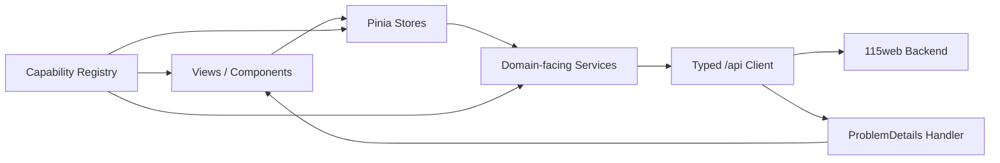
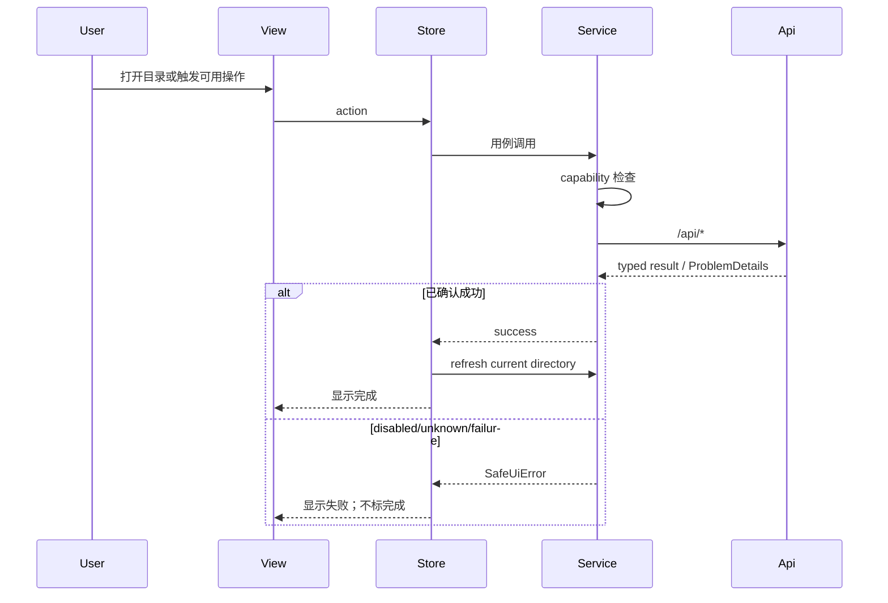
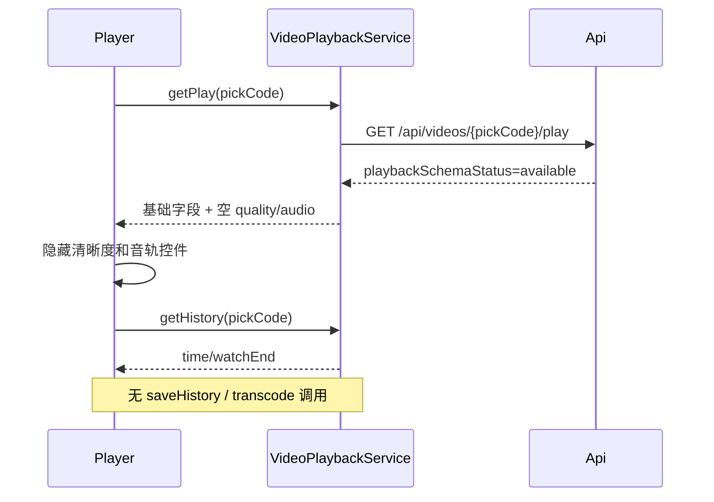

# 设计文档：115 网盘前端

## 概述

前端采用 Vue 3 + TypeScript + Pinia + Vue Router，只调用后端 `/api/*`。后端负责 JWT UserSession、CookieSession 账号上下文、上游请求、错误适配与敏感值过滤。前端以 capability matrix 控制 Api、Service、Store、组件、快捷键和路由入口，任何 disabled 能力都必须形成零上游调用闭环。

## 设计原则

1. **证据闭集**：仅消费 integration spec 与 `docs/115-api-docs.md` 标为 collected 的契约。
2. **后端边界**：浏览器不访问 115 域名，不持有 Cookie、签名或账号凭据。
3. **Schema 状态优先**：`available` 表示可按已知字段渲染；`not_collected` 表示明细不可用，不等于空数据。
4. **完整脱敏**：Cookie、签名、账号标识、文件名、pickCode、临时 URL 与金额值不得进入日志、埋点或持久化缓存。
5. **真实完成语义**：只有已启用操作得到后端确认成功才显示完成；占位、受理或未知状态不算完成。

## 能力状态模型

```ts
export type CapabilityStatus = 'available' | 'partial' | 'disabled';

export const cloudDriveCapabilities = {
  fileList: 'available',
  download: 'available',
  createFolder: 'available',
  copySingle: 'available',
  rename: 'available',
  star: 'available',
  recycleList: 'available',
  videoBasic: 'partial',
  subtitleItems: 'disabled',
  historyRead: 'available',
  offlineRead: 'partial',
  myShares: 'available',
  vipBalanceSpace: 'available',
  userInfo: 'disabled',
  upload: 'disabled',
  search: 'disabled',
  move: 'disabled',
  delete: 'disabled',
  recycleWrite: 'disabled',
  historyWrite: 'disabled',
  transcode: 'disabled',
  offlineWrite: 'disabled',
  shareSendReceive: 'disabled',
} as const satisfies Record<string, CapabilityStatus>;
```

`disabled` 的能力不得只做视觉置灰后仍保留点击处理器；应同时满足：不构造 API 方法、不在 Service 暴露命令、不在 Store 暴露 action、不注册快捷键、不创建后台轮询。

## 架构



### 分层职责

| 层 | 职责 | 禁止事项 |
|---|---|---|
| View/Component | 渲染状态、触发 Store action | 直接调用 API；自行推断 capability |
| Store | 管理页面状态和并发令牌 | 存储临时 URL 或敏感值 |
| Service | 编排用例、检查 capability | 绕过 disabled 检查 |
| API | 调用后端 `/api/*`、解析生成类型 | 访问 115 域名；生成上游签名 |
| Error Handler | 解析 ProblemDetails、输出安全提示 | 展示上游原始消息或请求数据 |

### 路由与导航

| 路由 | 页面 | 状态 |
|---|---|---|
| `/files` | 文件浏览 | available |
| `/recycle` | 回收站只读 | available |
| `/offline` | 云下载读视图 | partial |
| `/share` | 我的分享 | available |
| `/user` | VIP/余额/空间 | available |
| `/login` | JWT 登录/注册与账号绑定指引 | available |

搜索不建立可触发路由；禁用能力不通过 query 参数或深链重新开放。

## API 与 Service 设计

### AuthSessionService

- `register(input)` → `POST /api/auth/register`；`login(input)` → `POST /api/auth/login`。
- `refresh()` → `POST /api/auth/refresh`；`logout()` → `POST /api/auth/logout`；`me()` → `GET /api/auth/me`。
- 仅在内存中保存 `accessToken/tokenType/expiresAt/userId`；JWT 不包含 Cookie 或角色。
- `check()` → `GET /api/auth/check`，用于探测当前用户当前 CookieSession；`cookie_invalid` / `cookie_not_active` / `cloud_drive_account_context_ambiguous` 导航到登录或账号选择界面。
- 不调用用户基础资料端点，不在前端实现 Cookie 注入；401 时清理 JWT 和账号摘要。

### CloudDriveAccountService

- `list()` → `GET /api/cloud-drive/accounts`，只消费账号摘要。
- `bind(input)` → `POST /api/cloud-drive/accounts`；UID/CID/USSID 仅存在绑定请求的短生命周期内。
- `select(cloudAccountUid)` → `POST /api/cloud-drive/accounts/select`，更新当前 UserSession 账号。
- 命名映射：API cloudAccountUid 对应领域 UserSession.ActiveCloudAccountUid，数据库列为 active_cloud_account_uid；普通业务 Service 不重复传递 UID。
- `unbind(cloudAccountUid)` → `DELETE /api/cloud-drive/accounts/{cloudAccountUid}`，成功后清除对应摘要和当前选择。
- 多账号未选择时阻止普通业务 Service 调用，不通过前端重复传递 `CloudAccountUid`。

### FileBrowserService

- `list(input)` → `GET /api/files`。
- 输入只使用后端公开的受支持字段：`directoryId,offset,limit,type,asc,orderBy,customOrder,stdir,showDir`。
- 详情由后端返回的列表条目/详情派生 DTO 消费，不直接调用任何 115 接口。
- 请求以递增 token 处理竞态；晚到旧响应不得覆盖当前目录。

### FileOperationService

公开方法只包括：

```ts
interface FileOperationService {
  download(fileId: string, pickCode: string): Promise<TemporaryDownload>;
  createFolder(parentId: string, name: string): Promise<void>;
  copySingle(fileId: string, targetDirectoryId: string): Promise<void>;
  rename(fileId: string, newName: string): Promise<void>;
  toggleStar(fileId: string, starred: boolean): Promise<void>;
}
```

- 不提供 `upload/search/move/delete` 方法。
- `copySingle` 在 selection size 不等于 1 时拒绝。
- 只有同步成功后才显示完成 Toast 并刷新受影响目录。
- 若后端返回 `cloud_drive_api_not_collected`，注册表立即将对应能力视为 disabled，且不自动重试。

### RecycleBinService

- `list({offset,limit,asc,order})` → `GET /api/recycle`。
- item schema 为 available，显示已采集字段；`status/type` 作为原始字符串，不推断枚举。
- 不提供 restore、permanentDelete、clear 方法。

### TemporaryResourceService

- 下载/图片/文档/视频 URL 只保存在组件作用域内存。
- 不进入 Pinia 持久化、localStorage、sessionStorage、日志或分析事件。
- 组件卸载、资源过期或会话失效时清理引用。

### VideoPlaybackService

- `getPlay(pickCode)` → `GET /api/videos/{pickCode}/play`。
- `getSubtitles(pickCode)` → `GET /api/videos/{pickCode}/subtitles`。
- `getHistory(pickCode)` → `GET /api/videos/{pickCode}/history`。
- 不提供 saveHistory 或 submitTranscode。
- `playbackSchemaStatus='available'` 后才能消费基础字段；清晰度、音轨数组为空时隐藏选择器。
- 字幕 `itemSchemaStatus='not_collected'` 时显示明细不可用，不构造默认字幕。

### OfflineTaskService

- `loadTasks(page)`、`loadStats()`、`loadQuota()` 只读。
- task item schema 未采集，`items=[]` 与 `itemSchemaStatus='not_collected'` 表示明细不可用。
- 不提供新增 URL/BT、解析种子、删除或清空方法；不启动基于任务状态的轮询。

### ShareService

- 只提供 `listMyShares({offset,limit})`，对应 `/api/shares?tab=slist`。
- item schema available；字段严格来自生成 DTO。
- 不提供 `send` / `receive` 标签或 API 参数。

### UserCenterService

- `loadVip()`、`loadBalance()`、`loadStorage()` 可并行且局部失败。
- `loadProfile()` 只聚合上述三类；`info=null` 是预期状态。
- 空间展示 `allTotal/allUse/allRemain`、动态 `typeCounts/typeSummaries`。
- 余额仅存于当前页面内存状态，退出页面即清理；不记录具体值。

## Store 与组件状态

### FileBrowserStore

```ts
interface FileBrowserState {
  directoryId: string;
  items: CloudDriveFileDto[];
  paths: CloudDrivePathDto[];
  offset: number;
  limit: number;
  loading: boolean;
  requestToken: number;
  selectedIds: Set<string>;
  error?: SafeUiError;
}
```

工具栏规则：新建目录可用；选中单项时复制/重命名/星标/下载按类型显示；上传、搜索、移动、删除始终不注册。

### RecycleBinStore

保存 `items/count/offset/pageSize/loading/error`。页面只读；没有 restore/delete/clear actions。

### VideoPlayerStore

只保存当前组件生命周期内的播放 DTO、历史读取结果和临时 URL；不持久化 `pickCode`、URL 或文件名。不存在转码 Job 和进度写 action。

### OfflineStore

保存三类读结果。`itemSchemaStatus='not_collected'` 时展示“云下载任务明细暂不可用”，不把 `items=[]` 显示为“暂无任务”。

### ShareStore

只保存当前页面的 `slist` 列表；离开页面清除可能含敏感值的 item 内容。

### UserCenterStore

保存 VIP/余额/空间的独立 loading/error/value 状态。余额值与动态分类仅驻留内存；不启用持久化插件。

## 关键 DTO 消费规则

### 视频

```ts
interface CloudDriveVideoPlayDto {
  playbackSchemaStatus: 'available' | 'not_collected';
  fileId?: string;
  fileName?: string;
  fileSize?: number;
  pickCode?: string;
  downloadUrl?: string;
  dvProfile?: number;
  hdrType?: number;
  isHdr?: boolean;
  isDolbyVision?: boolean;
  qualityOptions: readonly never[];
  audioTracks: readonly never[];
}
```

`downloadUrl/fileName/pickCode` 不进入日志、持久化状态或错误对象。

### 回收站

```ts
interface CloudDriveRecycleBinItemDto {
  cid: string;
  dtime: string;
  fileName: string;
  fileSize: string;
  id: string;
  parentName: string;
  status: string;
  type: string;
}
```

### 用户空间

```ts
interface SpaceUsageDto { size: number; sizeFormat: string }
interface TypeSummaryDto { count: number; pecent: number; size: number; sizeFormat: string }
interface CloudDriveSpaceInfoDto {
  schemaStatus: 'available';
  allTotal: SpaceUsageDto;
  allUse: SpaceUsageDto;
  allRemain: SpaceUsageDto;
  typeCounts: Record<string, number>;
  typeSummaries: Record<string, TypeSummaryDto>;
}
```

### Schema 状态与空态

| 场景 | UI |
|---|---|
| `schemaStatus/itemSchemaStatus='not_collected'` | “明细暂不可用” |
| schema available 且数组为空 | 真实“暂无数据” |
| capability disabled | 不显示触发入口；可显示静态能力说明 |
| low-confidence | 与 disabled 相同，不试探调用 |

## 交互时序

### 文件浏览与已启用写操作



### 视频读取



### 云下载与分享

云下载仅并行加载 list envelope、stats、quota；task item schema 未采集时不轮询。分享页面固定加载 `slist`，没有 tab 切换到 `send/receive` 的状态机。

## 错误处理

```ts
interface SafeProblemDetails {
  status?: number;
  title?: string;
  detail?: string;
  code?: string;
  errors?: Record<string, string[]>;
}
```

- 解析顺序：根级 `code` → 兼容 `extensions.code`；400 时优先 `errors`。
- `cloud_drive_api_not_collected`：关闭对应 capability，不重试。
- 401：进入登录指引；403：安全拒绝提示；429：稍后重试；404：刷新局部列表；410：失效空态；502/503：保留上下文并提供手动重试。
- `upstreamCode/upstreamMessage` 不面向用户；任何请求数据和敏感字段不写入错误对象。

## 响应式与可访问性

- 桌面使用侧栏；移动端使用底部导航；预览在窄屏全屏显示。
- capability registry 在所有断点共用，移动端动作面板不得重新暴露 disabled 操作。
- 模态框具备焦点陷阱、Esc 关闭和焦点恢复。
- 只注册打开、选择、重命名、单项复制、下载等可用快捷键；不注册搜索、上传、移动、删除快捷键。

## 验证策略

### 单元测试

- capability registry：disabled 能力在 Api/Service/Store/UI/快捷键各层均无触发路径。
- Schema 状态：`not_collected` 与真实空数组使用不同文案。
- Video：available 基础字段、空 quality/audio、历史只读、无转码/写进度调用。
- Error Handler：根级/兼容 code、400 errors、501 fail-closed、敏感字段完整排除。
- Completion：受理/占位/未知不能产生完成 Toast。

### 组件与 E2E

- 登录态检测、文件浏览、已启用单项操作、回收站只读、视频读取、云下载空明细、我的分享、用户中心局部失败。
- 断言搜索/上传/移动/删除/回收站写/云下载写/send/receive/转码/进度写在所有断点均不存在可触发入口。
- 断言日志与持久化存储不含 Cookie、签名、账号标识、文件名、pickCode、临时 URL 或金额值。

## 需求↔设计覆盖矩阵

| 需求 | 设计 |
|---|---|
| 1 登录态 | §AuthSessionService、§CloudDriveAccountService、§错误处理 |
| 2 文件浏览 | §FileBrowserService、§FileBrowserStore |
| 3 文件操作 | §FileOperationService、§文件浏览与已启用写操作 |
| 4 上下文菜单 | §Store 与组件状态、§能力状态模型 |
| 5 搜索 | §能力状态模型、§路由与导航 |
| 6 回收站 | §RecycleBinService、§回收站 |
| 7 图片预览 | §TemporaryResourceService |
| 8 视频 | §VideoPlaybackService、§视频 |
| 9 文档预览 | §TemporaryResourceService |
| 10 完成语义 | §设计原则、§文件浏览与已启用写操作 |
| 11 主题 | §响应式与可访问性 |
| 12 响应式 | §响应式与可访问性 |
| 13 键盘 | §响应式与可访问性 |
| 14 状态 | §Schema 状态与空态、§错误处理 |
| 15 云下载 | §OfflineTaskService、§OfflineStore |
| 16 分享 | §ShareService、§ShareStore |
| 17 用户中心 | §UserCenterService、§UserCenterStore、§用户空间 |
| 18 错误 | §错误处理 |
| 19 架构边界 | §架构、§分层职责、§验证策略 |
