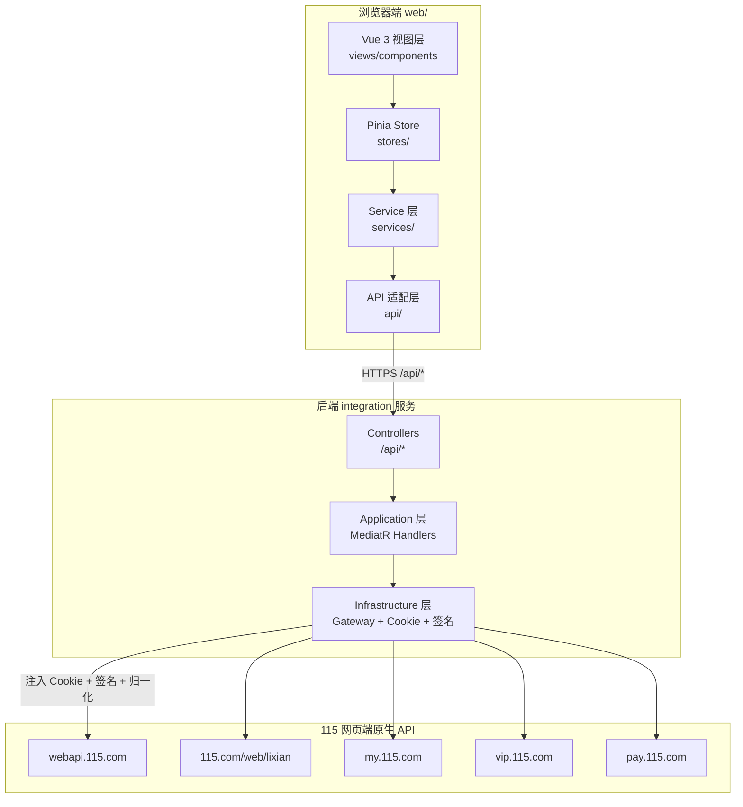
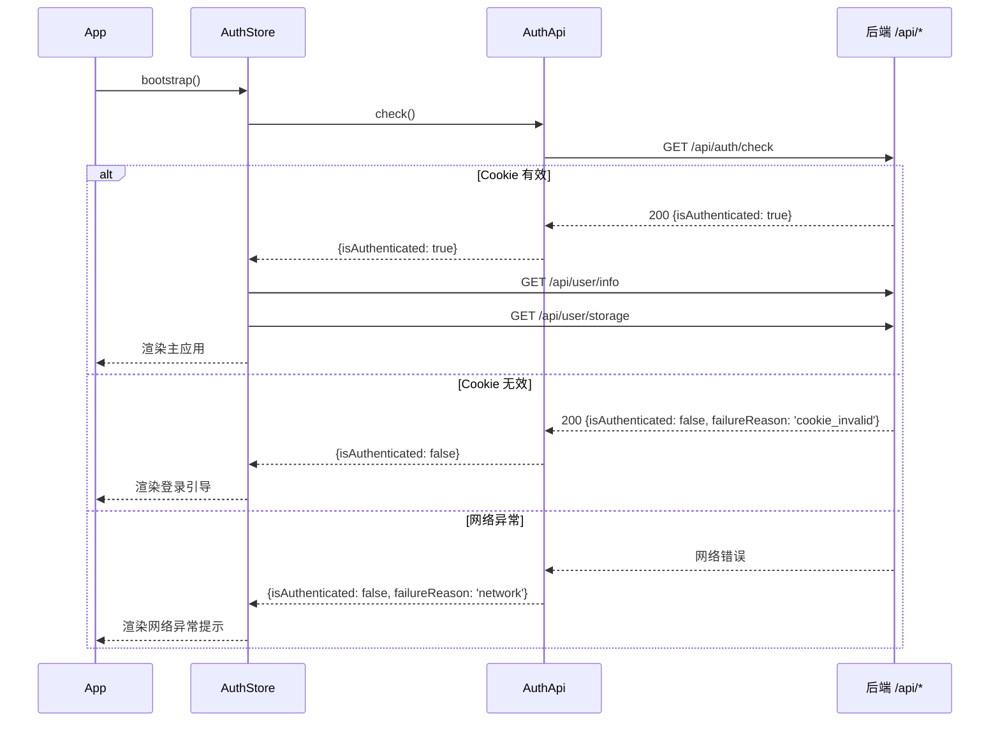
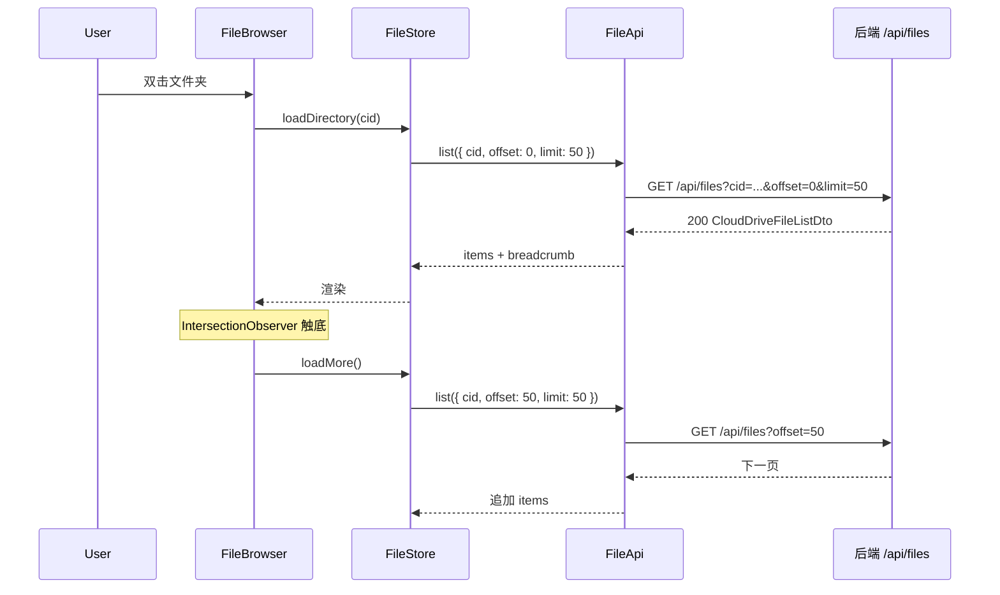
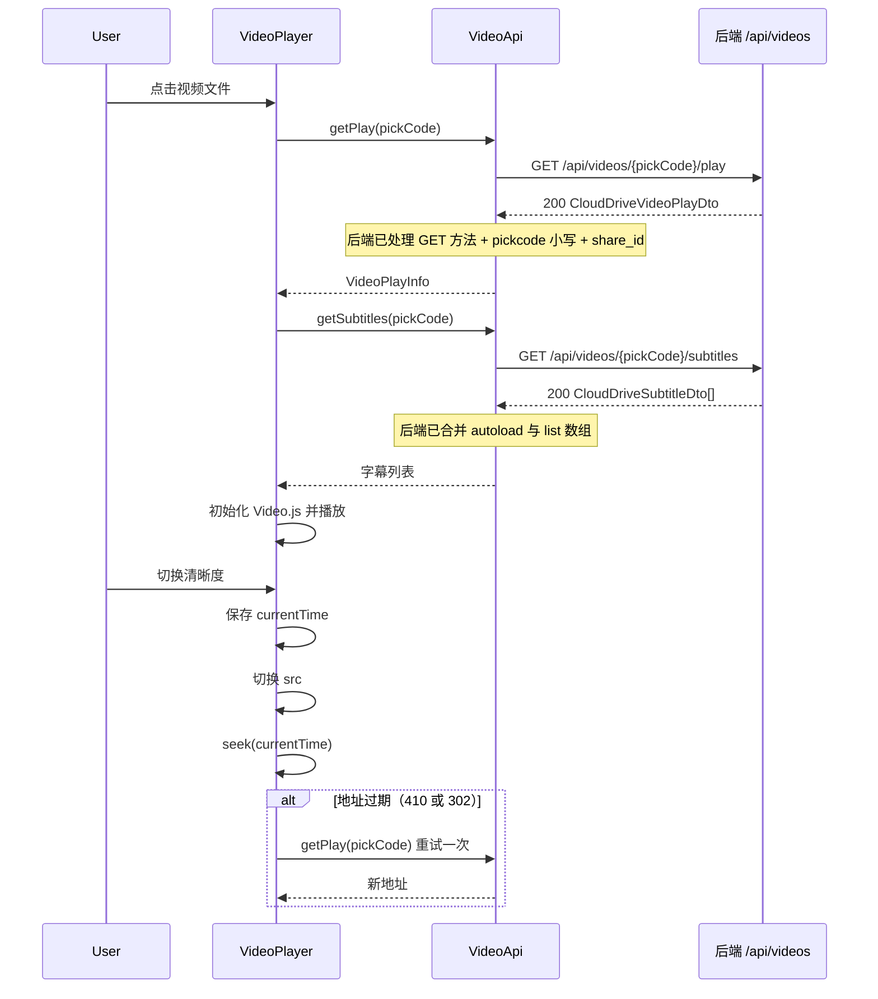
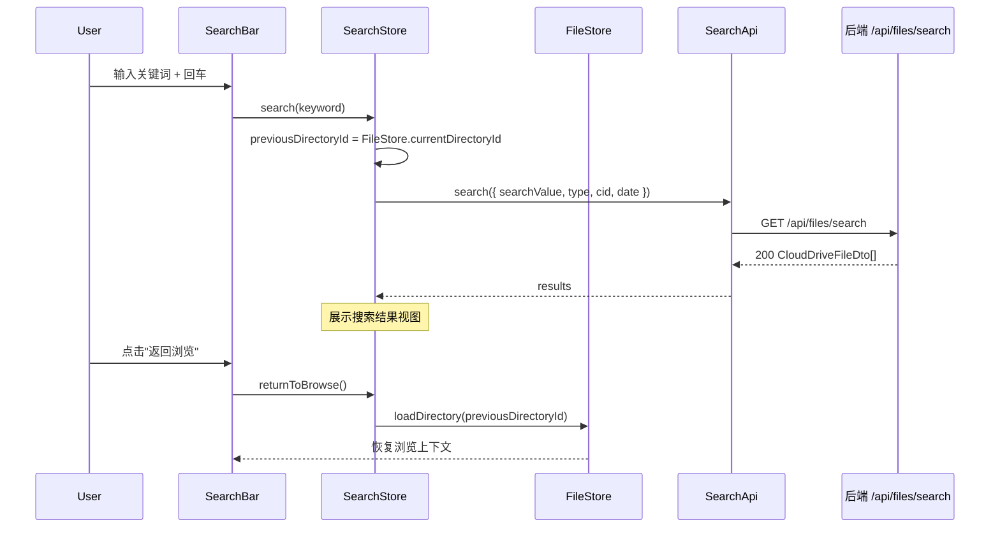
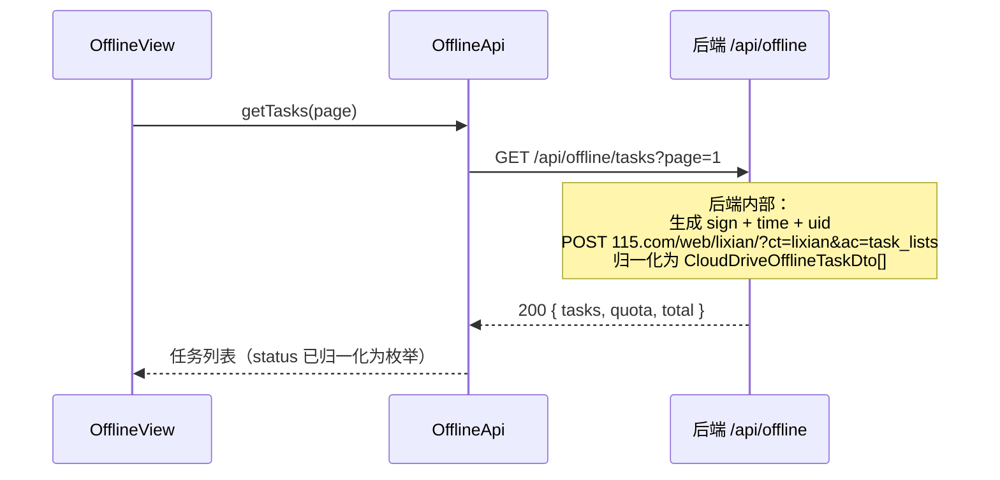
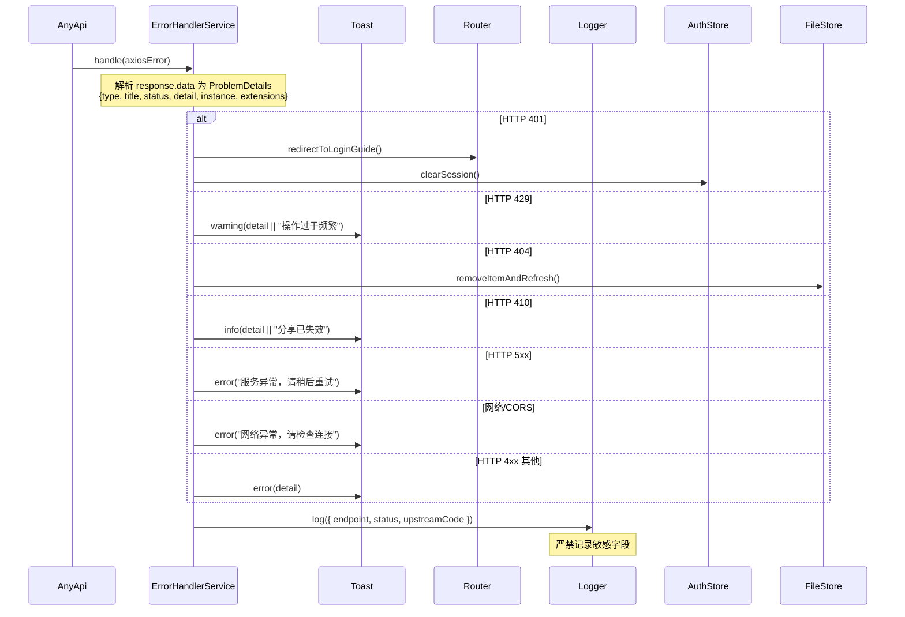
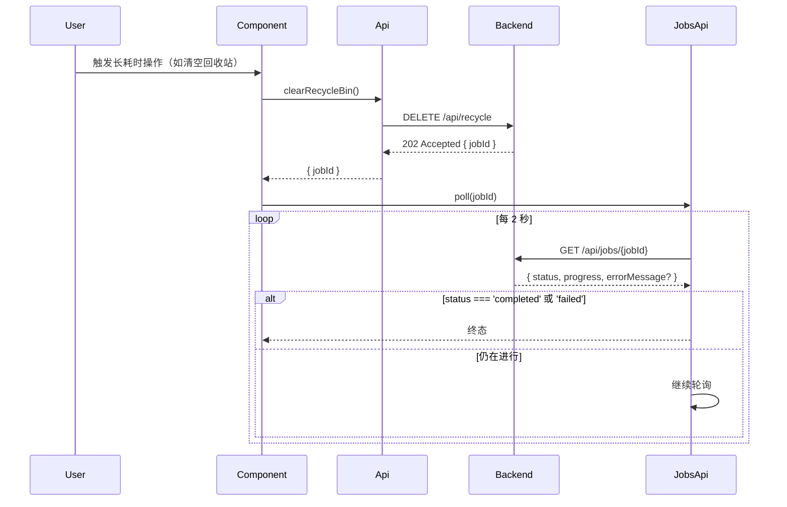

# 技术设计文档：115 网盘前端展示

## 1. 概述

本设计文档基于已确认的 `requirements.md`，定义 115 网盘前端展示层的技术实现方案。前端（`web/`）基于 Vue 3 + TypeScript 实现用户界面、状态管理与交互逻辑，**通过后端 integration 服务提供的 `/api/*` REST 端点消费 115 网盘数据**。

> **对齐基线**：本设计对齐 `requirements.md`（18 个功能模块）与 `.kiro/specs/115-cloud-drive-integration/requirements.md`（30 条后端需求，已通过二轮审核）。

> **架构决策**：前端**不直连 115 网页端 API**，不涉及 Cookie 注入、签名生成、数据归一化、错误字段适配、频控重试等底层细节。所有这些责任由后端 integration 服务（.NET 10 DDD + CQRS）承担。前端仅消费标准化 ProblemDetails 错误响应与归一化 DTO。

> **Cookie 安全边界**：Cookie-based 不是自动安全机制。后端负责 `Set-Cookie` 安全属性（`HttpOnly`、`Secure`、`SameSite`）与状态变更请求 CSRF 防护；前端不读取或写入会话 Cookie，只按 OpenAPI 契约携带后端要求的 CSRF header/token。

> **设计权威边界**：本设计的所有组件、数据模型、接口调用必须能追溯到 `requirements.md` 中的具体需求条目。前端 API 契约 SHALL 与后端 OpenAPI 规范（`/openapi/v1.json`）自动生成的 TypeScript 类型对齐。

> **数据源权威性**：前端消费的是**后端归一化后的 DTO**（`CloudDriveFileDto`、`CloudDriveVideoPlayDto` 等），字段名使用 camelCase（`fileId`、`pickCode`），无需处理网页端短字段名或字段名大小写差异。

---

## 2. 系统架构

### 2.1 整体分层



### 2.2 架构决策

| 决策 | 方案 | 覆盖需求 |
|------|------|----------|
| 认证方式 | Cookie 由后端管理，前端仅通过 `GET /api/auth/check` 查询登录态 | _覆盖需求: 19.2, 19.3, 1.1_ |
| Cookie 与 CSRF 安全边界 | 后端设置会话 Cookie 安全属性并校验状态变更请求的 CSRF 防护；前端不管理 Cookie，仅按 OpenAPI 契约携带 CSRF 凭据 | _覆盖需求: 19.7, 19.8_ |
| 多账号 | **不支持**，单账号模型（后端维护） | _覆盖需求: 19.4_ |
| 业务逻辑位置 | **后端承担所有 115 API 交互**（Cookie、签名、归一化、频控、错误适配）；前端纯消费 | _覆盖需求: 19.2, 19.3_ |
| 签名生成 | 后端 `SignatureService` 负责，前端**不涉及** | _覆盖需求: 19.3_ |
| 跨域处理 | 后端 CORS 中间件允许前端域名访问；前端同源请求 `/api/*` | _覆盖需求: 19.2_ |
| 请求取消 | `AbortController` + `AbortSignal`（前端层） | _覆盖需求: 14.3_ |
| 错误处理 | 前端消费 `application/problem+json` ProblemDetails，按 HTTP 状态与 `detail`/`extensions.upstreamCode` 分类 | _覆盖需求: 19.6, 18.1, 18.2, 18.3, 18.4, 18.5, 18.6, 18.7, 18.8, 18.9, 18.10, 18.11_ |
| DTO 契约 | 前端从后端 `/openapi/v1.json` 生成 TypeScript 类型，字段使用 camelCase | _覆盖需求: 19.5, 19.6_ |

### 2.3 技术栈

| 层 | 技术 | 版本基线 | 说明 |
|----|------|---------|------|
| 前端框架 | Vue 3 + TypeScript | 3.5 + 5.7 | 组合式 API |
| 路由 | Vue Router | 4.5 | 哈希或 History 模式 |
| 状态管理 | Pinia | 2.3 | 模块化 Store |
| 组件库 | Naive UI | 2.41 | 暗色主题 |
| HTTP 客户端 | Axios + AbortController | 1.7 | 统一拦截器 + ProblemDetails 解析 |
| 样式 | Tailwind CSS + CSS Variables | 4.1 | Glassmorphism 通过 CSS Variables |
| 图标 | Lucide Icons | 0.469 | `lucide-vue-next` |
| 视频 | Video.js | 8.21 | 内置 HLS |
| 文档 | PDF.js | 4.9 | 显式配置 worker |
| 构建 | Vite | 6.2 | ESM + HMR |
| 类型生成 | `openapi-typescript` | 7.x | 从后端 `/openapi/v1.json` 生成类型 |

_覆盖需求: 19.1_

---

## 3. 前端分层设计

### 3.1 目录结构

```
web/src/
├── views/              # 页面级编排
│   ├── HomeView.vue
│   ├── FileBrowserView.vue
│   ├── RecycleBinView.vue
│   ├── OfflineDownloadView.vue
│   ├── ShareManagementView.vue
│   └── UserCenterView.vue
├── components/         # 可复用 UI
│   ├── layout/         # 布局组件（Sidebar/Header/BottomNav）
│   ├── file/           # 文件浏览器组件
│   ├── preview/        # 预览组件（Image/Video/Doc）
│   ├── operation/      # 操作组件（ContextMenu/Breadcrumb）
│   └── common/         # 通用（Toast/Skeleton/ErrorState）
├── composables/        # 组合式逻辑（useKeyboard/useInfiniteScroll）
├── stores/             # Pinia Store
│   ├── authStore.ts
│   ├── fileStore.ts
│   ├── searchStore.ts
│   ├── recycleBinStore.ts
│   ├── offlineStore.ts
│   ├── shareStore.ts
│   ├── userCenterStore.ts
│   └── uiStore.ts
├── services/           # 横切业务逻辑
│   ├── clipboardService.ts
│   ├── keyboardService.ts
│   ├── temporaryResourceService.ts
│   └── errorHandlerService.ts
├── api/                # HTTP 封装
│   ├── http.ts         # Axios 实例 + 拦截器 + ProblemDetails 解析
│   ├── authApi.ts
│   ├── fileApi.ts
│   ├── searchApi.ts
│   ├── recycleBinApi.ts
│   ├── videoApi.ts
│   ├── documentApi.ts
│   ├── offlineApi.ts
│   ├── shareApi.ts
│   ├── userApi.ts
│   └── jobsApi.ts      # 后台任务轮询（/api/jobs/{jobId}）
├── types/              # 共享类型（从后端 OpenAPI 生成）
│   ├── generated.ts    # openapi-typescript 自动生成
│   └── index.ts        # 业务扩展类型
├── utils/              # 纯函数
│   ├── formatters.ts
│   ├── fileNameValidator.ts
│   └── sizeFormatter.ts
└── styles/             # 全局样式与主题变量
```

### 3.2 数据流向

`View → Store → Service → API → Backend /api/* → 115 Remote`

前端只关心到 `Backend /api/*` 边界，`/api/*` 之后由后端承担。

_覆盖需求: 19.2, 19.3_

### 3.3 路由设计

| 路径 | 视图 | 守卫 | 覆盖需求 |
|------|------|------|----------|
| `/` | `HomeView`（默认重定向到 `/files`） | `requireAuth` | _覆盖需求: 1.1, 1.2, 1.3, 1.4, 1.5, 1.6_ |
| `/files` | `FileBrowserView`（可选 query `?cid=xxx`） | `requireAuth` | _覆盖需求: 2.1, 2.2, 2.3, 2.4, 2.5, 2.6, 2.7, 2.8, 2.9, 2.10, 2.11, 2.12, 2.13, 2.14_ |
| `/recycle` | `RecycleBinView` | `requireAuth` | _覆盖需求: 6.1, 6.2, 6.3, 6.4, 6.5, 6.6, 6.7_ |
| `/offline` | `OfflineDownloadView` | `requireAuth` | _覆盖需求: 15.1, 15.2, 15.3, 15.4, 15.5, 15.6, 15.7, 15.8, 15.9, 15.10, 15.11_ |
| `/share` | `ShareManagementView`（可选 query `?tab=slist\|send\|receive`） | `requireAuth` | _覆盖需求: 16.1, 16.2, 16.3, 16.4, 16.5, 16.6, 16.7_ |
| `/user` | `UserCenterView` | `requireAuth` | _覆盖需求: 17.1, 17.2, 17.3, 17.4, 17.5, 17.6, 17.7, 17.8, 17.9_ |
| `/login` | `LoginGuideView` | 无 | _覆盖需求: 1.3_ |

#### 路由守卫
- **`requireAuth`**：检查 `AuthStore.isAuthenticated`；未登录 → 重定向 `/login`（保留原 URL 以便恢复）
- **启动时**：`main.ts` 先执行 `AuthStore.bootstrap()` 再挂载 Router，避免守卫首次判断失败

_覆盖需求: 1.3, 1.6_

### 3.4 已删除的旧组件

以下组件因架构调整已从实现计划中移除：

| 已删除 | 原因 | 覆盖需求 |
|--------|------|----------|
| `authStore.currentAccountUid` / 多账号逻辑 | 单账号模型（后端维护） | _覆盖需求: 19.4_ |
| `jobStore.ts` + `jobPollingService.ts` | 全局任务面板已移除，改为按需调用 `/api/jobs/{jobId}`；该删除属于 R10 架构决策，不作为有效需求追溯编号 |
| `proxyConfig.ts` / `server/` 代理层 | 代理层移至后端 integration 服务 | _覆盖需求: 19.2, 19.3_ |
| OAuth / PKCE 相关代码 | Cookie 认证由后端处理 | _覆盖需求: 19.4_ |
| Cookie 注入、签名生成相关代码 | 由后端承担 | _覆盖需求: 19.3_ |
| per-endpoint 错误字段适配器 | 后端已归一化为 ProblemDetails | _覆盖需求: 18.1, 18.2, 18.3, 18.4, 18.5, 18.6, 18.7, 18.8, 18.9, 18.10, 18.11_ |

#### 现有 `web/` 代码迁移边界

当前仓库 `web/` 仍存在旧版 OAuth/PKCE、多账号、`CloudAccountUid`、全局 `JobStore`/`TaskPanel` 与 `/api/cloud-drive` API 前缀实现。本 spec 以 Cookie 单账号与后端 integration `/api/*` 归一化契约为目标架构，因此执行阶段必须先完成以下迁移：

- 删除 `AuthCallbackPage`、OAuth/PKCE 回调、`createPkceSession()`、`exchangeCode()`、`listAccounts()`、`switchAccount()` 与 `currentAccountUid` 状态
- 将 `AuthStore` 收敛为 `isAuthenticated/user/spaceSummary/bootstrapStatus`，登录态仅通过 `GET /api/auth/check` 与用户信息端点恢复
- 将 API baseURL 从旧 `/api/cloud-drive` 口径迁移为后端 integration 的 `/api/*` 端点口径
- 删除全局 `JobStore`、`jobPollingService`、`TaskPanel` 及布局/移动导航中的入口；202 Accepted 响应由调用方通过 `jobsApi.poll(jobId)` 按需轮询
- 将手写 DTO 替换为 `openapi-typescript` 生成类型，并在 `types/index.ts` 仅保留前端扩展类型

_覆盖需求: 19.2, 19.3, 19.4, 19.5, 19.6_

---

## 4. 核心组件设计

### 4.1 会话与登录态（需求 1）

#### AuthStore
- **职责**：维护登录态、当前用户信息、存储空间摘要
- **状态**：`isAuthenticated: boolean`、`user: UserInfo | null`、`spaceSummary: SpaceSummary | null`、`bootstrapStatus: 'idle' | 'checking' | 'ready' | 'unauthenticated'`
- **Actions**：
  - `bootstrap(): Promise<void>` — 启动入口，内部顺序调用 `checkAuth()` → `fetchUserInfo()` → `fetchSpaceSummary()`
  - `checkAuth(): Promise<AuthCheckResult>` — 调用 `authApi.check()`（对应后端 `GET /api/auth/check`）
  - `fetchUserInfo(): Promise<void>` — 调用 `userApi.getInfo()`（对应 `GET /api/user/info`）
  - `fetchSpaceSummary(): Promise<void>` — 调用 `userApi.getStorage()`（对应 `GET /api/user/storage`）
  - `clearSession(): void` — 清除内存会话状态
- **返回类型**：
  ```typescript
  interface AuthCheckResult {
    isAuthenticated: boolean;
    failureReason?: 'cookie_invalid' | 'network';
  }
  ```
- **覆盖需求**：_覆盖需求: 1.1, 1.2, 1.4, 1.5_

#### AuthGuard 组件（布局层）
- **职责**：根据 `AuthStore.isAuthenticated` 渲染登录引导或主应用
- **行为**：
  - Cookie 无效或全局 `401` → 清除敏感内存状态
  - 渲染 `LoginGuideView`，提示"Cookie 已失效，请联系系统管理员更新"
  - 不展示 Toast，由布局层统一承载引导信息
- **覆盖需求**：_覆盖需求: 1.3, 1.6, 18.3_

#### LoginGuideView
- **职责**：承载未登录、会话失效与网络异常时的引导说明和恢复入口
- **展示状态**：
  - `cookie_invalid` → 提示联系系统管理员更新 Cookie
  - `network` → 提示检查网络并提供重试入口
- **覆盖需求**：_覆盖需求: 1.3_

### 4.2 文件浏览器（需求 2）

#### FileStore
- **职责**：维护当前目录、文件列表、分页、排序、筛选、选择态
- **状态**：
  - `currentDirectoryId: string`（根目录 `"0"`）
  - `items: CloudDriveFileDto[]`
  - `paging: { offset: number; limit: number; hasMore: boolean }`
  - `sort: SortOption`（引用 §6.1 DTO）
  - `filter: FileFilter`（引用 §6.1 DTO）
  - `selection: Set<string>`（fileId 集合）
  - `breadcrumb: CloudDriveBreadcrumbDto[]`
- **Actions**：`loadDirectory(cid)`、`loadMore()`、`setSort(sort)`、`setFilter(filter)`、`refresh()`、`select(fileId)`、`selectRange(startId, endId)`、`selectAll()`、`clearSelection()`
- **API**：`fileApi.list({ cid, offset, limit, o, asc, ... })` 对应后端 `GET /api/files`
- **约束**：默认 `limit=50`；后端 400 错误（limit 超限）由前端展示友好错误
- **覆盖需求**：_覆盖需求: 2.1, 2.2, 2.3, 2.4, 2.5, 2.6, 2.7, 2.8, 2.9, 2.10, 2.11, 2.12, 2.13, 2.14_

#### FileBrowser 组件
- **子组件**：`FileListView`、`FileGridView`、`FileToolbar`、`BreadcrumbNav`、`ViewModeToggle`
- **覆盖需求**：_覆盖需求: 2.1, 2.2, 2.3, 2.4, 2.5, 2.6, 2.7, 2.8, 2.9, 2.10, 2.11, 2.12, 2.13, 2.14_

#### BreadcrumbNav
- **数据源**：`FileStore.breadcrumb`（后端归一化的 `CloudDriveBreadcrumbDto[]`）
- **覆盖需求**：_覆盖需求: 2.5_

#### useInfiniteScroll Composable
- **职责**：基于 `IntersectionObserver` 监听滚动触底
- **防抖/去重**：300ms 防抖 + 请求 ID 去重
- **覆盖需求**：_覆盖需求: 2.7, 14.3_

### 4.3 文件操作（需求 3）

> **说明**：本节功能大部分依赖后端待补采集的写操作 API，组件接口已定义，实现等待后端 API 就绪。

#### FileOperationService
- **职责**：封装文件 CRUD 的统一调度
- **接口**：
  - `createFolder(parentId, folderName)` → `POST /api/files/folders` _（待后端就绪）_
  - `rename(fileId, newName)` → `PATCH /api/files/{fileId}` _（待后端就绪）_
  - `move(fileIds, targetDirectoryId)` → `POST /api/files/move` _（待后端就绪）_
  - `copy(fileIds, targetDirectoryId)` → `POST /api/files/copy` _（待后端就绪）_
  - `delete(fileIds)` → `DELETE /api/files` _（待后端就绪）_
  - `download(pickCode)` → `GET /api/files/{pickCode}/download` _（待后端就绪）_
  - `toggleStar(fileId, starred)` → `POST /api/files/{fileId}/star` _（待后端就绪）_
- **202 Accepted 处理**：大文件上传、批量操作返回 `{ jobId }` 时，通过 `jobsApi.poll(jobId, { intervalMs: 2000 })` 每 2 秒轮询 `GET /api/jobs/{jobId}` 直到终态
- **连续下载保护**：批量下载逐个顺序执行；若检测到浏览器拦截连续下载或窗口句柄为空，立即通过 Toast 提示用户允许连续下载或改为手动下载
- **覆盖需求**：_覆盖需求: 3.1, 3.2, 3.3, 3.4, 3.5, 3.6, 3.7, 3.8, 3.9, 3.10, 3.11_

#### ClipboardService
- **职责**：应用内剪贴板，管理复制/剪切/粘贴
- **状态**：`items: CloudDriveFileDto[]`、`mode: 'copy' | 'cut' | null`
- **覆盖需求**：_覆盖需求: 3.6, 4.5_

#### UploadZone 组件（占位）
- **状态**：接口已定义，实现等待后端上传 API 就绪
- **覆盖需求**：_覆盖需求: 3.1, 3.2_

#### ConfirmDialog
- **职责**：承载删除、彻底删除、清空回收站等危险操作确认
- **文案规则**：删除固定为"文件将移至回收站"；彻底删除与清空回收站固定为"文件将被永久删除且无法恢复"
- **覆盖需求**：_覆盖需求: 3.6, 6.4, 6.5_

#### FolderPickerDialog
- **职责**：展示目录树选择器，供移动/复制操作选择目标目录
- **行为**：支持懒加载目录节点、当前目录禁选，并在确认前回显目标路径
- **覆盖需求**：_覆盖需求: 3.5_

### 4.4 右键菜单（需求 4）

#### ContextMenu 组件
- **职责**：根据目标（文件/多选/空白）动态渲染菜单项
- **菜单规则**：
  - 文件夹：打开、重命名、移动、复制、删除
  - 图片：预览
  - 视频：播放
  - 文档：预览
  - 所有文件：下载、详情、星标切换
  - 多选：移动、复制、删除、逐个下载（全为文件时）
  - 空白：新建文件夹、上传文件、刷新、粘贴（条件显示）
- **定位策略**：初始按鼠标位置显示；当菜单距视口右侧或底部小于 50px 时，自动翻转到鼠标左侧或上侧
- **键盘交互**：维护 `activeIndex`，支持方向键上下切换、左右调整子菜单与 `Enter` 确认
- **覆盖需求**：_覆盖需求: 4.1, 4.2, 4.3, 4.4, 4.5, 4.6, 4.7_

#### FileDetailsModal
- **职责**：展示文件元数据；缺失字段以占位符呈现
- **API**：`fileApi.getDetail(fileId)` 对应 `GET /api/files/{fileId}`
- **覆盖需求**：_覆盖需求: 4.7_

### 4.5 搜索（需求 5）

#### SearchStore
- **职责**：维护搜索关键词、筛选、结果、前一目录上下文
- **状态**：
  - `keyword: string`
  - `filters: SearchFilters`（引用 §6.1 DTO）
  - `results: CloudDriveFileDto[]`
  - `paging: { offset: number; limit: number; hasMore: boolean }`
  - `previousDirectoryId: string | null`
  - `history: string[]`（localStorage 最多保留 20 条）
  - `suggestions: string[]`
  - `suggestionOpen: boolean`
- **Actions**：`search(keyword, filters)`（首次搜索，重置分页）、`loadMore()`（无限滚动）、`loadSuggestions(keyword)`、`persistHistory(keyword)`、`clearSearch()`、`returnToBrowse()`
- **API**：`searchApi.search({ searchValue, type, cid, date, ... })` 对应 `GET /api/files/search`
- **约束**：后端硬上限由 ProblemDetails 400 返回，前端展示友好错误
- **覆盖需求**：_覆盖需求: 5.1, 5.2, 5.3, 5.4, 5.5, 5.6, 5.7, 5.8, 5.9, 5.10, 5.11_

#### SearchBar 组件
- **职责**：搜索输入、类型筛选、目录筛选、时间筛选、历史建议下拉
- **建议策略**：关键词长度 ≥2 时，使用 200ms 防抖触发 `SearchStore.loadSuggestions()`；展示 localStorage 搜索历史与当前匹配建议
- **覆盖需求**：_覆盖需求: 5.1, 5.5, 5.6, 5.7, 5.8, 5.9_

### 4.6 回收站（需求 6）

#### RecycleBinStore
- **职责**：维护回收站列表、分页
- **状态**：`items: CloudDriveRecycleItemDto[]`、`paging`、`count: number`
- **API**：`recycleBinApi.list({ offset, limit })` 对应 `GET /api/recycle`
- **说明**：**后端已处理**回收站响应的动态键结构（文件 ID 为键），前端直接消费数组形式
- **覆盖需求**：_覆盖需求: 6.1, 6.2, 6.3, 6.4, 6.5, 6.6, 6.7_

#### RecycleBinView + RecycleItemCard 组件
- **自动刷新**：进行中任务 10 秒轮询
- **覆盖需求**：_覆盖需求: 6.1, 6.2, 6.3, 6.4, 6.5, 6.6, 6.7_

### 4.7 图片预览（需求 7）

#### ImageViewer 组件
- **职责**：全屏灯箱、切换、缩放、拖拽
- **子组件**：`ImageStage`（主图区）、`ImageTopBar`（文件名 + 下载 + 关闭）、`ThumbnailNavigator`（底部缩略图导航条）
- **图片集合来源**：打开时由父组件传入当前已加载图片子集（`props: { images: CloudDriveFileDto[]; initialIndex: number }`）；不直接访问 `FileStore.items`，保持组件解耦
- **图片过滤规则**：仅包含 `isVideo === false` 且 `ico` 属于可安全预览扩展名（如 `jpg/png/gif/webp/bmp`）；`SVG` 因脚本注入风险排除
- **资源来源**：优先使用 `CloudDriveFileDto.originalUrl`；为空时调用 `GET /api/files/{pickCode}/preview` 兜底
- **重试策略**：URL 过期时重试一次（使用 `temporaryResourceService`）
- **覆盖需求**：_覆盖需求: 7.1, 7.2, 7.3, 7.4, 7.5, 7.6, 7.7, 7.8, 7.9_

#### ThumbnailNavigator 组件
- **职责**：灯箱底部缩略图列表，高亮当前项，点击切换
- **数据来源**：当前已加载的图片集合，使用 `thumb` 字段
- **覆盖需求**：_覆盖需求: 7.3_

#### useZoomPan Composable
- **职责**：鼠标滚轮缩放、双击放大、触屏捏合、拖拽平移
- **覆盖需求**：_覆盖需求: 7.4_

### 4.8 视频播放器（需求 8）

#### VideoPlayer 组件
- **基于**：Video.js 8.x
- **HLS 支持**：Safari 原生支持 HLS；Chrome/Firefox 等依赖 Video.js 8.x 内置的 `@videojs/http-streaming`
- **API 调用**：`videoApi.getPlay(pickCode)` → `GET /api/videos/{pickCode}/play`，返回 `CloudDriveVideoPlayDto`
- **后端归一化**：后端已处理 115 网页端的 GET 方法、小写 `pickcode` 参数、`share_id` 必填等细节；前端仅消费标准 DTO
- **控制栏**：播放/暂停、进度条、音量、全屏、速度选项（0.5x / 1x / 1.25x / 1.5x / 2x）
- **清晰度**：从 `availableDefinitions` 渲染选择菜单
- **清晰度枚举**：SD=1 / HD=2 / FHD=3 / FullHD=4 / UHD4K=5 / Original=100
- **切换保留进度**：
  - 切换前记录 `currentTime` 与 `paused` 状态
  - 切换 `src` 后监听 `loadedmetadata` 事件触发 `player.currentTime(savedTime)`
  - 若切换前处于播放状态则调用 `player.play()` 恢复播放
  - 若切换后加载失败（404/410），通过 `TemporaryResourceService` 重新请求地址并重试一次
- **VIP 检测**：`vipUpgradeRequired: true` 时展示升级提示
- **转码中状态**：`status: 'transcoding'` 时展示"视频转码中"提示和刷新按钮
- **覆盖需求**：_覆盖需求: 8.1, 8.2, 8.3, 8.4, 8.5, 8.6, 8.7, 8.8, 8.9, 8.10, 8.11, 8.13_

#### SubtitleSelector 组件
- **职责**：从 `videoApi.getSubtitles(pickCode)` → `GET /api/videos/{pickCode}/subtitles` 响应渲染字幕菜单
- **归一化**：后端已合并 `autoload` 与 `list` 数组为统一 `CloudDriveSubtitleDto[]`（通过 `isAutoload` 区分）
- **空状态**：列表为空时隐藏控件或展示"无字幕"
- **覆盖需求**：_覆盖需求: 8.7, 8.8_

#### VideoHistoryService（待后端 API 就绪）
- **职责**：保存/读取视频播放进度
- **API**：`GET /api/videos/{pickCode}/history`、`POST /api/videos/{pickCode}/history`
- **覆盖需求**：_覆盖需求: 8.12, 8.14_

#### TemporaryResourceService（视频/图片共用）
- **职责**：检测临时地址过期，自动重新请求并重试一次
- **策略**：仅允许一次透明重试；二次失败进入可恢复错误态
- **覆盖需求**：_覆盖需求: 7.8, 7.9, 8.11_

### 4.9 文档预览（需求 9）

#### DocViewer 组件
- **API 调用**：`documentApi.getPreview(pickCode)` → `GET /api/documents/{pickCode}/preview`，返回 `{ url, renderMode }`
- **`renderMode: 'Direct'` 分支**：
  - PDF：使用 PDF.js，显式配置 worker
  - TXT：等宽字体渲染（`font-family: 'Consolas', 'Monaco', monospace`），UTF-8 为主，回退 GBK
- **`renderMode: 'ThirdParty'` 分支**：Office 格式通过第三方渲染库加载（待配置）
- **`renderMode: 'NotAvailable'` 分支**：展示"预览服务未配置，请下载后查看"
- **覆盖需求**：_覆盖需求: 9.1, 9.2, 9.3, 9.4, 9.5, 9.6_

  ### 4.10 暗色主题与 Glassmorphism（需求 11）

  #### 主题系统
  - **实现**：CSS Variables + Tailwind 4 dark mode
  - **基础色**：`--bg-base: #0a0a0f`, `--bg-surface: #1a1a2e`
  - **Glassmorphism**：`backdrop-filter: blur(12px); background: rgba(255,255,255,0.08); border: 1px solid rgba(255,255,255,0.12)`
  - **统一色彩系统**：所有颜色定义在 `:root` CSS Variables 中，确保跨组件一致性
  - **对比度要求**：所有文本与图形元素满足 WCAG AA（普通文本 ≥ 4.5:1，大文本 ≥ 3:1，图标与状态指示 ≥ 3:1）
  - **过渡**：`transition: all 200ms ease`，过渡时长控制在 150ms-300ms
  - **文件类型图标配色**：图片/视频/文档/压缩包/音频/文件夹使用差异化主题色
  - **覆盖需求**：_覆盖需求: 11.1, 11.2, 11.3, 11.4, 11.6_

  #### ThemeController
  - **职责**：管理暗色/亮色主题切换与偏好持久化
  - **状态**：`theme: 'dark' | 'light'`
  - **行为**：
    - 默认初始化为 `dark`
    - 从 `localStorage['cloudDrive.theme']` 读取用户偏好
    - 切换后同步 `document.documentElement.dataset.theme` 与 Naive UI theme provider
  - **覆盖需求**：_覆盖需求: 11.1, 11.5_

  #### prefers-reduced-motion 降级
  - 使用媒体查询禁用非必要动画
  - **覆盖需求**：_覆盖需求: 11.7_

### 4.11 响应式布局（需求 12）

#### 断点系统
- **桌面**：≥1024px（完整侧边栏 + 工具栏）
- **平板**：768-1023px（汉堡菜单）
- **移动**：<768px（底部导航栏）
- **覆盖需求**：_覆盖需求: 12.1, 12.2, 12.3, 12.4, 12.5, 12.6_

#### AppLayout 组件
- **职责**：根据视口宽度切换布局
- **覆盖需求**：_覆盖需求: 12.1, 12.2, 12.3, 12.4_

### 4.12 键盘快捷键（需求 13）

#### KeyboardService
- **职责**：全局按键监听、作用域管理、焦点隔离
- **作用域**：`fileBrowser`、`imageViewer`、`videoPlayer`、`docViewer`
- **焦点隔离**：当 `document.activeElement` 是输入控件时禁用 fileBrowser 快捷键
- **Backspace 规则**：仅在 `fileBrowser` 作用域且 `fileBrowserFocused = true` 时触发目录回退，并阻止浏览器默认历史后退
- **覆盖需求**：_覆盖需求: 13.1, 13.2, 13.3, 13.4, 13.5, 13.6, 13.7_

#### 快捷键映射表

| 作用域 | 快捷键 | 动作 | 覆盖需求 |
|--------|--------|------|----------|
| fileBrowser | `Ctrl+A` | 全选已加载文件 | _覆盖需求: 13.1_ |
| fileBrowser | `Delete` | 删除选中项 | _覆盖需求: 13.1_ |
| fileBrowser | `F2` | 重命名 | _覆盖需求: 13.1_ |
| fileBrowser | `Ctrl+C` | 复制到内部剪贴板 | _覆盖需求: 13.1_ |
| fileBrowser | `Ctrl+X` | 剪切到内部剪贴板 | _覆盖需求: 13.1_ |
| fileBrowser | `Ctrl+V` | 粘贴 | _覆盖需求: 13.1_ |
| fileBrowser | `Enter` | 打开选中项 | _覆盖需求: 13.1_ |
| fileBrowser | `Backspace` | 返回上级目录（阻止浏览器后退）| _覆盖需求: 13.3, 13.7_ |
| fileBrowser | `Ctrl+F` | 聚焦搜索栏 | _覆盖需求: 13.1_ |
| fileBrowser | `方向键` | 文件导航 | _覆盖需求: 13.2_ |
| imageViewer | `← / →` | 切换图片 | _覆盖需求: 13.4_ |
| imageViewer | `Esc` | 关闭灯箱 | _覆盖需求: 13.1_ |
| videoPlayer | `Space` | 播放/暂停 | _覆盖需求: 13.5_ |
| videoPlayer | `← / →` | 快退/快进 10s | _覆盖需求: 13.5_ |
| videoPlayer | `↑ / ↓` | 音量增减 | _覆盖需求: 13.5_ |
| videoPlayer | `Esc` | 关闭播放器 | _覆盖需求: 13.1_ |
| docViewer | `Esc` | 关闭预览 | _覆盖需求: 13.1_ |

#### UIStore 焦点与视图状态
- **状态**：
  - `viewMode: 'list' | 'grid'`（列表/网格视图，用户偏好）
  - `sidebarCollapsed: boolean`（侧边栏收起状态）
  - `breakpoint: 'desktop' | 'tablet' | 'mobile'`（由 `useBreakpoint` 同步）
  - `isOffline: boolean`（网络状态）
  - `fileBrowserFocused: boolean`、`activeModal: string | null`、`keyboardSuspended: boolean`
- **Actions**：`setViewMode(mode)`、`toggleSidebar()`、`setBreakpoint(bp)`、`setOfflineStatus(offline)`
- **覆盖需求**：_覆盖需求: 2.3, 12.1, 12.2, 12.3, 12.4, 13.6, 13.7, 14.6_

#### useBreakpoint Composable
- **职责**：基于 `window.matchMedia` 监听视口变化并同步到 `UIStore.breakpoint`
- **生命周期**：组件 `onMounted` 订阅，`onUnmounted` 清理 listener
- **覆盖需求**：_覆盖需求: 12.1_

### 4.13 加载状态与错误处理（需求 14 + 18）

#### SkeletonLoader 组件
- **变体**：`list`、`grid`、`detail`
- **覆盖需求**：_覆盖需求: 14.1_

#### Toast 通知系统
- **基于**：Naive UI `useMessage()` 在组件内使用；服务层通过 `createDiscreteApi(['message'])` 在应用启动时创建全局 `message` 实例
- **类型**：success / warning / error / info
- **时长**：3-5 秒
- **覆盖需求**：_覆盖需求: 14.2_

#### ErrorHandlerService
- **职责**：统一消费后端 ProblemDetails，分类路由到对应处理器
- **后端契约**：所有非 2xx 响应为 `application/problem+json` 格式，字段含 `type/title/status/detail/instance`，以及 `extensions.upstreamCode`（115 errNo/code）/`extensions.upstreamMessage`
- **错误分类**（按 HTTP 状态码）：
   - `401 Unauthorized` → `AuthGuard` 接管：`clearSession()` + 跳转登录引导，不展示 Toast
   - `404 Not Found` → 提示 `detail` 字段，或移除失效项并刷新列表
   - `410 Gone`（分享过期） → 展示失效空状态
   - `429 Too Many Requests` → Toast "操作过于频繁"，不重试
   - `5xx` → Toast 通用"服务异常"（不暴露 `upstreamCode`）
   - 网络异常/CORS/timeout → Toast "网络异常，请检查连接"，并提供重试入口
- **超时阈值**：Axios `timeout = 30000`
- **日志脱敏**：手机号、邮箱、Cookie、令牌严禁写入日志
- **重试上限**：同一操作默认 1 次
- **覆盖需求**：_覆盖需求: 14.4, 14.5, 14.7, 18.1, 18.2, 18.3, 18.4, 18.5, 18.6, 18.7, 18.8, 18.9, 18.10, 18.11_

#### ForegroundOperationGuard
- **职责**：跟踪同步上传等前台进行中操作，并在用户关闭标签页、刷新或离开路由前触发保护提示
- **状态**：`activeOperationCount: number`、`operationLabels: string[]`
- **行为**：有前台进行中操作时注册 `beforeunload`；操作完成或取消后移除监听；路由切换时通过 Router guard 触发确认
- **覆盖需求**：_覆盖需求: 14.8, 14.9_

#### NetworkStatusBanner 组件
- **职责**：网络离线时顶部固定条
- **覆盖需求**：_覆盖需求: 14.5_

### 4.14 云下载（需求 15）

#### OfflineStore
- **状态**：`tasks: CloudDriveOfflineTaskDto[]`、`quota: CloudDriveOfflineQuotaDto | null`、`stats: TaskStats | null`、`filter: TaskStatusFilter`
- **任务状态枚举**：后端已归一化为 `'failed' | 'allocating' | 'downloading' | 'success'`
- **Actions 与对应 API**：
  - `loadTasks(page)` → `GET /api/offline/tasks?page=N`
  - `loadQuota()` → `GET /api/offline/quota`
  - `loadStats()` → `GET /api/offline/stats`
  - `setFilter(status)` → 前端筛选已加载任务（全部/进行中/已完成/失败）
- **写操作**（`createUrlTask`、`createBtTask`、`parseTorrent`、`deleteTask`、`clearTasks`）待后端 API 就绪
- **说明**：签名、`ct=lixian` 必填、`stat` 参数等细节由后端处理，前端不涉及
- **覆盖需求**：_覆盖需求: 15.1, 15.2, 15.3, 15.4, 15.5, 15.6, 15.7, 15.8, 15.9, 15.10, 15.11_

#### OfflineDownloadView + TaskListItem + QuotaSummaryCard 组件
- **自动刷新**：进行中任务 10 秒轮询
- **覆盖需求**：_覆盖需求: 15.1, 15.2, 15.3, 15.4, 15.5, 15.6, 15.7, 15.8, 15.9, 15.10, 15.11_

### 4.15 分享管理（需求 16）

#### ShareStore
- **状态**：按标签页分别维护 `slist`、`send`、`receive` 三组数据、分页、切换态
- **Actions**：`loadShares(tab)`、`switchTab(tab)`
- **API**：`shareApi.list({ tab, offset, limit })` 对应 `GET /api/shares`
- **覆盖需求**：_覆盖需求: 16.1, 16.2, 16.3, 16.4, 16.5, 16.6, 16.7_

#### ShareManagementView + ShareItemCard 组件
- **占位字段**：未返回字段以占位符展示
- **复制能力**：当 `shareUrl` 或 `receiveCode`（提取码）存在时，渲染复制按钮，基于 `navigator.clipboard.writeText()` 实现（需回退到降级方案 `execCommand('copy')`）
- **覆盖需求**：_覆盖需求: 16.3, 16.6_

### 4.16 用户中心（需求 17）

#### UserCenterStore
- **状态**：分别维护 `userInfo`、`vipInfo`、`balance`、`storageDetails` 四个子模块
- **Actions**：
  - `loadProfile()` → `GET /api/user/profile`（聚合端点，推荐）
  - `loadUserInfo()` → `GET /api/user/info`
  - `loadVipInfo()` → `GET /api/user/vip`
  - `loadBalance()` → `GET /api/user/balance`
  - `loadStorageDetails()` → `GET /api/user/storage`
- **敏感字段保护**：后端已过滤 34 个敏感字段（手机号、邮箱、住址、生日、职业等），前端 SHALL **严禁**尝试访问这些字段；开发环境若意外收到敏感字段，记录告警
- **格式化字段优先**：展示空间占用时优先使用后端返回的 `sizeFormat` 字段
- **覆盖需求**：_覆盖需求: 17.1, 17.2, 17.3, 17.4, 17.5, 17.6, 17.7, 17.8, 17.9_

#### UserCenterView + UserProfileCard + VipStatusCard + BalanceCard + StorageDetailsCard 组件
- **错误隔离**：聚合接口单一子模块为 `null` 时，对应区域展示错误提示和重试按钮
- **覆盖需求**：_覆盖需求: 17.9_

---

## 5. 关键时序图

### 5.1 启动登录态检测



_覆盖需求: 1.1, 1.2, 1.3, 1.4, 1.5, 1.6_

### 5.2 文件浏览 + 无限滚动



_覆盖需求: 2.1, 2.5, 2.7_

### 5.3 视频播放 + 清晰度切换



_覆盖需求: 8.1, 8.2, 8.3, 8.4, 8.5, 8.6, 8.7, 8.8, 8.9, 8.10, 8.11_

### 5.4 搜索与返回浏览



_覆盖需求: 5.1, 5.2, 5.3, 5.4, 5.5, 5.6, 5.7, 5.8, 5.9, 5.10, 5.11_

### 5.5 云下载任务列表



_覆盖需求: 15.1, 15.4, 15.5_

### 5.6 统一错误处理（ProblemDetails 消费）



_覆盖需求: 18.1, 18.2, 18.3, 18.4, 18.5, 18.6, 18.7, 18.8, 18.9, 18.10_

### 5.7 后台任务轮询（大文件上传、清空回收站）



_覆盖需求: 3.8, 6.5, 15.8_

---

## 6. 数据模型

### 6.1 共享 DTO

所有 DTO **由后端 OpenAPI（`/openapi/v1.json`）自动生成**到 `web/src/types/generated.ts`，前端业务代码消费生成的 TypeScript 类型。以下列出关键 DTO 的结构摘要（字段对齐后端 `.kiro/specs/115-cloud-drive-integration/requirements.md` 中的归一化定义）。

#### CloudDriveFileDto

对应 `GET /api/files` 响应中的每个 item。所有字段已由后端归一化为 camelCase 长名，前端无需处理网页端的 `n/s/fc/pc` 等短字段。

```typescript
interface CloudDriveFileDto {
  fileId: string;              // 后端: fid
  parentId?: string;           // 后端: cid（item 中表示父目录）
  fileName: string;            // 后端: n
  category: 'file' | 'folder'; // 后端: fc (1=folder, 0=file)
  size: number;                // 后端: s
  pickCode: string;            // 后端: pc
  sha1?: string;               // 后端: sha
  ico?: string;                // 后端: ico
  fileClass?: string;          // 后端: class
  thumb?: string;              // 后端: tu
  originalUrl?: string;        // 后端: u（临时 token URL）
  videoImg?: string;           // 后端: tp
  isVideo: boolean;            // 后端: iv
  videoDefinition?: VideoDefinition; // 后端: fvs
  playDuration?: number;       // 后端: play_long（秒）
  uploadTime?: number;         // 后端: te
  updateTime?: number;         // 后端: t
  isStarred: boolean;          // 后端: m
  isPrivate: boolean;          // 后端: hdf
  uploadStatus: 'incomplete' | 'complete'; // 后端: sta
}
```

_覆盖需求: 2.2, 4.7_

#### CloudDriveBreadcrumbDto

```typescript
interface CloudDriveBreadcrumbDto {
  cid: string;
  pid: string;
  name: string;
}
```

_覆盖需求: 2.5_

#### CloudDriveFileListDto（列表响应封装）

```typescript
interface CloudDriveFileListDto {
  items: CloudDriveFileDto[];
  path: CloudDriveBreadcrumbDto[];
  count: number;
  offset: number;
  limit: number;
  hasMore: boolean;
}
```

_覆盖需求: 2.1, 2.5_

#### SortField / SortOption

```typescript
type SortField = 'file_name' | 'user_ptime' | 'file_size' | 'file_type';

interface SortOption {
  field: SortField;
  asc: boolean; // API `asc` 参数（1=升序, 0=降序）
}
```

_覆盖需求: 2.6_

#### FileFilter

```typescript
interface FileFilter {
  type?: 1 | 2 | 3 | 4 | 5 | 6 | 7; // 1=文档, 2=图片, 3=音乐, 4=视频, 5=压缩, 6=应用, 7=书籍
  star?: boolean;                    // 仅显示星标
}
```

_覆盖需求: 2.3_

#### SearchFilters

```typescript
interface SearchFilters {
  type?: 1 | 2 | 3 | 4 | 5;  // 1=文档, 2=图片, 3=音乐, 4=视频, 5=压缩包
  cid?: string;               // 限定搜索目录
  date?: string;              // 格式 YYYY-MM-DD（对应后端 date 参数）
  // 注：后端已明确 gte_day/lte_day 属于开放平台参数，网页端仅支持 date
}
```

_覆盖需求: 5.5, 5.6_

#### TaskStatusFilter

```typescript
type TaskStatusFilter = 'all' | 'active' | 'completed' | 'failed';
// 前端筛选值，active 对应 API 已归一化的 'allocating' + 'downloading'
```

_覆盖需求: 15.4_

#### VideoDefinition 枚举

```typescript
type VideoDefinition = 1 | 2 | 3 | 4 | 5 | 100;
// 1=SD 标清, 2=HD 高清, 3=FHD 超清, 4=FullHD 1080P, 5=UHD4K 4K, 100=Original 原画
```

_覆盖需求: 8.5_

#### CloudDriveVideoPlayDto

```typescript
interface CloudDriveVideoPlayDto {
  pickCode: string;
  fileName: string;
  fileSize: number;
  playDuration: number;
  videoUrls: VideoUrlVariantDto[];
  availableDefinitions: VideoDefinition[];
  userSelectedDefinition?: VideoDefinition;
  status?: 'ready' | 'transcoding';
  jobId?: string;              // 转码任务 ID（当 status: 'transcoding'）
  vipUpgradeRequired?: boolean;
}

interface VideoUrlVariantDto {
  url: string;
  height: number;
  width: number;
  definition: VideoDefinition;
  title: string;
  definitionNew?: number;
}
```

_覆盖需求: 8.4, 8.5, 8.9, 8.10_

#### CloudDriveSubtitleDto

```typescript
interface CloudDriveSubtitleDto {
  sid: string;
  language: string;
  title: string;
  url: string;
  type: string;
  isAutoload: boolean;         // 后端标记：来自 autoload 数组为 true
  sha1?: string;
  fileId?: string;             // 外挂字幕文件 ID
  fileName?: string;
  pickCode?: string;
}
```

_覆盖需求: 8.7_

#### CloudDriveRecycleItemDto

```typescript
interface CloudDriveRecycleItemDto {
  id: string;                  // 后端已处理动态键 → 常规数组
  fileName: string;
  category: 'file' | 'folder'; // type: 1=file, 2=folder
  fileSize: number;
  deletedTime: number;         // dtime
  thumbnailUrl?: string;
  originalParentId: string;    // cid
  originalParentName: string;  // parent_name
  pickCode: string;
  restoreStatus: 'normal' | 'restoring'; // status: 0=normal, -1=restoring
}
```

_覆盖需求: 6.2_

#### CloudDriveOfflineTaskDto

```typescript
interface CloudDriveOfflineTaskDto {
  infoHash: string;
  name: string;
  size: number;
  addTime: number;
  lastUpdate: number;
  percentDone: number;
  status: OfflineTaskStatus;   // 后端已归一化
  url: string;
  fileId?: string;
  parentId?: string;
  videoDefinition?: VideoDefinition;
  playDuration?: number;
}

type OfflineTaskStatus = 'failed' | 'allocating' | 'downloading' | 'success';
// 后端已将 API -1/0/1/2 归一化
```

_覆盖需求: 15.4, 15.5_

#### CloudDriveOfflineQuotaDto

```typescript
interface CloudDriveOfflineQuotaDto {
  package: Record<string, unknown>; // 套餐详情
  count: number;
  surplus: number;
  maxSize: number;
  used: number;
}
```

_覆盖需求: 15.2_

#### TaskStats

```typescript
interface TaskStats {
  total: number;
  active: number;
  completed: number;
  failed: number;
}
// 后端已映射：total_count→total, failed_count→failed, finished_count→completed, downloading_count→active
```

_覆盖需求: 15.3_

#### CloudDriveShareDto

```typescript
interface CloudDriveShareDto {
  shareId: string;
  title?: string;
  createTime?: number;
  status?: string;
  receiveCode?: string;
  shareUrl?: string;
  // 未返回字段为 undefined，UI 以占位符展示
}
```

_覆盖需求: 16.3_

#### CloudDriveUserInfoDto

后端已严格过滤 34 个敏感字段，前端只接收脱敏后的 `maskedPhone`/`maskedEmail`。**前端 SHALL 严禁**在代码中引用被过滤的字段名。

```typescript
interface CloudDriveUserInfoDto {
  uid: string;                 // user_id
  nickname: string;            // user_name
  avatarUrl?: string;          // user_face
  isVip: boolean;              // is_vip
  maskedPhone?: string;        // pub_mobile_mask（后端已脱敏）
  maskedEmail?: string;        // pub_email_mask（后端已脱敏）
  // 注：pub_mobile / pub_email / alipay / wechat / weibo / birthday / salary
  // 以及其他 27 个敏感字段由后端归一化层过滤，绝不出现在此 DTO
}
```

_覆盖需求: 17.3, 17.8_

#### CloudDriveVipInfoDto

```typescript
interface CloudDriveVipInfoDto {
  levelName: string;
  expireTime?: number;
  // 具体字段以后端归一化为准
}
```

_覆盖需求: 17.4_

#### CloudDriveBalanceDto

```typescript
interface CloudDriveBalanceDto {
  balance?: number;            // 后端已将 00_balance 索引访问归一化为 balance
  balanceFormatted?: string;
  currency?: string;
}
```

_覆盖需求: 17.5_

#### CloudDriveStorageDetailsDto

```typescript
interface CloudDriveStorageDetailsDto {
  usedSize: number;
  usedFormatted: string;       // size_format 优先
  totalSize: number;
  totalFormatted: string;
  remainSize: number;
  remainFormatted: string;
  categoryBreakdown?: Record<string, { size: number; formatted: string }>;
}
```

_覆盖需求: 17.6, 17.7_

#### SpaceSummary（顶栏展示）

```typescript
interface SpaceSummary {
  usedFormatted: string;
  totalFormatted: string;
  percentUsed: number;
}
```

_覆盖需求: 1.5_

#### CloudDriveUserProfileDto（聚合端点响应）

```typescript
interface CloudDriveUserProfileDto {
  userInfo: CloudDriveUserInfoDto | null;
  vip: CloudDriveVipInfoDto | null;
  balance: CloudDriveBalanceDto | null;
  storage: CloudDriveStorageDetailsDto | null;
  // 任一子模块失败时为 null（错误隔离）
}
```

_覆盖需求: 17.2, 17.9_

#### ProblemDetails（错误响应）

前端 ErrorHandlerService 消费的标准错误格式（对应后端 RFC 7807 实现）：

```typescript
interface ProblemDetails {
  type: string;           // URI，标识错误类型
  title: string;          // 简短标题
  status: number;         // HTTP 状态码
  detail?: string;        // 详细描述（面向用户）
  instance?: string;      // 请求 URI
  extensions?: {
    upstreamCode?: number | string;  // 115 原始 errNo/errCode/code
    upstreamMessage?: string;         // 115 原始 error/message/msg
    // 其他扩展字段
  };
}
```

_覆盖需求: 18.1, 18.2_

#### JobStatusDto（后台任务轮询）

```typescript
interface JobStatusDto {
  jobId: string;
  type: 'upload' | 'batch_copy' | 'batch_move' | 'batch_delete' | 'clear_recycle' | 'clear_offline';
  status: 'pending' | 'running' | 'completed' | 'failed';
  progress: number;        // 0-100
  startedAt?: number;
  completedAt?: number;
  errorMessage?: string;
}
```

_覆盖需求: 3.8, 14.8_

### 6.2 前端 DTO 与后端契约对齐

| 维度 | 前端职责 | 后端职责 |
|------|---------|---------|
| 字段命名 | 消费 camelCase | 归一化 115 短字段 → camelCase |
| 动态键结构 | 消费数组 | 处理回收站 `data` 动态键 → 数组 |
| 字段大小写 | 消费统一格式 | 处理 `errNo`/`errno`/`errCode` 变体 |
| 错误响应 | 消费 ProblemDetails | 转换 115 错误响应 → ProblemDetails |
| 敏感字段 | 消费脱敏后字段 | 过滤 34 个隐私字段 |
| 值域枚举 | 消费字符串枚举 | 将数值枚举（如 status -1/0/1/2）归一化为字符串 |
| 签名生成 | **不涉及** | 生成云下载 `sign + time + uid` |
| Cookie 注入 | **不涉及** | 注入 `UID/CID/USSID` |
| 会话 Cookie 安全属性 | 不读取、不写入、不覆盖 | `Set-Cookie` 设置 `HttpOnly`、`Secure`、`SameSite=Lax` 或 `SameSite=Strict`；跨站例外才使用 `SameSite=None; Secure` |
| CSRF 防护 | 仅按 OpenAPI 契约携带后端暴露的 CSRF header/token，不自造 token | 对状态变更请求校验 CSRF token 或等效 `Origin`/`Referer`/Fetch Metadata 防护，失败返回 `403` ProblemDetails |

> **原则**：前端严格遵守「只消费、不解析」的契约边界。若发现后端 DTO 与后端 requirements 不一致，应提 issue 给 integration spec 修正，而非前端自行适配。

_覆盖需求: 19.5, 19.6, 19.7, 19.8_

---

## 7. 错误处理策略

### 7.1 ProblemDetails 消费

**核心原则**：前端不处理 115 网页端的 9 种错误字段变体，这是后端 `ExceptionHandlingMiddleware` 的职责。前端仅消费 `application/problem+json` 格式响应。

#### HTTP 响应头检测

```typescript
// axios 拦截器判定
if (response.headers['content-type']?.includes('application/problem+json')) {
  const problem = response.data as ProblemDetails;
  errorHandlerService.handle(problem, response.status);
}
```

### 7.2 错误分类（按 HTTP 状态码 + ProblemDetails）

| HTTP 状态 | 场景 | 前端处理 | 覆盖需求 |
|----------|------|---------|----------|
| 401 Unauthorized | Cookie 失效 | 跳转登录引导 + `clearSession()` | _覆盖需求: 18.3_ |
| 400 Bad Request | 参数校验失败（如关键词空白、limit 超限） | Toast 显示 `detail` 字段 | _覆盖需求: 5.10, 18.1, 18.2_ |
| 404 Not Found | 文件不存在 | 移除失效项 + 刷新列表，或显示 `detail` | _覆盖需求: 18.4_ |
| 410 Gone | 分享链接过期 | 展示失效空状态 | _覆盖需求: 18.5_ |
| 429 Too Many Requests | 频控 | Toast "请求过于频繁" | _覆盖需求: 18.6_ |
| 500 Internal Server Error | 后端异常 | Toast "服务异常，请稍后重试"（不暴露 `upstreamCode`） | _覆盖需求: 18.7_ |
| 502 Bad Gateway | 115 API 异常或业务错误 | Toast `detail`（对用户友好） | _覆盖需求: 18.7_ |
| 网络错误（无响应） | 网络/CORS 问题 | Toast "网络异常，请检查连接" | _覆盖需求: 18.8_ |

### 7.3 调试信息展示（开发环境）

```typescript
// 开发环境在控制台输出完整 ProblemDetails（含 upstreamCode/upstreamMessage）
if (import.meta.env.DEV) {
  console.error('[API Error]', {
    endpoint: response.config.url,
    status: response.status,
    problem: response.data,
  });
}
```

生产环境不将 `upstreamCode`/`upstreamMessage` 展示给用户，避免泄露内部实现细节。

### 7.4 重试策略

- **自动重试**：仅临时资源地址过期场景，最多 1 次（`TemporaryResourceService`）
- **其他错误**：不自动重试，依赖用户点击"重试"按钮

_覆盖需求: 7.8, 8.11, 18.10_

### 7.5 日志脱敏

前端错误日志结构化字段包括：`timestamp`、`endpoint`、`httpStatus`、`upstreamCode`（开发环境）。

**严禁写入日志**：手机号、邮箱、Cookie 内容、任何令牌、请求/响应体。

_覆盖需求: 18.9_

---

## 8. 测试策略

### 8.1 测试层级

| 层级 | 工具 | 覆盖目标 |
|------|------|----------|
| 单元测试 | Vitest | 纯函数、快捷键服务、错误分类、ProblemDetails 解析 |
| 属性测试 | fast-check | 文件夹优先排序、文件名校验、临时资源只重试一次、已加载范围全选 |
| 组件测试 | @vue/test-utils + Vitest | 加载态、错误态、空态、状态流转 |
| E2E 测试 | Playwright | 登录态检测、文件浏览主路径、搜索与返回、视频播放、回收站、云下载、用户中心 |
| 契约测试 | openapi-typescript + Vitest | 前端 DTO 与后端 OpenAPI schema 一致性 |

### 8.2 关键测试场景

#### 单元测试
- `fileNameValidator.test.ts`：非法字符拒绝、空名拒绝 _覆盖需求: 3.4_
- `sizeFormatter.test.ts`：格式化字段优先、回退字节计算 _覆盖需求: 17.7_
- `problemDetailsParser.test.ts`：各 HTTP 状态码 → 错误分类 _覆盖需求: 18.1, 18.2, 18.3, 18.4, 18.5, 18.6, 18.7, 18.8, 18.9, 18.10_
- `errorHandlerService.test.ts`：401 → 跳转、404 → 刷新、410 → 空状态 _覆盖需求: 18.3, 18.4, 18.5, 18.6, 18.7, 18.8_

#### 组件测试
- `FileBrowser.spec.ts`：列表/网格切换、多选、范围选择 _覆盖需求: 2.1, 2.2, 2.3, 2.4, 2.5, 2.6, 2.7, 2.8, 2.9, 2.10, 2.11, 2.12, 2.13, 2.14_
- `ImageViewer.spec.ts`：加载态、失败态、重试、缩放 _覆盖需求: 7.1, 7.2, 7.3, 7.4, 7.5, 7.6, 7.7, 7.8, 7.9_
- `VideoPlayer.spec.ts`：清晰度切换保留进度、字幕、VIP 升级提示、转码中提示 _覆盖需求: 8.1, 8.2, 8.3, 8.4, 8.5, 8.6, 8.7, 8.8, 8.9, 8.10, 8.11, 8.13_
- `RecycleBinView.spec.ts`：列表渲染、空状态 _覆盖需求: 6.1, 6.2, 6.3, 6.4, 6.5, 6.6, 6.7_

#### E2E 测试
- `auth.spec.ts`：Cookie 有效/失效/网络异常三种路径 _覆盖需求: 1.1, 1.2, 1.3, 1.4, 1.5, 1.6_
- `file-browse.spec.ts`：目录切换、排序、筛选、分页 _覆盖需求: 2.1, 2.2, 2.3, 2.4, 2.5, 2.6, 2.7, 2.8, 2.9, 2.10, 2.11, 2.12, 2.13, 2.14_
- `search.spec.ts`：搜索、日期筛选、返回浏览 _覆盖需求: 5.1, 5.2, 5.3, 5.4, 5.5, 5.6, 5.7, 5.8, 5.9, 5.10, 5.11_
- `video.spec.ts`：播放、清晰度、字幕、VIP 提示 _覆盖需求: 8.1, 8.2, 8.3, 8.4, 8.5, 8.6, 8.7, 8.8, 8.9, 8.10, 8.11, 8.12, 8.13, 8.14_
- `offline.spec.ts`：任务列表、配额、筛选 _覆盖需求: 15.1, 15.2, 15.3, 15.4, 15.5, 15.6, 15.7, 15.8, 15.9, 15.10, 15.11_
- `error-handling.spec.ts`：401 跳转、429 频控、404 移除、410 分享过期、网络异常 _覆盖需求: 18.1, 18.2, 18.3, 18.4, 18.5, 18.6, 18.7, 18.8, 18.9, 18.10, 18.11_
- `responsive.spec.ts`：桌面/平板/移动三种视口的布局切换、预览全屏、右键→长按退化 _覆盖需求: 12.1, 12.2, 12.3, 12.4, 12.5, 12.6_

#### 契约测试
- `openapi-sync.spec.ts`：启动时 fetch `/openapi/v1.json` 校验生成类型与运行时一致

_覆盖需求: 19.5_

### 8.3 测试数据

- Mock 层在 API 边界（`axios` adapter）
- 使用后端 integration 提供的 OpenAPI schema 样本作为 fixture
- **不再需要** 115 网页端原始响应 mock（那是后端集成测试的职责）

---

## 9. 需求 ↔ 设计覆盖度检查

| 需求模块 | 主要设计组件 |
|---------|-------------|
| 1. 登录态检测 | §4.1 AuthStore + AuthGuard |
| 2. 文件浏览器 | §4.2 FileStore + FileBrowser + BreadcrumbNav + useInfiniteScroll |
| 3. 文件操作 _(待后端 API 就绪)_ | §4.3 FileOperationService + ClipboardService + UploadZone + JobsApi |
| 4. 右键菜单 | §4.4 ContextMenu + FileDetailsModal |
| 5. 搜索 | §4.5 SearchStore + SearchBar |
| 6. 回收站 | §4.6 RecycleBinStore + RecycleBinView |
| 7. 图片预览 | §4.7 ImageViewer + useZoomPan + TemporaryResourceService |
| 8. 视频播放器 | §4.8 VideoPlayer + SubtitleSelector + VideoHistoryService + TemporaryResourceService |
| 9. 文档预览 | §4.9 DocViewer |
| 10. [已删除] | — |
| 11. 暗色主题 | §4.10 主题系统 |
| 12. 响应式布局 | §4.11 断点 + AppLayout |
| 13. 键盘快捷键 | §4.12 KeyboardService + UIStore |
| 14. 加载与错误 | §4.13 SkeletonLoader + Toast + ErrorHandlerService |
| 15. 云下载 | §4.14 OfflineStore + OfflineDownloadView |
| 16. 分享管理 | §4.15 ShareStore + ShareManagementView |
| 17. 用户中心 | §4.16 UserCenterStore + UserCenterView |
| 18. 通用错误处理 | §4.13 ErrorHandlerService + §7 错误处理策略 |
| 19. 前端架构与契约边界 | §2.2 架构决策 + §2.3 技术栈 + §3.2 数据流向 + §3.4 现有代码迁移边界 + §6.2 前端 DTO 与后端契约对齐 |

**覆盖度检查结果**：18 个有效需求模块 100% 覆盖（需求 10 为架构决策删除）。

---

## 10. 范围边界（与需求对齐）

### 10.1 依赖后端待补采集 API 的功能

以下组件已定义接口，实现等待后端 integration spec 完成对应 API 的采集与实现：

| 组件/方法 | 后端 API | 覆盖需求 |
|----------|---------|----------|
| `FileOperationService.createFolder()` | `POST /api/files/folders` | _覆盖需求: 3.3_ |
| `FileOperationService.rename()` | `PATCH /api/files/{fileId}` | _覆盖需求: 3.4_ |
| `FileOperationService.move()` / `copy()` | `POST /api/files/move` / `copy` | _覆盖需求: 3.5_ |
| `FileOperationService.delete()` | `DELETE /api/files` | _覆盖需求: 3.6_ |
| `FileOperationService.download()` | `GET /api/files/{pickCode}/download` | _覆盖需求: 3.7_ |
| `FileOperationService.toggleStar()` | `POST /api/files/{fileId}/star` | _覆盖需求: 4.2_ |
| `UploadZone` + 上传流程 | `POST /api/files/upload` | _覆盖需求: 3.1, 3.2_ |
| 回收站还原/彻底删除/清空 | `POST /api/recycle/restore` / `DELETE /api/recycle/{id}` / `DELETE /api/recycle` | _覆盖需求: 6.3, 6.4, 6.5_ |
| 视频播放进度保存/读取 | `GET/POST /api/videos/{pickCode}/history` | _覆盖需求: 8.12, 8.13_ |
| 云下载创建/删除/清空 | `POST /api/offline/tasks/*` / `DELETE /api/offline/tasks/{infoHash}` | _覆盖需求: 15.5, 15.6, 15.7, 15.8_ |

### 10.2 不纳入当前迭代（已排除）

见 `requirements.md` 范围排除章节。前端不应调用 integration spec 中已显式排除的后端 API。详见 `.kiro/specs/115-cloud-drive-integration/requirements.md` 的"官方 API 范围排除声明"（13 个官方端点）。

---

## 11. 关键实现注意事项

1. **前端不涉及 Cookie 管理**：Cookie 由后端 integration 服务注入 115 API 请求，前端仅通过 `GET /api/auth/check` 查询登录态
2. **Cookie 安全与 CSRF 属于后端契约**：后端必须设置会话 Cookie 的 `HttpOnly`、`Secure`、`SameSite` 属性，并保护状态变更请求；前端只按 OpenAPI 暴露的 CSRF header/token 契约发送请求
3. **前端不涉及签名生成**：云下载签名 (`sign + time + uid`) 由后端 `SignatureService` 承担
4. **前端不处理错误字段变体**：后端 `ExceptionHandlingMiddleware` 已将 9 种 115 错误格式统一转换为 ProblemDetails
5. **OpenAPI 类型生成**：在 CI 中执行 `openapi-typescript http://localhost:5000/openapi/v1.json -o src/types/generated.ts`，确保前端类型与后端契约同步
6. **敏感字段边界**：后端已过滤 34 个隐私字段（手机号、邮箱、住址、生日、职业、兴趣等），前端 SHALL **严禁**假设这些字段存在；开发环境若意外收到，记录警告并提 issue
7. **视频 VIP 检测**：后端在 `CloudDriveVideoPlayDto` 中返回 `vipUpgradeRequired: true` 标志，前端据此展示升级引导
8. **图片 `originalUrl` 时效性**：使用 `TemporaryResourceService` 做过期检测与一次重试；若 URL 过期，前端重新调用 `GET /api/files/{pickCode}/preview`
9. **回收站数据结构**：后端已处理动态键（文件 ID 为键），前端直接消费 `CloudDriveRecycleItemDto[]`
10. **大文件/批量操作 202 处理**：后端返回 `202 Accepted { jobId }` 时，前端调用 `jobsApi.poll(jobId)` 轮询 `GET /api/jobs/{jobId}`
11. **分页硬上限由后端校验**：前端默认 `limit=50`，若超限后端返回 400 ProblemDetails，前端展示友好错误
12. **DTO 契约边界原则**：前端严格遵守「只消费、不解析」。若发现后端 DTO 与 integration requirements 不一致，应提 issue 给后端修正，不在前端自行适配
