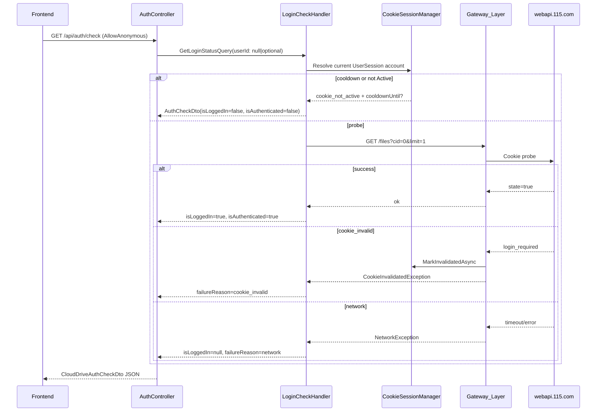
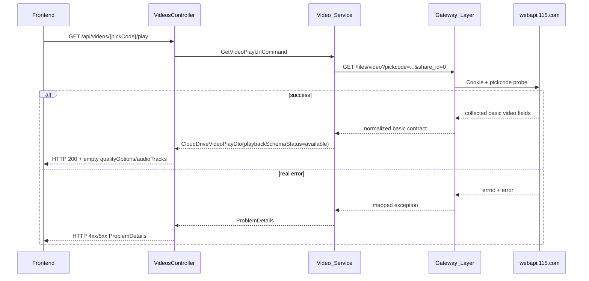
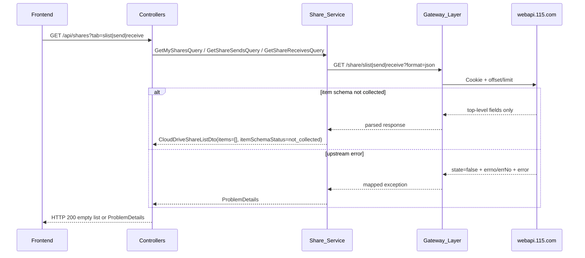
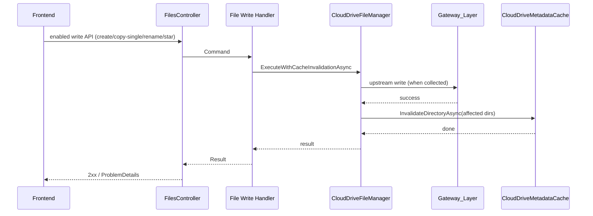

# 设计文档：115 网盘集成

## 概述

本设计文档描述 115 网盘集成功能的技术架构与实现方案。系统基于 .NET 10 原生技术栈，采用 DDD 四层架构 + MediatR CQRS 模式，通过本地 User/UserSession 的 JWT 认证和按用户绑定的 CookieSession 上下文，对接已验收证据覆盖的 **115 网页端 API**（`webapi.115.com`、`vip.115.com`、`pay.115.com`、`clouddownload.115.com`）。

> **认证方案声明**：本地用户通过 JWT 登录；已认证用户通过绑定 API 提交自己的 115 Cookie 三元组，系统按 UserId + CloudAccountUid 以 Data Protection 加密保存。当 Cookie 失效时，系统仅标记状态、进入冷却期并发布 `CookieInvalidated` 领域事件，不尝试自动恢复。

> **框架依赖说明：** 本模块构建在 `115-cloud-drive-net10` 定义的 .NET 10 原生框架之上，复用其 MediatR CQRS 分发、Pipeline Behavior（Validation / Transaction / Logging / DomainEventDispatch）、SqlSugar 仓储基类、Quartz.NET 调度、IDistributedCache JSON 封装、FluentValidation 集成、全局异常中间件 + ProblemDetails 等基础设施。

> **CQRS 返回模式说明：** 本模块所有 Command 使用框架定义的 `ICommand` / `ICommand<TResponse>` 接口，所有 Query 使用 `IQuery<TResponse>` 接口。Handler 统一返回 `Result` / `Result<T>`，业务级错误（如文件不存在、名称非法）通过 `Result.Failure(error)` 返回；基础设施级异常（如 `CloudDriveNetworkException`、`CloudDriveConfigurationException`）仍然抛出，由全局异常中间件统一处理。Command 使用 `sealed record` 定义，Handler 使用 `internal sealed` 修饰。

> **表现层失败响应说明：** WebApi Controller / Endpoint 适配层不得直接将 `Result.Failure(...)` 作为 HTTP 200 响应体返回；必须依据 `Error.Code` 通过集中映射输出非 2xx 的 `ProblemDetails`。仅抛出的异常继续由全局异常中间件处理。

### 设计目标

- 遵循 .NET 10 DDD 四层架构（Domain / Application / Infrastructure / WebApi），职责清晰分离
- 通过 **JWT 用户会话 + CookieSession 账号上下文**对接 115 网页端 API；系统不主动发起 115 授权流程
- 仅对已验收采集契约提供能力；未采集的上传、搜索、移动、删除及其他写操作保持禁用
- 内置频控限流、缓存、后台任务机制，降低 API 调用频率与风控风险
- 统一错误响应字段适配（errNo / errCode / errno / code / msg / message 等变体），由 `ErrorFieldAdapter` 按 URL 路径定向处理
- 严格遵守认证与响应内容的合规要求，不在日志/持久化/对外响应中暴露 Cookie 完整值或敏感用户字段

### 关键设计决策

| 决策 | 选择 | 理由 |
|------|------|------|
| 认证模式 | **个人 JWT 会话 + CookieSession**（UID/CID/USSID 由用户绑定） | 本地用户会话决定可访问的 115 账号上下文 |
| Cookie 存储 | 通过 `ICloudDriveSecretProtector`/Data Protection 按 UserId + CloudAccountUid 加密持久化 | 支持多账号绑定、更新、撤销并避免明文泄露 |
| 账号隔离 | 当前用户 + 当前 UserSession 的 `ActiveCloudAccountUid` | 同一用户可绑定多个账号；每个会话独立保存当前账号 |
| 命名映射 | HTTP cloudAccountUid -> Domain UserSession.ActiveCloudAccountUid -> DB active_cloud_account_uid | 绑定/选择 API 显式传 UID，普通业务请求由会话解析 |
| 账号上下文传递 | 普通业务端点不要求前端传递 `CloudAccountUid`；应用层由 `ICloudDriveAccountContextResolver` 根据 UserSession 解析，绑定/选择/解绑端点显式接收账号 UID |
| Cookie 失效处理 | 标记状态 + 冷却期（默认 60 秒，可通过 `CookieCooldownSeconds` 配置）+ `CookieInvalidated` 领域事件 | 避免失效后短时间内反复探测或暴露内部状态，系统不尝试自动恢复 |
| 云下载写能力 | 默认禁用 | `add_task_urls` 仅有失败样本，签名算法与成功响应未采集 |
| 限流策略 | 令牌桶算法 + 有界排队/拒绝 + 按用户/115账号/场景维度 | 支持分类请求频率、超限处置与可观测性 |
| 缓存方案 | IDistributedCache + JSON 封装（DistributedCacheExtensions） | 按用户+115账号+目录维度缓存，支持 TTL 配置 |
| 后台任务 | Quartz.NET IJob + IScheduler + JobOrchestrator | 仅调度已启用且已采集契约的操作；禁用能力不得创建任务 |
| 写操作返回模型 | 同步结果 + 异步受理双态 DTO | 统一表达立即完成与后台排队的结果 |
| 错误字段适配 | `ErrorFieldAdapter` 注册表按 URL 路径声明 `errNo / errCode / errno / code / msg / message` 变体 | 115 网页端不同 URL 的错误响应字段存在多种变体，需统一解析口径 |
| 失败响应 | `Result.Failure` 统一映射为非 2xx `ProblemDetails`，异常交给全局异常中间件 | 兼容现有 `Result` 模式与 WebApi 基线，避免 `200 + failure body` |
| HTTP 客户端 | IHttpClientFactory + Polly + Cookie Gateway 抽象 | 连接池管理、按幂等边界应用重试、超时、熔断并保持分层清晰 |
| 图片/文档预览 | 通过下载地址 + 前端渲染 | 115 网页端无专门预览 API |
| 视频播放 | 网页端 `GET webapi.115.com/files/video` | 已采集成功基础字段；清晰度、音轨和主动转码仍未采集 |
| 资源访问策略 | 临时直链优先，保留受控代理模式 | 满足临时资源、受限访问与合规要求 |

### 前置约束与边界

- **数据源范围**：系统只使用父阶段已验收的脱敏采集证据。未出现在证据闭集中的域名、路径、参数、响应或错误映射一律不得启用
- 系统以前置条件已满足为部署前提：用户必须先拥有本地 JWT UserSession，并为需要访问的 115 账号绑定有效 Cookie 三元组（UID/CID/USSID）；若 Data Protection、数据库或网页端配置缺失，必须禁用 115 集成功能并记录配置错误。具体采用双层保护机制：
  - **启动期校验**：在 `AddCloudDrive()` 扩展方法中通过 `IOptions<CloudDriveAppConfig>` 的 `ValidateOnStart()` 或手动校验逻辑，检查 Cookie 加密密钥、签名密钥、网页端基础域名等核心配置是否完整；校验失败时记录 `LogLevel.Error` 日志并将 `CloudDriveFeatureEnabled` 标志设为 `false`，但不阻止应用启动
  - **运行期保护**：所有 115 相关 Handler 在入口处检查 `CloudDriveFeatureEnabled` 标志（通过 `IOptions<CloudDriveAppConfig>` 注入），若为 `false` 则立即抛出 `CloudDriveConfigurationException`，确保不会发起任何 115 API 调用
- 所有下载地址、预览地址、播放地址均视为临时授权资源，只能在当前已绑定用户上下文中短时使用，不得持久化为公开永久链接
- Cookie 原文、签名密钥、用户敏感字段（手机号、邮箱、身份证、住址、生日等）不得写入日志、响应体或非加密持久化存储；日志输出前由 `CloudDriveSensitiveFieldsFilter` 按需求 23 / 26 的黑名单脱敏
- 对于高频浏览、媒体扫描、批量操作与跨设备访问场景，必须组合使用限流、缓存、后台任务和退避策略，以降低风控风险

### 账号隔离策略

- Cookie 会话记录按 `UserId + CloudAccountUid` 维度组织，其中 `CloudAccountUid` 为用户绑定 Cookie 三元组解析出的 115 账号唯一标识（Cookie 方案无 AppId 维度）
- `UserSession.ActiveCloudAccountUid` 保存当前会话选择的账号；没有选择时单个 Active 账号可自动使用，多账号时必须显式选择
- 元数据缓存键按 `UserId + CloudAccountUid + DirectoryId/FileId` 组合生成，确保多账号缓存维度稳定；当前公开 API 不接收账号参数
- 限流桶按 `UserId + CloudAccountUid + Category` 维度维护，避免后台任务、媒体播放与云下载互相挤占配额
- 后台任务记录需关联 `CloudAccountUid`，以便审计、恢复和重放时准确定位账号上下文
- 普通业务端点不得要求前端重复传递账号 UID；账号绑定、选择、解绑端点可以显式接收 UID，并必须验证其属于当前用户
- 账号上下文由 `ICloudDriveAccountContextResolver` 根据 JWT UserSession 统一解析；无账号返回 unavailable，多账号未选择返回 `cloud_drive_account_context_ambiguous`

### 同步/异步执行边界

- 文件列表、文件详情（由列表条目派生）、下载、新建目录、重命名、星标、单项复制、回收站列表、视频基础信息、历史读取、云下载读统计、我的分享、VIP/余额/空间查询采用同步执行
- 未采集或仅有失败样本的能力统一返回 `cloud_drive_api_not_collected`，不得创建后台任务、不得进入重试链路，也不得以“已受理”表示完成
- 视频播放按 `/files/video` 的已采集成功字段返回 `PlaybackSchemaStatus = "available"`；`QualityOptions` 与 `AudioTracks` 固定为空，主动转码入口禁用
- 已采集的写操作只有收到与其契约匹配的成功响应后才可返回同步完成；当前没有任何已采集能力可返回异步受理

### 幂等与重试边界

- 自动退避重试按 **用例幂等性 / `CloudDriveApiContext.Category`（或等价读/写分类）** 判定，**不得**仅凭 HTTP 方法；已采集的幂等 GET 与云下载读查询可有限重试
- 文件列表/详情、下载地址、回收站列表、视频播放信息、字幕列表、历史读取、云下载读查询、我的分享和用户已采集读接口可执行自动退避重试
- 新建文件夹、复制、重命名、星标等非幂等写操作默认不自动重试；状态未知时不得盲目重放
- 禁用能力在 Gateway 前短路，不得调用上游或创建恢复检查点

### Web API 失败响应边界

- Controller 仅负责 HTTP 输入/输出适配与 `ISender.Send()` 分发，不承载业务逻辑，也不得直接返回领域层 `Result` 作为成功响应体
- `Result.IsSuccess` 映射为正常 2xx 响应；后台受理场景返回 202 / Accepted 语义并携带 `JobId`
- `Result.IsFailure` 必须通过集中映射输出非 2xx `ProblemDetails`，并在响应中保留稳定的业务错误码（例如 `extensions.code`）
- 抛出的 `CloudDrive*Exception` 与其他未处理异常继续由全局异常中间件统一处理

## 系统架构

本模块采用 **DDD 四层架构**（Domain / Application / Infrastructure / WebApi），应用层通过 **MediatR CQRS** 编排业务用例，Infrastructure 层以单一 **Cookie Gateway**（`ICloudDriveWebApiGateway` / `CloudDriveApiClient`）对接已验收的 115 网页端 API。MediatR Pipeline Behavior 顺序为 **Logging → Validation → Transaction → DomainEventDispatch**（可选 PreValidation 插在 Logging 与 Validation 之间）；领域事件由 `DomainEventDispatchBehavior` 在 Handler 执行后、事务提交前自动分发。

_覆盖需求: 29_

## 时序图

关键交互时序以各组件小节内的 Mermaid `sequenceDiagram` 为准（含 Cookie 探测、文件列表、上传、视频播放空态、分享列表等）。本顶层章节满足 `spec-format.md`「时序图」要求；图元不在此重复粘贴，避免与组件节漂移。

## 组件设计

### 1. 认证与会话管理模块 (Auth)

_覆盖需求: 1, 2, 3_

> **认证方案说明**：本系统采用个人 JWT 会话认证；每个用户通过账号绑定 API 保存一个或多个 CookieSession。请求 115 时由当前 UserSession 的 `ActiveCloudAccountUid` 解析 Cookie。Cookie 失效时仅标记状态、进入冷却期并发布 `CookieInvalidated` 领域事件，不尝试自动恢复。

#### CloudDriveAuth 模块（CQRS Command/Query）

应用层通过 MediatR Command/Query 编排 Cookie 会话管理与登录态检测。Controller 构造 Command/Query 对象并通过 `IMediator.Send()` 分发。

```csharp
// --- Commands ---
/// 已认证用户绑定或更新自己的 115 账号 Cookie 会话（UID/CID/USSID + 可选额外字段）
public sealed record UpsertCookieSessionCommand(Guid UserId, UpsertCookieSessionInput Input) : ICommand<CloudDriveCookieSessionDto>, IHasInput<UpsertCookieSessionInput>;

/// 已认证用户解绑指定 115 账号的 Cookie 会话
public sealed record RevokeCookieSessionCommand(Guid UserId, RevokeCookieSessionInput Input) : ICommand, IHasInput<RevokeCookieSessionInput>;

/// 标记 Cookie 失效并进入冷却期（由失效检测链路内部触发，非对外端点）
public sealed record EnterCookieCooldownCommand(Guid UserId, EnterCookieCooldownInput Input) : ICommand, IHasInput<EnterCookieCooldownInput>;

// --- Queries ---
/// 探测当前用户当前账号的登录态（对应需求 3 `/api/auth/check`）
public sealed record GetLoginStatusQuery(Guid? UserId) : IQuery<CloudDriveAuthCheckDto>;

/// 查询当前用户已绑定的 Cookie 会话摘要（不暴露 Cookie 原文）
public sealed record GetBoundAccountsQuery(Guid UserId) : IQuery<List<CloudDriveAccountSummaryDto>>;

/// 聚合查询 115 账号的用户信息（对应需求 23 多源聚合：user_info + vip_limit + get_yun_card + pay.115.com/）
public sealed record GetUserInfoQuery(Guid UserId) : IQuery<CloudDriveUserInfoDto>, ICloudDriveAccountScopedRequest;
```

> 说明：每个 Command/Query 对应一个 `ICommandHandler` / `IQueryHandler`，Handler 返回 `Result<T>` 或 `Result`，内部调用应用层服务或 Domain 方法。
> 说明：`UpsertCookieSessionCommand` 仅面向已认证个人用户；输入通过 JWT UserSession 绑定到当前用户，系统不主动发起 115 授权。
> 说明：`GetLoginStatusQuery` 通过调用 `GET webapi.115.com/files?cid=0&limit=1` 探测 Cookie 是否仍然可用，并映射为公开 `CloudDriveAuthCheckDto`（camelCase JSON）。不变式：`IsAuthenticated === (IsLoggedIn === true)`。(1) 业务成功 → `IsLoggedIn=true`、`IsAuthenticated=true`，省略 `FailureReason`；(2) `errNo=login_required` 等登录失效 → `CloudDriveApiClient` 调用 `CookieSessionManager.MarkInvalidatedAsync`，Handler 返回 `IsLoggedIn=false`、`IsAuthenticated=false`、`FailureReason='cookie_invalid'`；(3) 网络异常或未分类错误 → `IsLoggedIn=null`、`IsAuthenticated=false`、`FailureReason='network'`，不触发冷却；(4) 冷却期/非 Active 短路 → `IsLoggedIn=false`、`IsAuthenticated=false`、`FailureReason='cookie_not_active'`，并在已知时填 `CooldownUntil`。Controller 对该端点 `AllowAnonymous`，不调用 `GetAuthenticatedUserId()`。
> 说明：`RevokeCookieSessionCommand` 不调用远程登出接口（网页端无对应接口），仅清除本地 `CookieSession` 记录、失效相关缓存与限流桶。
> 说明：普通 Command Handler 中的领域事件由框架 `DomainEventDispatchBehavior` 在 Handler 执行后、事务提交前自动分发（前提是仓储在 Insert/Update 时调用了 `IDomainEventSource.Track(entity)`），Handler 内部不应手动调用 `IMediator.Publish()`。仅 Quartz Job 因不经过 MediatR Pipeline，需要手动发布领域事件。
> 说明：普通业务端点的输入 DTO 不包含 `CloudAccountUid`。Command/Query Handler 在进入应用层后通过 `ICloudDriveAccountContextResolver` 根据 JWT UserSession 解析当前账号上下文；绑定、选择和解绑 DTO 可以显式携带 `CloudAccountUid`，但必须校验当前用户归属。
> 说明：Cookie 失效或探测失败时基础设施层抛出 `CloudDriveCookieInvalidatedException`，由全局异常中间件统一处理并保留原始错误字段供上层提示；同时触发 `CookieInvalidated` 领域事件发布。

#### CookieSessionManager

应用层服务，按 `UserId + CloudAccountUid` 编排 Cookie 会话生命周期（读取、更新、加密存储、失效标记、冷却管理）。通过构造函数注入依赖，不继承框架基类。注入 `ICookieSessionRepository`、`ICloudDriveSecretProtector`、`ICookieInvalidationNotifier` 与 `IOptions<CloudDriveAppConfig>`，负责仓储读写、机密保护、失效通知与配置读取的编排协作。

> 说明：`CookieSessionManager` 的职责是编排 Cookie 读取 → 注入请求头 → 失效检测 → 冷却管理的流程，属于应用层编排逻辑。纯业务规则（如"Cookie 是否处于冷却期"、"是否已失效"）保留在 `CookieSession` 实体方法中。
> 说明：Cookie 没有自动刷新机制 — 失效后必须由用户重新绑定。`CookieSessionManager` 在检测到 Cookie 失效时，仅标记状态、进入冷却期并发布 `CookieInvalidated` 领域事件，不尝试自动恢复；冷却期默认 60 秒，可通过 `CookieCooldownSeconds` 配置调整。

```csharp
public class CookieSessionManager
{
    /// 存储或更新 Cookie 会话（加密持久化 UID/CID/USSID + 额外字段）
    Task UpsertSessionAsync(Guid userId, string cloudAccountUid, CookieTriplet cookies, IDictionary<string, string>? extraFields = null);

    /// 获取当前有效的 Cookie 字符串（用于请求头注入；若处于冷却期则抛出 `CloudDriveCookieInvalidatedException`）
    Task<string> GetValidCookieHeaderAsync(Guid userId, string cloudAccountUid);

    /// 检查指定账号是否已绑定可用 Cookie
    Task<bool> IsAuthorizedAsync(Guid userId, string cloudAccountUid);

    /// 标记 Cookie 失效并进入冷却期（由 ApiClient 在探测到失效响应时调用）
    Task MarkInvalidatedAsync(Guid userId, string cloudAccountUid, string reason);

    /// 撤销指定账号的 Cookie 会话
    Task RevokeSessionAsync(Guid userId, string cloudAccountUid);
}

/// Cookie 三元组值对象（Domain 层）
public readonly record struct CookieTriplet(string Uid, string Cid, string Ussid);
```

#### ICookieInvalidationNotifier

应用层抽象，用于输出 Cookie 失效通知与系统告警。默认实现 `LoggingCookieInvalidationNotifier` 仅输出脱敏结构化日志；`CookieInvalidated` 领域事件由 `CookieSession` 聚合根在仓储 Update 后经 `DomainEventDispatchBehavior` 统一分发，Notifier 不直接调用 `IMediator.Publish()`。

```csharp
public interface ICookieInvalidationNotifier
{
    Task NotifyAsync(Guid userId, string cloudAccountUid, string reason, CancellationToken cancellationToken = default);
}
```

#### ICloudDriveSecretProtector

应用层抽象，用于对需要持久化的机密值执行 Protect / Unprotect。基础设施层默认使用 ASP.NET Core Data Protection 实现；同一部署拓扑下必须持久化并共享 key ring，以保证服务重启后仍可解密既有 Cookie 与签名密钥，多实例部署时也能读取同一份加密数据。

```csharp
public interface ICloudDriveSecretProtector
{
    string Protect(string keyName, string plaintext);
    string Unprotect(string keyName, string ciphertext, int? keyVersion = null);
}
```

> 说明：在 Cookie 方案下，`ICloudDriveSecretProtector` 的加密目标为：(1) `CookieSession` 聚合根的 UID/CID/USSID 三元组与可选额外字段；(2) `ICookieSignatureStrategy` 所依赖的云下载签名密钥。禁止在日志或对外响应体中输出以上原文。

#### ICookieSignatureStrategy（禁用的云下载写扩展点）

应用层可保留签名抽象，但不得据此启用云下载写操作。验收证据只证明 `add_task_urls` 请求携带 `sign/time/uid`，没有证明算法、成功响应或删除/清空契约。

> 默认实现必须返回明确的 `offline_signature_not_available` 业务错误，不得生成占位签名、复用历史实现或向上游发起请求。

```csharp
public interface ICookieSignatureStrategy
{
    /// 生成云下载请求的签名三元组
    CookieSignature Generate(Guid userId, string cloudAccountUid, string requestBody);
}

/// 云下载签名结果（值对象）
public readonly record struct CookieSignature(string Sign, long Time, string Uid);
```

#### LoginCheckHandler（需求 3 登录态检测）

`GetLoginStatusQuery` 的处理器，按以下策略探测 Cookie 是否仍然可用：

1. 从 `CookieSessionManager` 解析当前用户账号上下文；匿名请求无用户上下文时返回未登录状态；若会话非 Active 或处于冷却期内，直接返回 `IsLoggedIn = false`、`IsAuthenticated = false`、`FailureReason = "cookie_not_active"`，并在已知时填 `CooldownUntil`，不发起官方请求
2. 否则调用 `GET webapi.115.com/files?cid=0&limit=1` 并解析响应：
    - 业务成功（`state == true`）→ `IsLoggedIn = true`、`IsAuthenticated = true`，省略 `FailureReason`
    - 识别为登录失效类错误码（如 `errNo=login_required` 或 `ErrorFieldAdapter` 判定为登录失效的其他变体）→ `CloudDriveApiClient` 已通过 `CookieSessionManager.MarkInvalidatedAsync` 持久化失效状态和冷却期；Query Handler 捕获 `CloudDriveCookieInvalidatedException` 后返回 `IsLoggedIn = false`、`IsAuthenticated = false`、`FailureReason = "cookie_invalid"`
    - 其他未知错误或网络超时 → `IsLoggedIn = null`、`IsAuthenticated = false`、`FailureReason = "network"`，不触发冷却
3. 返回公开 DTO `CloudDriveAuthCheckDto`；始终保证 `IsAuthenticated === (IsLoggedIn === true)`；内部诊断日志可记录脱敏后的 `CloudAccountUid`

> 说明：该 Handler 为 Query Handler，符合 CQRS 约束（不发布事件、不写库、不调用写 Command）。冷却状态推进由基础设施请求链路中的 `CloudDriveApiClient` 与 `CookieSessionManager.MarkInvalidatedAsync` 负责，系统手动标记冷却仍通过独立的 `EnterCookieCooldownCommand` 完成。

##### 时序：Cookie 探测 / auth check + 冷却



### 2. 文件管理模块 (File)

_覆盖需求: 4, 5, 6, 7, 8, 9, 10, 11, 12, 13, 13a, 14_

#### CloudDriveFile 模块（CQRS Command/Query）

应用层通过 MediatR Command/Query 编排文件 CRUD、搜索、回收站等操作.

```csharp
// --- 已启用 Queries ---
public sealed record GetFileListQuery(Guid UserId, GetFileListInput Input) : IQuery<PagedResultDto<CloudDriveFileDto>>, ICloudDriveAccountScopedRequest, IHasInput<GetFileListInput>;
public sealed record GetFileDetailQuery(Guid UserId, GetFileInput Input) : IQuery<CloudDriveFileDetailDto>, ICloudDriveAccountScopedRequest, IHasInput<GetFileInput>;
public sealed record GetDownloadUrlQuery(Guid UserId, GetDownloadUrlInput Input) : IQuery<CloudDriveDownloadDto>, ICloudDriveAccountScopedRequest, IHasInput<GetDownloadUrlInput>;
public sealed record GetRecycleBinListQuery(Guid UserId, GetRecycleBinListInput Input) : IQuery<CloudDriveRecycleListDto>, ICloudDriveAccountScopedRequest, IHasInput<GetRecycleBinListInput>;

// --- 已启用 Commands ---
public sealed record CreateFolderCommand(Guid UserId, CreateFolderInput Input) : ICommand<CloudDriveFolderDto>, ICloudDriveAccountScopedRequest, IHasInput<CreateFolderInput>;
public sealed record RefreshDirectoryCommand(Guid UserId, RefreshDirectoryInput Input) : ICommand, ICloudDriveAccountScopedRequest, IHasInput<RefreshDirectoryInput>;
public sealed record CopyFilesCommand(Guid UserId, CopyFilesInput Input) : ICommand<CloudDriveOperationResultDto>, ICloudDriveAccountScopedRequest, IHasInput<CopyFilesInput>;
public sealed record RenameFileCommand(Guid UserId, RenameFileInput Input) : ICommand<CloudDriveFileDetailDto>, ICloudDriveAccountScopedRequest, IHasInput<RenameFileInput>;
public sealed record ToggleStarCommand(Guid UserId, ToggleStarInput Input) : ICommand<CloudDriveOperationResultDto>, ICloudDriveAccountScopedRequest, IHasInput<ToggleStarInput>;
```

> 说明：`GetFileListQuery` 返回 `PagedResultDto<CloudDriveFileDto>`，列表响应在顶层携带面包屑 `Paths`（JSON: `paths`），由网页端 `path`/`paths` 归一化映射。
> 说明：目录刷新仅作为应用层内部缓存失效能力，不暴露公开 `POST /api/files/refresh` 端点；前端刷新当前目录时重新调用 `GET /api/files`。

> **禁用闭集**：搜索、上传、移动、删除、回收站写操作没有验收契约，不进入 CQRS 已启用集合。可保留兼容端点，但必须在调用 Gateway 前以 `cloud_drive_api_not_collected` 失败。

#### CloudDriveFileManager

应用层服务，按 `UserId + CloudAccountUid` 上下文编排文件操作的缓存协作与 API 调用（缓存优先读取、写操作后缓存失效等）。通过构造函数注入依赖，调用 `ICloudDriveWebApiGateway` 时仅需传递 `UserId + CloudAccountUid`；网关内部从 `CookieSessionManager` 获取当前 Cookie 并注入请求头。

> 说明：`CloudDriveFileManager` 的职责是编排"检查缓存→调用 API→写入缓存→失效缓存"的流程，属于应用层编排逻辑。纯业务规则（如文件名合法性验证）保留在 Domain 层的 `CloudDriveFileNameValidator` 静态类中.

```csharp
public class CloudDriveFileManager
{
    /// 获取文件列表（缓存优先）
    Task<CloudDriveFileListResult> GetFileListAsync(Guid userId, string cloudAccountUid, string directoryId, int offset, int limit);

    /// 获取文件详情（缓存优先）
    Task<CloudDriveFileDetail> GetFileDetailAsync(Guid userId, string cloudAccountUid, string fileId);

    /// 执行文件操作并使缓存失效
    Task<T> ExecuteWithCacheInvalidationAsync<T>(Guid userId, string cloudAccountUid, string[] affectedDirectoryIds, Func<Task<T>> action);
}
```

> 说明：文件名验证逻辑由 Domain 层的 `CloudDriveFileNameValidator` 静态类提供，`CloudDriveFileManager` 和 Handler 调用该静态方法完成名称校验。注意：网页端新建文件夹接口（对应需求 9）限制文件夹名最长 **255 字符**，而重命名接口（对应需求 13）限制文件名最多 **255 字节**（UTF-8 下中文字符占 3 字节）；具体限值依据需求采集中的网页端响应。因此验证器须提供 `ValidateNewFolderName`（255 字符）和 `ValidateRenameFileName`（255 字节）两种校验方法。

### 3. 预览模块 (Preview)

_覆盖需求: 15, 19_

#### CloudDrivePreview 模块（CQRS Query）

应用层通过 MediatR Query 根据文件类型提供预览信息.

```csharp
public sealed record GetImagePreviewQuery(Guid UserId, GetPreviewInput Input) : IQuery<CloudDriveImagePreviewDto>, ICloudDriveAccountScopedRequest, IHasInput<GetPreviewInput>;
public sealed record GetDocPreviewQuery(Guid UserId, GetPreviewInput Input) : IQuery<CloudDriveDocPreviewDto>, ICloudDriveAccountScopedRequest, IHasInput<GetPreviewInput>;
```

> 说明：`GetImagePreviewQuery` 仅支持 `JPG/JPEG/PNG/GIF/BMP/WEBP` 六类格式，通过已采集 `/files/download` 返回临时地址或系统受控代理地址；不直接把列表 `u/tu/tp` 推断为原图契约。不支持的格式或不存在的文件必须返回明确错误.
> 说明：`GetDocPreviewQuery` 仅支持 `PDF/TXT` 直接渲染，以及 `DOC/DOCX/XLS/XLSX/PPT/PPTX` 第三方渲染；文件不存在或格式不支持时必须返回明确错误，Office 第三方服务未配置时必须返回 `RenderMode = NotAvailable`，且不得伪造可预览能力.

### 4. 视频模块 (Video)

_覆盖需求: 16, 17, 18_

#### CloudDriveVideo 模块（CQRS Command/Query）

应用层通过 MediatR Command/Query 编排已采集的视频播放、字幕与历史读取；主动转码和进度写入保持禁用。

```csharp
public sealed record GetVideoPlayUrlCommand(Guid UserId, GetVideoPlayInput Input) : ICommand<CloudDriveVideoPlayDto>, ICloudDriveAccountScopedRequest, IHasInput<GetVideoPlayInput>;
public sealed record GetSubtitlesQuery(Guid UserId, GetSubtitlesInput Input) : IQuery<CloudDriveSubtitleListDto>, ICloudDriveAccountScopedRequest, IHasInput<GetSubtitlesInput>;
public sealed record GetVideoPlayProgressQuery(Guid UserId, GetVideoPlayProgressInput Input) : IQuery<CloudDriveVideoPlayProgressDto>, ICloudDriveAccountScopedRequest, IHasInput<GetVideoPlayProgressInput>;
```

> 说明：`GetVideoPlayUrlCommand` **禁止**在播放路径内自动提交转码或创建转码后台任务。`GET /files/video` 已采集成功基础字段，因此返回 `PlaybackSchemaStatus = "available"`；由于未采集清晰度/音轨数组，`QualityOptions` 与 `AudioTracks` 固定为空。字幕多次样本均为空数组，item schema 仍为 `not_collected`。`GET /files/history` 提供历史读取，进度写入未采集。

##### 时序：视频播放空态



##### 时序：分享列表查询



### 5. 后台任务模块 (Quartz.NET Job)

_覆盖需求: 28_

#### CloudDriveJob 查询（CQRS Query）

应用层通过 MediatR Query 管理长耗时任务状态查询.

```csharp
public sealed record GetJobStatusQuery(Guid UserId, GetJobStatusInput Input) : IQuery<CloudDriveJobDto>, ICloudDriveAccountScopedRequest, IHasInput<GetJobStatusInput>;
public sealed record GetJobListQuery(Guid UserId, GetJobListInput Input) : IQuery<PagedResultDto<CloudDriveJobDto>>, ICloudDriveAccountScopedRequest, IHasInput<GetJobListInput>;
```

#### CloudDriveJobOrchestrator

应用层协作组件，负责决定操作是同步执行还是转为后台任务，并统一创建 `CloudDriveJob` 记录、通过应用层抽象 `ICloudDriveJobScheduler` 调度对应的后台 Job；Infrastructure 层当前由 Quartz.NET 提供具体实现.

```csharp
public interface ICloudDriveJobOrchestrator
{
    Task<Guid> EnqueueSupportedOperationAsync(Guid userId, string cloudAccountUid, CloudDriveJobType jobType, object payload, CancellationToken cancellationToken = default);
}
```

> 说明：`CloudDriveJobOrchestrator` 必须先通过能力矩阵验证 `jobType` 已启用。上传、批量移动/删除、回收站写、云下载写和主动转码当前均不得入队。
> 说明：`CloudDriveJob` 是后台任务状态与恢复信息的唯一事实来源；当前 Quartz 仅承担进程内调度，不作为持久化来源。应用启动后必须执行任务恢复协调：扫描数据库中 `Pending` / `Running` 的任务记录，只重新调度 capability matrix 已启用且具备明确安全重试条件的任务；本轮所有与上传、移动、删除、回收站写、云下载写和转码相关的遗留任务均不得恢复为运行态，应标记 `Failed` 并记录固定脱敏原因。

### 6. 云下载模块 (Offline)

_覆盖需求: 20, 21_

> **接口映射说明**：本模块对接 `POST https://clouddownload.115.com/web/?ac={操作符}`。三个已启用读操作参数只在 query 中，且没有请求体。

#### CloudDriveOffline 模块（CQRS Command/Query）

应用层通过 MediatR Command/Query 编排云下载任务生命周期与配额查询。

```csharp
// --- Queries ---
/// 查询云下载任务列表（对应需求 20 AC1-AC3）
public sealed record GetOfflineTaskListQuery(Guid UserId, GetOfflineTaskListInput Input) : IQuery<CloudDriveOfflineTaskListDto>, ICloudDriveAccountScopedRequest, IHasInput<GetOfflineTaskListInput>;

/// 查询云下载空间配额与统计（对应需求 20 AC4-AC5）
public sealed record GetOfflineQuotaQuery(Guid UserId) : IQuery<CloudDriveOfflineQuotaDto>, ICloudDriveAccountScopedRequest;

/// 查询云下载任务统计（对应需求 20 AC7）
public sealed record GetOfflineStatsQuery(Guid UserId) : IQuery<CloudDriveOfflineStatsDto>, ICloudDriveAccountScopedRequest;

```

> 说明：`add_task_urls` 只有失败样本；BT 新增和单项删除仅有 UI 行为观察；清空未执行。所有云下载写端点必须返回 `cloud_drive_api_not_collected` 或 `offline_signature_not_available`，不得调用上游。
> 说明：仅查询操作（`task_lists` / `task_count` / `get_quota_package_info`）允许瞬时错误重试，且不得携带猜测性签名 body。
> 说明：云下载任务列表只映射 `task_lists` 顶层字段 `count/errcode/errtype/page/page_count/page_row/page_size/quota/real_state/state/tasks/total`；`tasks` item schema 未采集时返回 `Items = []` 与 `ItemSchemaStatus = "not_collected"`，不得推断任务状态值域。
> 说明：任务 item schema 未采集，列表只能返回空 `Items` 与 `ItemSchemaStatus = "not_collected"`。

---

### 7. 分享管理模块 (Share)

_覆盖需求: 22_

> **接口映射说明**：本模块仅启用 `GET webapi.115.com/share/slist`；query 为 `format=json&limit&offset`。`send` 与 `receive` 只有错误样本，入口保持禁用。

#### CloudDriveShare 模块（CQRS Query）

应用层通过 MediatR Query 管理分享资源（对应需求 22 AC1-AC6）。

```csharp
// --- Queries ---
/// 查询我的分享列表（/share/slist）
public sealed record GetMySharesQuery(Guid UserId, GetShareListInput Input) : IQuery<CloudDriveShareListDto>, ICloudDriveAccountScopedRequest, IHasInput<GetShareListInput>;

```

> 说明：`/share/slist` 已采集非空 `list` item，按 `docs/115-api-docs.md` 的字段与 JSON 类型逐项映射并返回 `ItemSchemaStatus = "available"`。`/share/send` 与 `/share/receive` 不得以错误响应反推成功 schema。
> 说明：分享相关写操作（创建/撤销分享）暂不在需求范围内；本模块仅提供读视图。

---

### 8. 用户中心聚合模块 (UserAggregator)

_覆盖需求: 23_

> **接口映射说明**：已启用来源为 `webapi.115.com/user/vip_limit?feature=2`、`webapi.115.com/files/index_info?count_space_nums=1`、已采集的 `vip.115.com` 产品/卡信息以及 `pay.115.com/?ct=balance&ac=getBalance`。用户基础资料接口未采集，`Info` 必须为 `null`。

#### CloudDriveUserAggregation 模块（CQRS Query）

应用层通过 MediatR Query 聚合多源用户信息。本模块通过 `UserAggregationService` 内部并行调用多源接口，并做失败容错（任一子接口失败不影响其他字段返回）。

```csharp
/// 获取用户聚合画像（对应需求 23 AC1）
public sealed record GetUserProfileQuery(Guid UserId) : IQuery<CloudDriveUserProfileDto>, ICloudDriveAccountScopedRequest;

/// 获取用户空间详情（对应需求 23 AC6, AC8）
public sealed record GetUserSpaceQuery(Guid UserId) : IQuery<CloudDriveSpaceInfoDto>, ICloudDriveAccountScopedRequest;

/// 获取用户 VIP 详情与特权（对应需求 23 AC4, AC5）
public sealed record GetUserVipQuery(Guid UserId) : IQuery<CloudDriveVipInfoDto>, ICloudDriveAccountScopedRequest;

/// 获取账户余额（对应需求 23 AC5）
public sealed record GetUserBalanceQuery(Guid UserId) : IQuery<CloudDriveBalanceDto>, ICloudDriveAccountScopedRequest;
```

#### UserAggregationService

应用层服务，按 `UserId + CloudAccountUid` 上下文并行调用已采集的 VIP、余额与空间接口并组装结果。通过构造函数注入 `ICloudDriveWebApiGateway`、`IOptions<CloudDriveAppConfig>`、`ILogger<UserAggregationService>` 等依赖；基础资料保持 `null`。

```csharp
public class UserAggregationService
{
    /// 并行聚合用户主资料、VIP、空间等信息；单个子接口失败返回空值并记录错误摘要
    Task<CloudDriveUserInfoDto> AggregateUserInfoAsync(Guid userId, string cloudAccountUid, CancellationToken cancellationToken = default);
}
```

> 说明：聚合过程使用字段白名单；Cookie、签名、账号标识、文件名、pickCode、临时 URL 和余额数值均不得进入日志或证据。基础资料因未采集保持 `null`。
> 说明：VIP 响应中 `00_balance` 字段（以数字开头）因 C# 属性命名限制，映射时统一归一化为 `Balance`；其余数字开头字段也需遵循此归一化策略。
> 说明：聚合失败策略：采用 `Task.WhenAll` 并行调用，任一子接口失败时该字段置空并在日志中记录 `sub_endpoint_failed` 条目（含脱敏的错误摘要）；只有所有子接口都失败时才返回 `Result.Failure`。

---

### 9. 基础设施组件

_覆盖需求: 24, 25, 26, 27, 29_

#### ICloudDriveWebApiGateway / CloudDriveApiClient

_覆盖需求: 25, 26, 29_

应用层通过 `ICloudDriveWebApiGateway` 抽象访问已验收的 115 网页端 HTTP 契约（定义在 Application 层 `Abstractions/`），基础设施层由 `CloudDriveApiClient` 实现。未采集能力不进入接口方法闭集：

| 序号 | 域名 | 用途 | 认证方式 |
|:---:|---|---|---|
| 1 | `webapi.115.com` | 文件列表、下载、新建、复制、重命名、星标、回收站、视频、字幕、进度读取、我的分享、VIP/空间 | Cookie |
| 2 | `vip.115.com` | VIP 卡、产品、优惠券空列表 | Cookie |
| 3 | `pay.115.com` | 余额 | Cookie |
| 4 | `clouddownload.115.com/web/` | 配额、计数、空任务列表 | Cookie 会话；读取无 request body |

> 登录态探测仅使用已采集的 `GET webapi.115.com/files?cid=0&limit=1`，不引入其他认证域名。

> 用户基础资料、上传、搜索、移动、删除、回收站写操作、云下载写操作、播放进度写入与主动转码不在已启用接口闭集中。

```csharp
public interface ICloudDriveWebApiGateway
{
    /// 发送网页端业务 API 请求（默认 webapi.115.com）
    /// 自动从 CookieSessionManager 读取当前 Cookie 并注入请求头；若 Cookie 处于失效冷却期则抛出 CloudDriveCookieInvalidatedException
    Task<T> SendWebApiRequestAsync<T>(Guid userId, string cloudAccountUid, HttpMethod method, string endpoint, CloudDriveApiContext context, CancellationToken cancellationToken = default);

    /// 发送用户中心类 API 请求（vip.115.com / pay.115.com / webapi.115.com）
    /// context.TargetDomain 指向已采集域名；基础资料请求不在闭集中
    Task<T> SendUserCenterRequestAsync<T>(Guid userId, string cloudAccountUid, HttpMethod method, string endpoint, CloudDriveApiContext context, CancellationToken cancellationToken = default);

    /// 发送云下载读取请求（clouddownload.115.com/web/?ac=...）
    /// task_lists/task_count/get_quota_package_info 均为 POST + query，且没有 request body
    Task<T> SendOfflineApiRequestAsync<T>(Guid userId, string cloudAccountUid, HttpMethod method, string endpoint, CloudDriveApiContext context, CancellationToken cancellationToken = default);
}

/// 统一请求上下文：当前已启用闭集只需要 query string 与 urlencoded form
public sealed class CloudDriveApiContext
{
    public string? TargetDomain { get; init; }                        // 多域名聚合时显式指定
    public IDictionary<string, string>? QueryParameters { get; init; } // query string
    public IDictionary<string, string>? FormFields { get; init; }      // application/x-www-form-urlencoded
    public string? Category { get; init; }                             // 限流桶场景分类
}

public class CloudDriveApiClient : ICloudDriveWebApiGateway
{
    // 负责 HTTP 通信、Cookie 注入、错误解析（委托 ErrorFieldAdapter）、重试边界控制与脱敏日志
}
```

> 说明：`CloudDriveApiClient` 对 115 网页端响应的成功判定由 `IErrorFieldAdapter` 按 method + host + path + 关键 query 动态解析（见下一节）；当前已验收 `state` 类型均为 boolean。HTTP 成功但未知 envelope 仍必须 fail closed。

#### IErrorFieldAdapter / ErrorFieldAdapter（错误响应字段适配器）

_覆盖需求: 25_

应用层抽象覆盖 requirements R25 中 **20 行已观察 envelope 规则**，按 host + path + 必要操作 query 声明映射。只有成功样本的行不得伪装成完整错误契约；未知失败形态 fail closed 为 `api_error` 并写入完全脱敏的 Warning。

```csharp
public interface IErrorFieldAdapter
{
    /// 根据请求 URL 与响应 JSON 解析出标准化的错误视图
    CloudDriveApiError? TryParse(Uri requestUri, JsonDocument responseJson);
}

public sealed class ErrorFieldAdapter : IErrorFieldAdapter
{
    // 内部持有 Dictionary<string, ErrorFieldDescriptor>，键为 URL 路径模式
    // 值为该 URL 下的错误字段名称 + 语义（号码类型/消息字段）
}

public sealed record CloudDriveApiError(string? Code, string? Message, string RawField, Uri SourceUri);

/// 单条 URL 对应的字段解析规则
public sealed record ErrorFieldDescriptor(
    string UrlPattern,                 // 例："/files/video" 或 "vip.115.com/?ct=order&ac=get_yun_card"
    string? CodeFieldName,             // 无数字码字段时为 null
    ErrorCodeType? CodeType,           // Number / String / null
    string? MessageFieldName,          // 无消息字段时为 null
    string? FallbackCodeFieldName = null,  // 备选字段（如 errNo 与 errno 双写场景）
    string? FallbackMessageFieldName = null);

public enum ErrorCodeType { Number, String }
```

> **匹配器契约**（与 R25 / tasks 2.2 同句）：(1) `webapi.115.com` path 必须精确相等；(2) `vip.115.com/` 与 `clouddownload.115.com/web/` 必须把 observed `ct/ac` 操作 query 纳入规则键；(3) 同主机多命中时先取 path 最长，再取操作 query 最具体；仍并列时 fail closed。
>
> 注册表必须逐行镜像 R25 的 20 行字段与类型，尤其区分 `errno` string/number、`errNo` 大小写、`msg`/`message`、`errcode`/`errtype`/`error_msg`。搜索、上传、用户基础资料、`video_push`、主动转码与其他 not-collected 能力不得注册为已支持规则。未命中规则的请求不得使用猜测性通用成功判定，只能返回 `api_error` 并记录脱敏 Warning。

#### CloudDriveRateLimiter

_覆盖需求: 24_

频控组件，基于令牌桶算法与有界排队/拒绝策略，实现按用户 + 115 账号 + 场景维度限流。注册为 Singleton 生命周期，内部通过 `ConcurrentDictionary<string, TokenBucket>` 按维度键持有令牌桶状态，确保跨请求共享限流计数。单机部署场景下使用进程内内存状态即可；多实例部署时需替换为分布式限流方案（如 Redis 令牌桶），当前设计预留 `ICloudDriveRateLimiter` 接口抽象以支持后续替换.

```csharp
public class CloudDriveRateLimiter
{
    /// 获取执行许可（可能等待或抛出限流异常）
    Task<IDisposable> AcquireAsync(Guid userId, string cloudAccountUid, string? category = null, CancellationToken cancellationToken = default);

    /// 记录 API 返回的频控信号（429 等），触发退避
    void RecordThrottleSignal(Guid userId, string cloudAccountUid, string? category = null);

    /// 清理指定用户与 115 账号的限流桶；category 为空时清理该账号全部场景
    void Reset(Guid userId, string cloudAccountUid, string? category = null);
}
```

> 说明：`AcquireAsync` 根据 `RateLimitOverflowStrategy` 选择排队或立即拒绝；队列长度超过 `RateLimitMaxQueueLength` 时直接返回限流异常
> 组件需要记录排队次数、拒绝次数、退避重试次数和最终失败次数，并输出到日志或指标系统

#### CloudDriveMetadataCache

_覆盖需求: 27_

元数据缓存组件，按用户 + 115 账号 + 目录维度对文件列表与详情使用短 TTL 缓存；目录列表默认 TTL 不超过 30 秒，手动刷新和写操作成功后必须绕过或失效旧缓存.

> 说明：Application 层定义 `ICloudDriveMetadataCache` 接口（包含 `GetOrSetAsync`、`InvalidateDirectoryAsync`、`InvalidateFileAsync` 方法签名，并在所有异步路径上传递 `CancellationToken`），实现类 `CloudDriveMetadataCache` 位于 Infrastructure 层，内部使用 `IDistributedCache` + `DistributedCacheExtensions`（Application 层不引用 `IDistributedCache`，遵循 Ports & Adapters 模式）。

```csharp
public class CloudDriveMetadataCache
{
    /// 获取或设置缓存
    Task<T?> GetOrSetAsync<T>(
        string cacheKey,
        Func<CancellationToken, Task<T>> factory,
        TimeSpan? ttl = null,
        CancellationToken cancellationToken = default);

    /// 使指定目录缓存失效
    Task InvalidateDirectoryAsync(
        Guid userId,
        string cloudAccountUid,
        string directoryId,
        CancellationToken cancellationToken = default);

    /// 使指定文件缓存失效
    Task InvalidateFileAsync(
        Guid userId,
        string cloudAccountUid,
        string fileId,
        CancellationToken cancellationToken = default);
}

```

> 说明：读路径可先检查 `CloudDriveMetadataCache` 的短 TTL 条目；仅当缓存未命中、TTL 过期或用户显式执行手动刷新时，才进入 `CloudDriveRateLimiter` 与 `CloudDriveApiClient` 的官方请求链路
> 搜索结果不走缓存：搜索关键词组合多变且实时性要求高，缓存命中率低，因此搜索请求直接经过限流器发往官方 API
> 手动刷新请求必须绕过现有缓存并重新拉取官方数据，但该次官方拉取仍需经过限流器统一治理
> 缓存内容仅允许写入官方实际返回字段或系统可验证的派生值；对官方未提供且不可验证的字段必须保留为空值或缺省值

##### 时序：写路径缓存失效



---

### 10. CSRF 与 Antiforgery（WebApi）

_覆盖需求: 31_

WebApi 层对 `POST`/`PUT`/`PATCH`/`DELETE` 等状态变更端点启用 ASP.NET Core Antiforgery（或等价中间件），并在 `/openapi/v1.json` 暴露 CSRF 凭据契约（header 名或 cookie 名，如 `X-XSRF-TOKEN` / `.AspNetCore.Antiforgery.*`）。前端/SDK 按 OpenAPI 契约自动携带凭据，无需自造 token。

- **校验失败**：返回 HTTP 403 `application/problem+json`，`extensions.code = csrf_failed`
- **Cookie 安全属性**：WebApi 签发给浏览器的会话/CSRF Cookie 须设置 `HttpOnly`、`Secure`（非本地开发）与显式 `SameSite`
- **115 Cookie 隔离**：115 会话三元组（UID/CID/USSID）不得作为浏览器 Cookie 下发；仅服务端加密持久化并由 Gateway 注入上游请求

---

## 数据模型

### 实体与值对象

_覆盖需求: 1, 2, 28_

#### CookieSession（聚合根 - 领域层）

存储用户的 115 网页端 Cookie 会话信息（三元组 UID/CID/USSID + 可选额外字段）。继承 `AggregateRoot<Guid>`，作为独立的事务边界与仓储入口。保留 `public` 无参构造函数供 SqlSugar ORM 反序列化使用，业务代码通过领域方法操作状态。

| 字段 | 类型 | 说明 |
|------|------|------|
| Id | Guid | 主键 |
| UserId | Guid | 系统用户 ID |
| CloudAccountUid | string | 115 账号唯一标识（UID） |
| EncryptedCookiePayload | string | 加密后的 Cookie 认证负载（JSON 序列化的 `{ uid, cid, ussid, extraFields }`） |
| KeyVersion | int | 加密密钥版本（用于 key ring 轮换时的向后兼容解密） |
| Status | CookieSessionStatus (enum) | 状态（Active, Invalidated, Revoked） |
| InvalidationReason | string? | 失效原因描述（仅 Status=Invalidated 时有值） |
| CooldownUntil | DateTime? | 冷却期截止时间（默认为标记失效后 60 秒，通过 `CookieCooldownSeconds` 配置） |
| LastProbedAt | DateTime? | 上次登录态探测时间 |
| CreationTime | DateTime | 创建（首次注入）时间 |
| LastModificationTime | DateTime? | 最后修改时间 |

```csharp
public enum CookieSessionStatus
{
    Active,       // 当前有效
    Invalidated,  // 探测到失效，处于冷却期或待系统重新注入
    Revoked       // 用户主动解绑
}
```

> 说明：`CookieSession` 实体方法包括 `MarkInvalidated(reason, cooldownSeconds)`、`EnterCooldown(cooldownSeconds)`、`IsInCooldown()`、`Revoke()`、`RefreshProbe(timestamp)` 等，封装状态转换规则；UID/CID/USSID 原文不暴露为属性，只能通过 `CookieSessionManager.GetValidCookieHeaderAsync` 在受保护的解密管道中取用。

#### CloudDriveJob（聚合根 - 领域层）

后台任务记录。继承 `AggregateRoot<Guid>`，作为独立的事务边界与仓储入口。保留 `public` 无参构造函数供 SqlSugar ORM 反序列化使用，业务代码通过领域方法操作状态.

| 字段 | 类型 | 说明 |
|------|------|------|
| Id | Guid | 主键 |
| UserId | Guid | 系统用户 ID |
| CloudAccountUid | string | 关联的 115 账号唯一标识 |
| JobType | CloudDriveJobType (enum) | 任务类型；公开 JSON 线格式见数据模型 `CloudDriveJobType` oracle（camelCase 字符串） |
| Status | CloudDriveJobStatus (enum) | 状态；公开 JSON 线格式见数据模型 `CloudDriveJobStatus` oracle（camelCase 字符串） |
| ResourceId | string? | 关联资源标识 |
| Progress | int | 进度百分比 (0-100) |
| ErrorMessage | string? | 错误信息 |
| PayloadJson | string? | 业务载荷数据（JSON 序列化的任务输入参数，如上传参数、批量操作文件列表等，供 Job 从数据库恢复完整业务上下文） |
| CheckpointData | string? | 后台任务恢复检查点数据（JSON；只有 capability matrix 已启用的任务类型才允许消费） |
| StartTime | DateTime? | 开始时间 |
| EndTime | DateTime? | 结束时间 |
| CreationTime | DateTime | 创建时间 |

#### CloudDriveAppConfig（配置类 - 应用层）

基础设施配置，通过 `IOptions<CloudDriveAppConfig>` + `IConfiguration` 注入。定义在 Application 层，供 Handler 和 Infrastructure 层共同使用。认证配置只包含受保护的 Cookie 会话与已验收网页端基础域名。

| 字段 | 类型 | 说明 |
|------|------|------|
| CookieEncryptionKeyName | string | `ICloudDriveSecretProtector` 用于加密 Cookie 负载的 key ring 名称 |
| SignatureKeyName | string? | 云下载签名密钥在 `ICloudDriveSecretProtector` 中的 key ring 名称（系统注入，可为空表示未启用云下载） |
| CookieCooldownSeconds | int | Cookie 失效后的冷却期（默认 60 秒） |
| WebApiBaseUrl | string | 网页端 API 基础域名，默认 `https://webapi.115.com/` |
| MyApiBaseUrl | string | 用户中心 API 基础域名，默认 `https://my.115.com/` |
| VipApiBaseUrl | string | VIP 中心 API 基础域名，默认 `https://vip.115.com/` |
| PayApiBaseUrl | string | 支付中心 API 基础域名，默认 `https://pay.115.com/` |
| OfflineApiBaseUrl | string | 云下载 API 基础域名，固定 `https://clouddownload.115.com/web/` |
| DefaultRateLimit | int | 默认每秒最大请求数 |
| RateLimitOverrides | Dictionary<string, int>? | 按场景覆盖的 QPS 配置 |
| RateLimitOverflowStrategy | RateLimitOverflowStrategy | 超限后的处理方式（Queue / Reject） |
| RateLimitMaxQueueLength | int | 限流排队的最大队列长度 |
| ThrottleRetryMaxAttempts | int | 官方返回限流信号后的最大退避重试次数 |
| ThrottleRetryBaseDelayMilliseconds | int | 限流退避基础延迟 |
| ThrottleRetryMaxDelayMilliseconds | int | 限流退避最大延迟 |
| CacheTtlSeconds | int | 元数据缓存 TTL（秒）；目录列表默认不超过 30 秒 |
| LargeFileAsyncThresholdBytes | long | 超过该阈值的上传默认走后台任务 |
| OfficePreviewServiceUrl | string? | Office 文档第三方预览服务地址（可选） |
| CloudDriveFeatureEnabled | bool | 115 集成功能是否启用（启动期校验通过后设为 true，配置缺失时为 false） |

```csharp
/// 定义在 Application 层，与 CloudDriveAppConfig 配置类一起使用
public enum RateLimitOverflowStrategy
{
    Queue,
    Reject
}
```

### DTO 定义

_覆盖需求: 30_

#### 公共与认证相关 DTO

```csharp
public interface ICloudDriveAccountContextResolver
{
    Task<CloudDriveAccountContext> ResolveAsync(Guid userId, CancellationToken cancellationToken = default);
}

public sealed record CloudDriveAccountContext(Guid UserId, string CloudAccountUid, string CookieUid);

public class CloudDriveOperationResultDto
{
    public bool Accepted { get; set; }          // 是否转为后台任务；false 表示已同步完成
    public Guid? JobId { get; set; }            // Accepted=true 时必填
    public string? Message { get; set; }        // 结果或受理说明
}

// 系统 DTO：不纳入普通前端消费面
public class CloudDriveCookieSessionDto
{
    public string CloudAccountUid { get; set; }
    public CookieSessionStatus Status { get; set; }      // Active / Invalidated / Revoked
    public DateTime CreationTime { get; set; }
    public DateTime? LastModificationTime { get; set; }
    public DateTime? CooldownUntil { get; set; }         // 失效状态下的冷却期截止时间
}

// 已废弃 CloudDriveLoginStatusDto，诊断字段已合并至 CloudDriveAuthCheckDto
// 公开 JSON（camelCase）：isAuthenticated / isLoggedIn / lastCheckedAt / cooldownUntil? / failureReason?
// 不变式：IsAuthenticated === (IsLoggedIn === true)
public class CloudDriveAuthCheckDto
{
    public bool IsAuthenticated { get; set; }   // 始终等于 (IsLoggedIn === true)
    public bool? IsLoggedIn { get; set; }       // true=有效，false=失效/未激活，null=未知（网络异常）
    public DateTime LastCheckedAt { get; set; } // 序列化为 ISO-8601 字符串
    public DateTime? CooldownUntil { get; set; }
    /// <summary>cookie_invalid | network | cookie_not_active；探测成功时省略</summary>
    public string? FailureReason { get; set; }
}

public class CloudDriveUserInfoDto
{
    public string SchemaStatus { get; set; } = "not_collected";
}

public class CloudDriveUserProfileDto
{
    public CloudDriveUserInfoDto? Info { get; set; }
    public CloudDriveSpaceInfoDto? Storage { get; set; }
    public CloudDriveVipInfoDto? Vip { get; set; }
    public CloudDriveBalanceDto? Balance { get; set; }
}

public class CloudDriveSpaceInfoDto
{
    public string SchemaStatus { get; set; } = "available";
    public CloudDriveSpaceUsageDto AllTotal { get; set; }
    public CloudDriveSpaceUsageDto AllUse { get; set; }
    public CloudDriveSpaceUsageDto AllRemain { get; set; }
    public IDictionary<string, long> TypeCounts { get; set; } = new Dictionary<string, long>();
    public IDictionary<string, CloudDriveTypeSummaryDto> TypeSummaries { get; set; } = new Dictionary<string, CloudDriveTypeSummaryDto>();
}

public class CloudDriveSpaceUsageDto
{
    public long Size { get; set; }
    public string SizeFormat { get; set; }
}

public class CloudDriveTypeSummaryDto
{
    public long Count { get; set; }
    public double Pecent { get; set; }          // 保留上游拼写；上游 JSON number
    public long Size { get; set; }
    public string SizeFormat { get; set; }
}

public class CloudDriveVipInfoDto
{
    public string SchemaStatus { get; set; } = "available";
    public CloudDriveVipLimitDto? UserLimit { get; set; }
    public IReadOnlyList<CloudDriveVipLimitDto> LimitList { get; set; } = [];
    public IDictionary<string, object> VipList { get; set; } = new Dictionary<string, object>();
    public CloudDriveYunCardDto? YunCard { get; set; }
}

public class CloudDriveBalanceDto
{
    public string SchemaStatus { get; set; } = "available";
    public string CanWithdraw { get; set; }
    public string CantWithdraw { get; set; }
    public double Detail { get; set; }
    public double FeedbackActMoney { get; set; }
    public string Money { get; set; }
}

public class CloudDriveVipLimitDto
{
    public string Feature { get; set; }
    public string Level { get; set; }
    public string LevelName { get; set; }
    public string LimitNumbers { get; set; }
}

public class CloudDriveYunCardDto
{
    public double Balance00 { get; set; }        // 上游 00_balance；业务语义/单位 unknown
    public double ForeverCount { get; set; }
    public double Num { get; set; }
    public double SpaceCount { get; set; }
    public string SqcodeCancelCount { get; set; }
    public string SqcodeCount { get; set; }
    public string Url { get; set; }
    public double VipCount { get; set; }
}

// 系统 DTO：不纳入普通前端消费面
public class CloudDriveAccountSummaryDto
{
    public string CloudAccountUid { get; set; }
    public bool IsActive { get; set; }
    public DateTime CreationTime { get; set; }
}

public class UpsertCookieSessionInput
{
    public string CloudAccountUid { get; set; }           // 115 账号 UID
    public string Uid { get; set; }                       // Cookie UID
    public string Cid { get; set; }                       // Cookie CID
    public string Ussid { get; set; }                     // Cookie USSID
    public IDictionary<string, string>? ExtraFields { get; set; }  // 可选额外 Cookie 字段（如 acw_tc 等）
}

public class EnterCookieCooldownInput
{
    public string CloudAccountUid { get; set; }           // 系统指定账号 UID
    public string Reason { get; set; }                    // 失效原因（供日志与审计）
    public int? CooldownSeconds { get; set; }             // 可选覆盖默认冷却时长
}

public class RevokeCookieSessionInput
{
    public string CloudAccountUid { get; set; }           // 系统指定账号 UID
}
```

#### 关键输入 DTO（节选）

```csharp
public class GetFileListInput
{
    public string? DirectoryId { get; set; }    // 目录 ID，默认根目录 cid=0
    public int Offset { get; set; }
    public int Limit { get; set; } = 50;        // 与公开 HTTP 契约一致；受系统自有 CloudDrive:MaxPageSize 保护；docs 未采集 115 网页端硬上限
    public int? Type { get; set; }              // 网页端 type 数值，docs 未定义完整值域
    public int? Asc { get; set; }               // 排序方向：1=升序, 0=降序
    public string? OrderBy { get; set; }        // 公开 query `o` 取值：user_ptime | file_name | file_size（单下划线）；若上游内部仍使用双下划线形式，仅在 Gateway 适配层映射，不得对外暴露
    public int? CustomOrder { get; set; }       // 官方 custom_order
    public int? Stdir { get; set; }             // 官方 stdir
    public int? ShowDir { get; set; }           // 是否显示目录：0 或 1
}

public class SearchFileInput
{
    public string SchemaStatus { get; set; } = "not_collected";
}

public class ToggleStarInput
{
    public string FileId { get; set; }          // 文件(夹) ID
    public bool Starred { get; set; }           // JSON: starred；true=添加星标, false=取消星标
}

public class GetFileInput
{
    public string? FileId { get; set; }         // 文件(夹) ID，与 Path 二选一
    public string? Path { get; set; }           // 文件路径（官方 2025-06-06 新增，分隔符支持 / 和 >），与 FileId 二选一
}

public class InitUploadInput
{
    public string SchemaStatus { get; set; } = "not_collected";
}

public class UploadFileInput
{
    public string SchemaStatus { get; set; } = "not_collected";
}

public class GetPreviewInput
{
    public string FileId { get; set; }
}

public class GetVideoPlayInput
{
    public string? FileId { get; set; }
    public string? PickCode { get; set; }       // 官方接口必需；若缺失则先由 FileId 解析
    public int? Definition { get; set; }        // 期望清晰度；成功播放 schema 补采集前不启用具体值域
}

public class SubmitTranscodeInput
{
    public string SchemaStatus { get; set; } = "not_collected";
}

public class GetSubtitlesInput
{
    public string? FileId { get; set; }
    public string? PickCode { get; set; }       // 官方接口必需；若缺失则先由 FileId 解析
}

public class GetVideoPlayProgressInput
{
    public string? FileId { get; set; }
    public string? PickCode { get; set; }       // 官方接口必需；若缺失则先由 FileId 解析
}

public class RememberVideoPlayProgressInput
{
    public string SchemaStatus { get; set; } = "not_collected";
}
```

#### 文件相关 DTO

```csharp
public class PagedResultDto<T>
{
    public List<T> Items { get; set; } = [];
    public long TotalCount { get; set; }
    public int SkipCount { get; set; }
    public int MaxResultCount { get; set; }
    public List<CloudDrivePathNodeDto>? Paths { get; set; } // 文件列表面包屑；JSON: paths
}

/// 文件列表项
public class CloudDriveFileDto
{
    public string FileId { get; set; }          // 官方 fid
    public string FileName { get; set; }        // 官方 n
    public long Size { get; set; }              // 官方 s
    public int? RawCategoryCode { get; set; }   // 官方 fc；docs 未定义值域
    public string Category { get; set; } = "unknown";
    public bool? IsDirectory { get; set; }      // 仅真实样本验证后派生
    public string? PickCode { get; set; }       // 官方 pc
    public string? Sha1 { get; set; }           // 官方 sha
    public string? Ico { get; set; }            // 官方 ico
    public string? FileClass { get; set; }      // 官方 class
    public string? Thumb { get; set; }          // 官方 tu
    public string? OriginalUrl { get; set; }    // 官方 u（临时资源）
    public string? VideoImg { get; set; }       // 官方 tp
    public bool? IsVideo { get; set; }          // 官方 iv；值域未定义时可空
    public int? VideoDefinition { get; set; }   // 官方 fvs；docs 未定义值域
    public long? PlayDuration { get; set; }     // 官方 play_long
    public string? UploadTime { get; set; }     // 官方 te
    public string? UpdateTime { get; set; }     // 官方 t
    public bool? IsStarred { get; set; }        // 官方 m；值域未定义时可空
    public bool? IsPrivate { get; set; }        // 官方 hdf；值域未定义时可空
    public int? UploadStatusRaw { get; set; }   // 官方 sta；docs 未定义值域
    public string UploadStatus { get; set; } = "unknown";
}

/// 文件详情
/// 没有独立上游详情端点；该 DTO 只能由已采集文件列表条目与 path 上下文派生。
public class CloudDriveFileDetailDto : CloudDriveFileDto
{
    public string SchemaSource { get; set; } = "file_list_derived";
    public string? ParentId { get; set; }      // 列表 item pid/cid 的已采集值
    public List<CloudDrivePathNodeDto>? Paths { get; set; }
}

/// 路径树节点
public class CloudDrivePathNodeDto
{
    public string Aid { get; set; }
    public string FileId { get; set; }         // path[].cid
    public string IsSelectedPath { get; set; } // path[].isp；值域 unknown
    public string FileName { get; set; }       // path[].name
    public string ParentId { get; set; }       // path[].pid
}

/// 文件列表 fl 数组在验收样本中为空；item schema 不得定义。
public class CloudDriveFileLabelDto
{
    public string SchemaStatus { get; set; } = "not_collected";
}

/// 搜索结果
public class CloudDriveSearchListDto
{
    public IReadOnlyList<CloudDriveSearchResultDto> Items { get; set; } = Array.Empty<CloudDriveSearchResultDto>();
    public string ItemSchemaStatus { get; set; } = "not_collected";
}

/// 搜索契约未包含在 2026-08-09 已验收 evidence 中；该类型不得由 Handler 构造。
public class CloudDriveSearchResultDto
{
    public string SchemaStatus { get; set; } = "not_collected";
}

/// 文件夹信息
public class CloudDriveFolderDto
{
    public string FolderId { get; set; }        // response file_id/cid
    public string Name { get; set; }            // response file_name/cname
    public string ParentId { get; set; }        // 回显 request pid；不是额外响应字段
}

/// 上传契约未采集；仅用于标识禁用状态，不得承载旧 OSS 凭据字段。
public class CloudDriveUploadSessionDto
{
    public string SchemaStatus { get; set; } = "not_collected";
}

/// 上传契约未采集；兼容类型只能表达 disabled。
public class CloudDriveUploadedFileDto
{
    public string SchemaStatus { get; set; } = "not_collected";
}

/// 上传执行结果（同步完成或异步受理）
public class CloudDriveUploadExecutionDto : CloudDriveOperationResultDto
{
    public string SchemaStatus { get; set; } = "not_collected";
}

/// 回收站列表响应
/// /rb 顶层与非空 data[] item 均已采集。
public class CloudDriveRecycleListDto
{
    public IReadOnlyList<CloudDriveRecycleBinItemDto> Items { get; set; } = Array.Empty<CloudDriveRecycleBinItemDto>();
    public int Count { get; set; }              // 官方 count，原始类型 string，基础设施层转 number
    public int RbPass { get; set; }             // 官方 rb_pass
    public int Offset { get; set; }
    public int PageSize { get; set; }           // 官方 page_size
    public string? Order { get; set; }
    public int? IsAsc { get; set; }             // 官方 is_asc
    public string ItemSchemaStatus { get; set; } = "available";
}

/// 回收站项
/// 只映射单个非空样本明确给出的 string 字段，不声明 status/type 枚举。
public class CloudDriveRecycleBinItemDto
{
    public string Id { get; set; }
    public string? ParentDirectoryId { get; set; } // cid
    public string FileName { get; set; }           // file_name
    public string FileSize { get; set; }           // file_size
    public string DeletedTime { get; set; }        // dtime
    public string? ParentName { get; set; }         // parent_name
    public string? StatusRaw { get; set; }          // status，枚举 unknown
    public string? TypeRaw { get; set; }            // type，枚举 unknown
    public string SchemaStatus { get; set; } = "available";
}

/// 下载信息
public class CloudDriveDownloadDto
{
    public string DownloadUrl { get; set; }    // 临时下载地址或系统受控代理地址
    public string FileName { get; set; }
    public long FileSize { get; set; }
    public bool IsTemporary { get; set; } = true;
}

```

#### 云下载相关 DTO

```csharp
public class GetOfflineTaskListInput
{
    public int Page { get; set; } = 1;
    internal int ObservedPageSize => 15;
    internal int ObservedStat => 12; // 原始控制值；语义/枚举 unknown
}

public class AddOfflineTaskInput
{
    public string SchemaStatus { get; set; } = "not_collected";
}

public class CancelOfflineTaskInput
{
    public string SchemaStatus { get; set; } = "not_collected";
}

public class ClearOfflineTasksInput
{
    public string SchemaStatus { get; set; } = "not_collected";
}

public class CloudDriveOfflineTaskListDto
{
    public IReadOnlyList<CloudDriveOfflineTaskDto> Items { get; set; } = Array.Empty<CloudDriveOfflineTaskDto>();
    public int Page { get; set; }
    public int PageCount { get; set; }          // 官方 page_count
    public int PageRow { get; set; }            // 官方 page_row
    public int PageSize { get; set; }           // 官方 page_size
    public int Count { get; set; }
    public int Quota { get; set; }
    public int Total { get; set; }
    public bool? RealState { get; set; }        // 官方 real_state
    public string? ErrType { get; set; }        // 官方 errtype
    public string ItemSchemaStatus { get; set; } = "not_collected";
}

/// 云下载任务项
/// 当前 docs/115-api-docs.md 仅采集到 tasks: object，未采集 item 字段。补采集前不得伪造 infoHash/name/status 等字段。
public class CloudDriveOfflineTaskDto
{
    public string SchemaStatus { get; set; } = "not_collected";
}

public class CloudDriveOfflineQuotaDto
{
    public object? Package { get; set; }
    public int Count { get; set; }
    public int Surplus { get; set; }
    public long MaxSize { get; set; }
    public long Used { get; set; }
}

public class CloudDriveOfflineStatsDto
{
    public int Total { get; set; }
    public int Active { get; set; }
    public int Completed { get; set; }
    public int Failed { get; set; }
}

public class CloudDriveShareListDto
{
    public IReadOnlyList<CloudDriveShareItemDto> Items { get; set; } = Array.Empty<CloudDriveShareItemDto>();
    public int? Count { get; set; }                 // /share/slist 官方 count
    public int? DefineReceiveCode { get; set; }     // 官方 define_receive_code
    public int? BindReceiveCode { get; set; }       // 官方 bind_receive_code
    public string ItemSchemaStatus { get; set; } = "available"; // 仅 tab=slist；send/receive 入口 disabled
}

/// 分享列表项
/// /share/slist 非空单样本字段；不声明状态枚举或字段必填性，敏感值禁止写日志。
public class CloudDriveShareItemDto
{
    public string? AccessUserIds { get; set; }
    public int AccessUserNums { get; set; }
    public int AutoFillRecvcode { get; set; }
    public int AutoRenewal { get; set; }
    public int CanAppeal { get; set; }
    public int CanGlobalAppeal { get; set; }
    public int CanShareAppeal { get; set; }
    public int CreateTime { get; set; }
    public int FileCategory { get; set; }
    public string FileCount { get; set; }
    public int FileNameState { get; set; }
    public int FileSize { get; set; }
    public int FileState { get; set; }
    public string FolderCount { get; set; }
    public string? ReceiveCode { get; set; }
    public int ReceiveCount { get; set; }
    public string? ReceiveUserIds { get; set; }
    public string? ReceiveUserLimit { get; set; }
    public int ReceiveUserNums { get; set; }
    public string? RenewalTime { get; set; }
    public string? Sha1 { get; set; }
    public string? ShareCode { get; set; }
    public string? ShareDuration { get; set; }
    public int ShareExpiresAt { get; set; }          // share_ex_time
    public int ShareStateRaw { get; set; }
    public string? ShareStateText { get; set; }
    public string? ShareTitle { get; set; }
    public string? ShareUrl { get; set; }
    public string? SkipLoginDownFlow { get; set; }
    public string? SkipLoginDownFlowLimit { get; set; }
    public string? SkipLoginState { get; set; }
    public string? SnapshotId { get; set; }          // snap_id
    public string? UserId { get; set; }
    public string SchemaStatus { get; set; } = "available";
}
```

#### 预览相关 DTO

```csharp
/// 图片预览
public class CloudDriveImagePreviewDto
{
    public string PreviewUrl { get; set; }     // 临时预览地址或系统受控代理地址
    public string FileName { get; set; }
    public string FileType { get; set; }
    public bool IsTemporary { get; set; } = true;
}

/// 文档预览
public class CloudDriveDocPreviewDto
{
    public string PreviewUrl { get; set; }     // 临时下载/预览地址或系统受控代理地址
    public string FileName { get; set; }
    public string FileType { get; set; }
    public DocRenderMode RenderMode { get; set; } // Direct（PDF/TXT）、ThirdParty（Office）或 NotAvailable（未配置第三方服务）
    public string? ThirdPartyPreviewUrl { get; set; } // 第三方预览服务 URL（仅 Office 格式）
    public bool IsTemporary { get; set; } = true;
}

/// <summary>
/// JSON 线格式 oracle：公开 JSON 为 PascalCase 字符串
/// <c>"Direct" | "ThirdParty" | "NotAvailable"</c>（与 frontend 透传约定一致；
/// <b>禁止</b>对该枚举套用 camelCase <c>JsonStringEnumConverter</c>）。
/// </summary>
public enum DocRenderMode
{
    Direct,      // PDF、TXT - 前端直接渲染
    ThirdParty,  // Office 格式 - 需第三方预览服务
    NotAvailable // 第三方服务未配置
}
```

#### 视频相关 DTO

```csharp
/// 视频播放信息：成功与错误 schema 已采集；清晰度和音轨 item 未采集。
public class CloudDriveVideoPlayDto
{
    public string? DownloadUrl { get; set; }   // download_url，临时且不得记录
    public string? DvProfile { get; set; }
    public string? FileId { get; set; }
    public string? FileName { get; set; }
    public string? FileSize { get; set; }
    public int? FileStatusRaw { get; set; }
    public string? HdrType { get; set; }
    public int? InlayPower { get; set; }
    public int? IsDolbyVisionRaw { get; set; }
    public int? IsHdrRaw { get; set; }
    public string? IsMarkRaw { get; set; }
    public string? ParentId { get; set; }
    public string? PickCode { get; set; }
    public string? Sha1 { get; set; }
    public bool? VideoPushState { get; set; }
    public IReadOnlyList<object> QualityOptions { get; set; } = []; // 响应中无该数组；必须为空
    public IReadOnlyList<object> AudioTracks { get; set; } = [];    // 响应中无该数组；必须为空
    public string PlaybackSchemaStatus { get; set; } = "available";
    public bool IsTemporary { get; set; } = true;
}

/// 主动转码契约未采集；兼容类型只能表达 disabled。
public class CloudDriveVideoTranscodeDto
{
    public string SchemaStatus { get; set; } = "not_collected";
}

/// 视频播放进度读取：GET /files/history，写入契约未采集。
public class CloudDriveVideoPlayProgressDto
{
    public string? FileName { get; set; }      // file_name
    public string? Hash { get; set; }          // hash
    public string? PickCode { get; set; }      // pick_code
    public string? Thumb { get; set; }         // thumb
    public long? TimeRaw { get; set; }         // time；单位 unknown
    public long? WatchEndRaw { get; set; }     // watch_end；枚举/语义 unknown
    public int? CategoryRaw { get; set; }      // category；枚举 unknown
    public long? AddTime { get; set; }         // add_time
    public string SchemaStatus { get; set; } = "available";
}

/// 字幕列表
public class CloudDriveSubtitleListDto
{
    public CloudDriveSubtitleDto? AutoloadSubtitle { get; set; }
    public List<CloudDriveSubtitleDto> Items { get; set; } = [];
    public string ItemSchemaStatus { get; set; } = "not_collected";
}

/// 字幕信息
public class CloudDriveSubtitleDto
{
    public string SchemaStatus { get; set; } = "not_collected";
}

```

**视频播放字段消费优先级**

| 判定场景 | 优先字段 | 说明 |
|----------|----------|------|
| 空态 / schema 未采集 | `playbackSchemaStatus` | 值为 `not_collected` 时不得推断可播放或转码 UI |
| schema 已采集 | `playbackSchemaStatus` | 值为 `available`（闭集仅 `available \| not_collected`）；补采集成功且可映射后必须置此正值 |
| 主动转码 | capability matrix | 当前为 disabled；不得出现 `transcoding` 状态或 Job |
| 可播放判断 | `downloadUrl` + 上游原始状态字段 | 仅在临时 URL 存在且上游原始字段不表示失败时播放；不构造额外状态枚举 |

#### 任务相关 DTO

```csharp
/// 后台任务信息
/// JSON 线格式：<see cref="CloudDriveJobType"/> / <see cref="CloudDriveJobStatus"/> 均配置
/// <c>JsonStringEnumConverter</c> + camelCase。枚举成员仅用于兼容既有记录，不表示 capability 已启用。
public class CloudDriveJobDto
{
    public Guid Id { get; set; }
    public CloudDriveJobType JobType { get; set; }
    public CloudDriveJobStatus Status { get; set; }
    public string? ResourceId { get; set; }
    public int Progress { get; set; }
    public string? ErrorMessage { get; set; }
    public DateTime? StartTime { get; set; }
    public DateTime? EndTime { get; set; }
}

/// <summary>
/// JSON 线格式 oracle：<c>JsonStringEnumConverter</c> + camelCase →
/// <c>"pending" \| "running" \| "completed" \| "failed" \| "cancelled"</c>。
/// </summary>
public enum CloudDriveJobStatus
{
    Pending,
    Running,
    Completed,
    Failed,
    Cancelled
}

/// <summary>
/// JSON 线格式 oracle：<c>JsonStringEnumConverter</c> + camelCase →
/// <c>"upload" \| "batchCopy" \| "batchMove" \| "batchDelete" \| "batchRecycleBinRestore" \|
/// "batchRecycleBinDelete" \| "clearRecycleBin" \| "clearOfflineTasks" \| "transcode"</c>。
/// </summary>
public enum CloudDriveJobType
{
    Upload,
    BatchCopy,
    BatchMove,
    BatchDelete,
    BatchRecycleBinRestore,
    BatchRecycleBinDelete,
    ClearRecycleBin,
    ClearOfflineTasks,
    Transcode
}
// 当前上述与上传、批量移动/删除、回收站写、云下载写、转码相关的成员全部 capability-disabled，
// Orchestrator 与恢复服务必须拒绝创建/恢复；不得因枚举存在而返回 Accepted/Completed。

public class GetJobStatusInput
{
    public Guid JobId { get; set; }
}

public class GetJobListInput
{
    public CloudDriveJobStatus? Status { get; set; }
    public int SkipCount { get; set; }
    public int MaxResultCount { get; set; } = 20;
}
```

### 115 API 响应模型（基础设施层内部使用）

基础设施层不得使用一个带固定 `int Code/int Errno` 的通用包装器吞并各端点类型差异。每个已启用请求都使用 endpoint-specific wire DTO，逐行镜像 `docs/115-api-docs.md`：例如 `/files/add.errno` 与 `/files/copy.errno` 为 string，`/files/batch_rename.errno` 为 number，`vip_limit.code` 为 string，而 `index_info.code` 为 number。当前已验收 `state` 均为 boolean。

`IErrorFieldAdapter` 在 wire DTO 反序列化前后均使用 method + host + path + 关键 query 规则验证 envelope；字段缺失、JSON 类型变化或未知失败形态一律 fail closed，不做 number/string 或大小写的宽松猜测转换。

> **网页端特殊接口行为说明（依据 `requirements.md` 采集）：**
> - **文件列表** `GET webapi.115.com/files`：只发送已验收 query 闭集；字段归一化（`fid → FileId`、`n → FileName`、`s → Size` 等）由 Infrastructure 层处理。搜索接口未采集，保持禁用。
> - **视频播放** `GET webapi.115.com/files/video`：query 为 `format/local/pickcode/share_id`；成功基础字段已采集，返回 `PlaybackSchemaStatus = "available"`，但清晰度/音轨数组为空。`video_push` 的非 JSON 响应不能作为可用契约。
> - **视频字幕** `GET webapi.115.com/movies/subtitle`：query 为 `format/pickcode`；顶层与空数组已采集，item schema 仍为 `not_collected`。
> - **回收站列表** `GET webapi.115.com/rb`：query 为 `asc/format/limit/o/offset`，不得附加未观察到的 `aid/cid`。非空 item 字段与类型按 `docs/115-api-docs.md` 精确映射，`ItemSchemaStatus = "available"`。
> - **云下载读接口** `POST clouddownload.115.com/web/`：操作符通过 query `ac` 传递；`task_lists` 另有 `page/page_size/stat`，配额查询另有 `uid`，三个读操作均无请求体。
> - **分享接口**：仅 `/share/slist` 成功 item schema 已采集并启用；`/share/send` 与 `/share/receive` 只有错误样本，保持禁用。
> - **用户聚合接口**：用户基础资料未采集；仅映射已验收的 VIP、余额与空间字段，基础资料保持 `null`。
> - **禁用接口**：上传、搜索、移动、删除、回收站写、云下载写、播放进度写与主动转码不得注册路由到上游。

## 错误处理

### 错误码映射

系统将 115 网页端错误码映射为内部业务异常，统一通过 `ErrorFieldAdapter`（位于 Gateway/ApiClient 解析路径）按 URL 路径解析原始错误字段后再分类；`ExceptionHandlingMiddleware` 仅将已分类异常映射为 `ProblemDetails`：

| 场景 | 异常类型 | `extensions.code` | HTTP |
|------|----------|-------------------|------|
| Cookie 失效 / 登录态无效 | `CloudDriveCookieInvalidatedException` | `cookie_invalid` | 401 |
| 冷却期短路（业务 API） | `CloudDriveCookieInvalidatedException` | `auth_expired` | 401 |
| Cookie 非 Active | `CloudDriveCookieInvalidatedException` / 业务失败 | `cookie_not_active` | 401（`/api/auth/check` 走公开 DTO） |
| HTTP 401 / 403（会话拒绝） | `CloudDriveCookieInvalidatedException` | `cookie_invalid` | 401 |
| 文件/目录/回收站不存在 | `CloudDriveFileNotFoundException` | `file_not_found` | 404 |
| 分享过期 | `CloudDriveApiException`（或专用异常） | `share_expired` | 410 |
| 频控 / 风控 | `CloudDriveRateLimitException` | `rate_limited` | 429 |
| 名称非法 | `CloudDriveInvalidNameException` | `invalid_name` | 400 |
| 通用业务请求错误（非 unknown_shape） | `CloudDriveApiException` | `api_error` | 502 |
| 115 HTTP 5xx / 网关异常 | `CloudDriveApiException` | `api_error` | 502 |
| `ErrorFieldAdapter` 未命中查找规则 | `CloudDriveApiException` | `unknown_error_shape` | 502 |
| 网络超时 / 连接失败 | `CloudDriveNetworkException` | `network_error` | 502 |
| 配置缺失 / 功能关闭 | `CloudDriveConfigurationException` | `configuration_error` | 503 |
| 上传失败 | `CloudDriveUploadException` | `upload_failed` | 500 |
| 未采集 API 占位 | Handler/`Result.Failure` | `cloud_drive_api_not_collected` | 501 |
| 云下载签名不可用 | `Result.Failure` / 策略默认实现 | `offline_signature_not_available` | 503 |
| CSRF 校验失败 | Antiforgery | `csrf_failed` | 403 |

### 应用业务错误码表

前端对齐词汇：`ProblemDetails.extensions.code` 为稳定应用业务码；`extensions.upstreamCode` 为可选 115 上游码（有则填）。业务失败路径 **SHALL** 填入下表某一码（与 net10「业务失败 code 非空」对齐）。

| `extensions.code` | HTTP | 含义 | 触发来源（示例） |
|-------------------|------|------|------------------|
| `auth_expired` | 401 | Cookie 冷却期短路，业务 API 禁止继续调用 115 | 冷却窗内访问业务端点 |
| `cookie_invalid` | 401 | Cookie 已被判定失效 | 探测/上游 `login_required` 等 |
| `cookie_not_active` | 401 | Cookie 会话非 Active | 无 Active 会话；公开 check 的 `failureReason` |
| `csrf_failed` | 403 | CSRF 校验失败 | Antiforgery / 状态变更端点 |
| `invalid_name` | 400 | 新建/重命名文件名非法 | `CloudDriveInvalidNameException` |
| `file_not_found` | 404 | 文件、目录或回收站资源不存在 | `CloudDriveFileNotFoundException` |
| `share_expired` | 410 | 分享已过期 | 分享接收/详情路径 |
| `rate_limited` | 429 | 触发频控或风控 | `CloudDriveRateLimitException` |
| `cloud_drive_api_not_collected` | 501 | 115 接口尚未采集，不得猜测 path | 未采集写操作占位 / parse-torrent 等 |
| `upload_failed` | 500 | 上传链路失败 | `CloudDriveUploadException` |
| `api_error` | 502 | 已解析的通用业务/上游失败（非 unknown_shape；含 115 HTTP 5xx/网关异常经同一异常类型映射） | `CloudDriveApiException` |
| `unknown_error_shape` | 502 | 错误字段规则未命中 | `ErrorFieldAdapter` fallback |
| `network_error` | 502 | 网络超时或连接失败 | `CloudDriveNetworkException` |
| `offline_signature_not_available` | 503 | 云下载签名未实现/未采集 | `ICookieSignatureStrategy` 默认失败 |
| `configuration_error` | 503 | 配置缺失或功能关闭 | `CloudDriveConfigurationException` |

> 说明：上表为对外稳定业务码**闭集**；新增码须同步改本表、R25.4 与 frontend 分支（若有）。`503` 由 `offline_signature_not_available` 与 `configuration_error` **不同码**区分。FluentValidation 字段级失败走 ProblemDetails `errors` 字典；若同时填 `code`，业务模块应使用上表已有码（如 `invalid_name`），不得自造表外码。

---

## 测试策略

### 正确性属性（Properties）

以下属性定义了系统必须满足的正确性约束，用于指导测试和验证。

### P1: Cookie 安全性

- **属性**: 对于任意 Cookie 存储操作，UID/CID/USSID 三元组与可选额外字段在持久化层中必须以加密形式存储；在同一部署 key ring 下，服务重启后仍必须能够解密既有 Cookie 和云下载签名密钥；且在日志输出、对外响应与异常中不得包含明文 Cookie
- **关联需求**: 需求 1 (AC1, AC2), 需求 2 (AC1, AC2), 需求 26 (AC1, AC2)
- **验证方式**: 单元测试验证 `CookieSessionManager.UpsertSessionAsync` 存储的值经过加密；集成测试验证在同一 key ring 下服务重启后仍可成功解密且日志输出由 `CloudDriveSensitiveFieldsFilter` 脱敏后不包含原始 Cookie 字符串

### P2: Cookie 失效处理

- **属性**: 对于任意使用 Cookie 的 API 调用，若 `CloudDriveApiClient` 探测到 Cookie 失效（`errNo=login_required` 或 HTTP 401/403），则系统必须：(1) 立即将 `CookieSession.Status` 标记为 `Invalidated` 并设置 `CooldownUntil`；(2) 抛出 `CloudDriveCookieInvalidatedException` 而非模糊错误；(3) 发布 `CookieInvalidated` 领域事件；(4) 在冷却期内不重复发起探测请求。系统不尝试自动恢复失效 Cookie（必须由用户重新绑定）
- **关联需求**: 需求 1 (AC4, AC5, AC6, AC7), 需求 3 (AC3, AC4)
- **验证方式**: 集成测试模拟 `errNo=login_required` 与 HTTP 401/403 两种失效场景，验证 `CookieSession.Status` 被标记为 `Invalidated`、`CookieInvalidated` 事件被发布，冷却期内的重复探测返回缓存结果而不发起新的官方请求

### P3: 频控限流一致性

- **属性**: 对于任意时间窗口内的 API 请求序列，实际发往 115 网页端的请求数不得超过配置的每秒最大请求数（按用户 + 115 账号 + 场景维度）
- **关联需求**: 需求 24 (AC1, AC2, AC3)
- **验证方式**: 单元测试验证 `CloudDriveRateLimiter` 在并发请求下，通过的请求数不超过配置上限

### P4: 缓存一致性

- **属性**: 对于任意已启用写操作（新建目录、单项复制、重命名、星标），只有在已采集成功 envelope 确认后才使受影响目录缓存失效；disabled 写操作不得触发上游或缓存变更。对于任意手动刷新请求，系统必须绕过或重建缓存并返回上游最新数据
- **关联需求**: 需求 27 (AC6, AC7, AC8)
- **验证方式**: 集成测试验证写操作后缓存被清除；验证用户显式刷新目录时绕过旧缓存并返回最新官方数据

### P5: 文件名验证

- **属性**: 对于任意文件/文件夹创建或重命名操作，若名称为空或包含非法字符，则系统必须拒绝操作并返回明确的验证错误，而非将无效名称传递给 115 API
- **关联需求**: 需求 9 (AC3, AC5), 需求 13 (AC3, AC5)
- **验证方式**: 单元测试分别验证 `CloudDriveFileNameValidator.ValidateNewFolderName`（255 字符）与 `ValidateRenameFileName`（255 字节）对空字符串和非法字符抛出 `CloudDriveInvalidNameException`

### P6: 错误码映射完整性

- **属性**: 对于 115 网页端 API 返回的任意非成功响应（HTTP 错误、HTTP 成功但 `state == false` / `errNo != 0` / `errCode != 0` / `code != 0` / `errno != 0` 等多种字段变体）以及网络超时/连接失败，系统必须由 `IErrorFieldAdapter` 根据 URL 路径查找对应的字段规则并映射为正确的内部业务异常，而非抛出未处理的原始异常
- **关联需求**: 需求 25 (AC1, AC2, AC3, AC4, AC5, AC6)
- **验证方式**: 单元测试逐行验证需求 25 的 **20 行**已验收规则，并同时匹配 method、host、path 与关键 query（尤其 `clouddownload` 的 `ac`）；未采集的搜索、上传、用户基础资料、`video_push`、主动转码以及其他路径不得注册为已支持规则

### P7: 预览类型路由正确性

- **属性**: 对于任意文件预览请求，系统必须根据文件扩展名正确路由到对应的预览策略（图片→已采集下载地址，视频→`PlaybackSchemaStatus=available` 的基础字段且清晰度/音轨为空，PDF/TXT→下载地址渲染，Office→第三方渲染或不可用），且不支持的格式必须返回明确的不支持提示
- **关联需求**: 需求 15 (AC1, AC5), 需求 16 (AC2, AC3, AC4, AC6, AC11, AC12), 需求 19 (AC2, AC3, AC7)
- **验证方式**: 单元测试验证图片/文档/视频扩展名被正确路由到对应预览策略；验证 Office 文档在未配置第三方预览服务时返回 `NotAvailable`；验证不支持的格式返回错误

### P8: 配置完整性校验

- **属性**: 系统启动时，若 `CookieEncryptionKeyName`、`WebApiBaseUrl` 或（如启用云下载）`SignatureKeyName` 任一核心配置缺失，则 `CloudDriveFeatureEnabled` 必须被设为 `false`；在应用运行期任何 Handler 进入前必须检测到该标志并抛出 `CloudDriveConfigurationException`，不得尝试调用任何 115 API
- **关联需求**: 需求 2 (AC2, AC3, AC4)
- **验证方式**: 集成测试验证上述配置缺失时，所有 115 相关 Handler 方法抛出 `CloudDriveConfigurationException`；正确配置下不抛出该异常

### P9: 临时资源标识

- **属性**: 对于任意返回下载地址、播放地址或预览地址的响应 DTO，`IsTemporary` 字段必须为 `true`
- **关联需求**: 需求 8 (AC6, AC7), 需求 15 (AC1, AC2), 需求 16 (AC10), 需求 19 (AC2)
- **验证方式**: 单元测试验证所有返回临时资源的 DTO 在构造与映射为对外响应后均保持 `IsTemporary = true`

### P10: 用户数据隔离

- **属性**: 对于任意缓存读写操作，不同用户、不同 115 账号的缓存数据必须完全隔离；用户 A 或账号 X 的缓存键不得与用户 B 或账号 Y 的缓存键冲突或交叉访问
- **关联需求**: 需求 27 (AC8, AC9)
- **验证方式**: 单元测试验证 `CloudDriveMetadataCache` 为不同 userId / cloudAccountUid 生成不同的缓存键，且一个用户或账号的失效操作不影响另一个用户或账号的缓存

### P11: 缓存数据真实性

- **属性**: 对于任意写入 `CloudDriveMetadataCache` 的条目，缓存字段必须来源于官方实际响应或系统可验证的派生值；系统不得凭空生成官方未提供且不可验证的元数据
- **关联需求**: 需求 27 (AC8)
- **验证方式**: 属性测试验证缓存映射仅包含官方响应字段和可验证派生字段；当官方缺失字段时返回空值或缺省值而非伪造数据

### P12: 失败响应语义一致性

- **属性**: 对于任意 Handler 返回的 `Result.Failure(error)`，表现层必须将其转换为非 2xx 的 `ProblemDetails` 响应，并保留稳定的业务错误码；系统不得以 HTTP 200 表示失败
- **关联需求**: 需求 25 (AC6)
- **验证方式**: 集成测试验证 Controller 对典型业务失败（如名称非法、文件不存在、配置禁用）输出预期状态码与 `application/problem+json`

### P13: 后台任务重启恢复协调

- **属性**: 对于任意在进程重启前处于 `Pending` 或 `Running` 状态且具备可恢复检查点的后台任务，系统启动后必须重新协调其状态：可恢复任务重新调度，不可恢复任务标记为失败并记录原因
- **关联需求**: 需求 28 (AC5, AC7)
- **验证方式**: 集成测试模拟进程中断后重新启动，验证恢复协调服务会根据 `PayloadJson` 与 `CheckpointData` 重新调度或失败收敛任务

---

## 需求↔设计覆盖矩阵

| 需求 | 覆盖设计组件 |
|------|------------|
| 需求 1 | §1. 认证与会话管理模块 (Auth), §实体与值对象 |
| 需求 2 | §1. 认证与会话管理模块 (Auth), §实体与值对象 |
| 需求 3 | §1. 认证与会话管理模块 (Auth) |
| 需求 4 | §2. 文件管理模块 (File) |
| 需求 5 | §2. 文件管理模块 (File) |
| 需求 6 | §2. 文件管理模块 (File) |
| 需求 7 | §2. 文件管理模块 (File) |
| 需求 8 | §2. 文件管理模块 (File) |
| 需求 9 | §2. 文件管理模块 (File) |
| 需求 10 | §2. 文件管理模块 (File) |
| 需求 11 | §2. 文件管理模块 (File) |
| 需求 12 | §2. 文件管理模块 (File) |
| 需求 13 | §2. 文件管理模块 (File) |
| 需求 13a | §2. 文件管理模块 (File) |
| 需求 14 | §2. 文件管理模块 (File) |
| 需求 15 | §3. 预览模块 (Preview) |
| 需求 16 | §4. 视频模块 (Video) |
| 需求 17 | §4. 视频模块 (Video) |
| 需求 18 | §4. 视频模块 (Video) |
| 需求 19 | §3. 预览模块 (Preview) |
| 需求 20 | §6. 云下载模块 (Offline) |
| 需求 21 | §6. 云下载模块 (Offline), P13 |
| 需求 22 | §7. 分享管理模块 (Share) |
| 需求 23 | §8. 用户中心聚合模块 (UserAggregator) |
| 需求 24 | §CloudDriveRateLimiter, P3 |
| 需求 25 | §ICloudDriveWebApiGateway / CloudDriveApiClient, §IErrorFieldAdapter / ErrorFieldAdapter, §错误码映射, P6, P12 |
| 需求 26 | §ICloudDriveWebApiGateway / CloudDriveApiClient |
| 需求 27 | §CloudDriveMetadataCache, P4, P11 |
| 需求 28 | §5. 后台任务模块 (Quartz.NET Job), §实体与值对象 |
| 需求 29 | §9. 基础设施组件 |
| 需求 30 | §DTO 定义 |
| 需求 31 | §10. CSRF 与 Antiforgery（WebApi） |
| NFR 性能与响应 | §概述, §设计目标, §CloudDriveRateLimiter, §CloudDriveMetadataCache |
| NFR 安全 | §1. 认证与会话管理模块 (Auth), §CookieSessionManager, §10. CSRF 与 Antiforgery（WebApi）, §P1: Cookie 安全性, §P2: Cookie 失效处理 |
| NFR 可观测性 | §ICloudDriveWebApiGateway / CloudDriveApiClient, §IErrorFieldAdapter / ErrorFieldAdapter（错误响应字段适配器）, §P6: 错误码映射完整性 |
| NFR 部署与系统 | §9. 基础设施组件, §CookieSession（聚合根 - 领域层）, §5. 后台任务模块 (Quartz.NET Job) |
| NFR 测试覆盖 | §正确性属性（Properties）, §P1: Cookie 安全性 … §P13: 后台任务重启恢复协调 |
