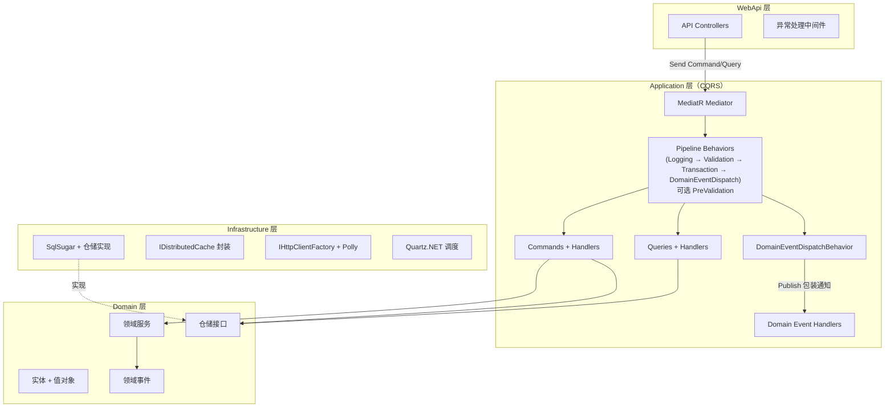
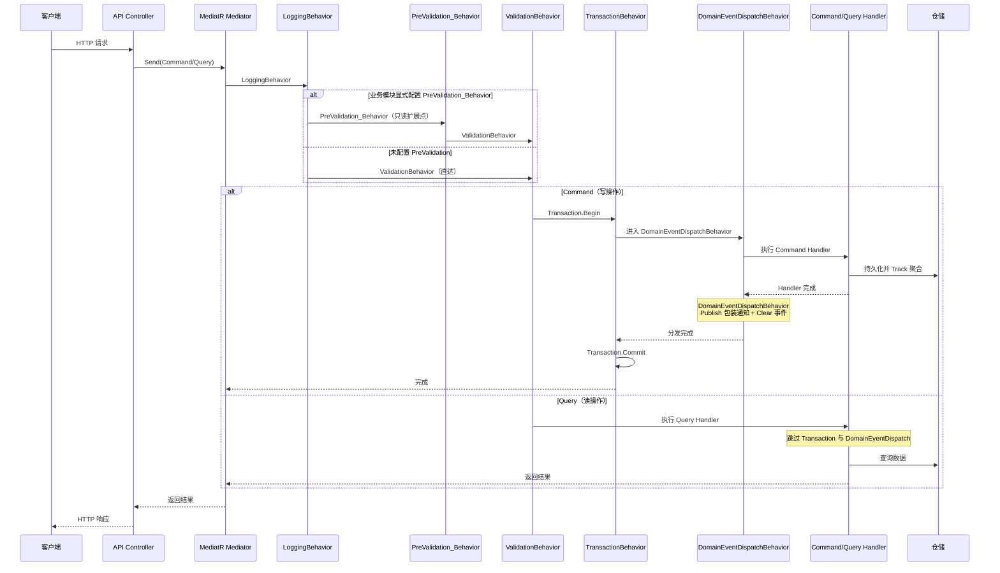

# 设计文档：.NET 10 原生框架搭建（替代 ABP）

## 概述

本设计文档描述以 .NET 10 原生技术栈替代 ABP 框架的基础架构搭建方案。目标是建立一套轻量的 DDD + CQRS 分层框架，供后续业务模块（如 115 网盘集成）在此基础上实现具体功能。

本文档不涉及任何具体业务逻辑，仅定义框架层面的技术选型、分层结构、基础设施约定和公共组件。

### 设计目标

- 搭建 DDD 四层架构（Domain / Application / Infrastructure / WebApi），职责清晰分离
- 引入 CQRS 模式，通过 MediatR 实现 Command/Query 逻辑分离（同一数据库实例）
- 引入领域事件机制，Domain 层收集纯领域事件，由 Application 层包装为 MediatR 通知后发布实现解耦
- 使用 SqlSugar CodeFirst 替代 EF Core，提供仓储基类与自动建表能力
- 使用 Quartz.NET 替代 ABP BackgroundJob，提供后台任务调度基础
- 使用原生 `IServiceCollection` 替代 ABP 模块系统
- 使用 `IDistributedCache` + JSON 封装替代 ABP `IDistributedCache<T>`
- 使用 FluentValidation 替代 DataAnnotation，集成 MediatR Pipeline
- 使用手动映射扩展方法替代 AutoMapper
- 使用 IHttpClientFactory + Polly 提供 HTTP 客户端韧性基础
- 使用 ASP.NET Core 中间件 + ProblemDetails 替代 ABP Exception Filter

### 关键设计决策

| 决策 | 选择 | 理由 |
|------|------|------|
| 框架 | .NET 10 原生（无 ABP） | 轻量化，减少框架依赖 |
| CQRS 分发 | 自定义 `ICommand` / `IQuery` + MediatR `IRequest<Result<T>>` | 统一 Result 模式、命名约定与 Pipeline 扩展点 |
| 领域事件 | Domain 纯领域事件 + Application 层 MediatR 通知包装 | 保持 Domain 零外部依赖，同时复用 CQRS 的 MediatR 分发基础设施 |
| ORM | SqlSugar CodeFirst | API 简洁，CodeFirst 自动建表，性能优秀 |
| 后台任务 | Quartz.NET | 支持持久化、集群、Cron 表达式 |
| 依赖注入 | Microsoft.Extensions.DependencyInjection | .NET 原生 DI |
| 缓存 | IDistributedCache | .NET 原生分布式缓存抽象 |
| 输入验证 | FluentValidation + MediatR Pipeline | 验证逻辑与 Handler 解耦，自动拦截 |
| 对象映射 | 手动映射扩展方法 | 避免反射开销，编译期可检查 |
| HTTP 客户端 | IHttpClientFactory + Polly | 连接池管理、重试、超时、熔断 |
| 异常处理 | ASP.NET Core 中间件 + ProblemDetails | 统一异常与 `Result.Failure` 的失败响应格式 |

### 技术栈对照表（ABP → .NET 10 原生）

| 能力 | 原 ABP 方案 | 新方案 |
|------|------------|--------|
| 框架基础 | ABP Framework | .NET 10 原生 |
| 模块系统 | ABP Module | `IServiceCollection` 扩展方法 |
| 应用服务调度 | ABP ApplicationService | `ICommand` / `IQuery` + `ICommandHandler` / `IQueryHandler`（Result 模式） |
| 领域事件 | ABP DomainEventBus | Domain 纯领域事件 + Application 层 MediatR 通知包装与 Handler |
| ORM | EF Core + ABP Repository | SqlSugar CodeFirst + 仓储基类 |
| 数据库迁移 | EF Core Migrations | 集中 CodeFirst 初始化入口调用 SqlSugar `InitTables` |
| 依赖注入 | ABP DI + 自动注册 | `Microsoft.Extensions.DependencyInjection` |
| 后台任务 | ABP BackgroundJob | Quartz.NET `IJob` + `IScheduler` |
| 分布式缓存 | ABP IDistributedCache<T> | `IDistributedCache` + JSON 封装 |
| 输入验证 | DataAnnotation / ABP Validation | FluentValidation + MediatR ValidationBehavior |
| 对象映射 | AutoMapper | 手动映射扩展方法 |
| 配置管理 | ABP Settings / IOptions | `IOptions<T>` + `IConfiguration` |
| 异常处理 | ABP Exception Filter | ASP.NET Core 中间件 + ProblemDetails |
| 审计日志 | ABP Auditing | 自定义中间件 + ILogger |
| 工作单元 | ABP UnitOfWork | SqlSugar 手动事务 / MediatR TransactionBehavior |

---

## 系统架构

### 整体结构

_覆盖需求: 1_

```
Server/src/
├── Domain/                          # 领域层
│   ├── Entities/                    # 实体基类与聚合根
│   ├── Enums/                       # 领域枚举
│   ├── Events/                      # 领域事件基类
│   ├── Exceptions/                  # 领域异常
│   ├── Repositories/                # 仓储接口
│   ├── Results/                     # Result / Error 等返回模型
│   └── Validators/                  # 领域校验器
├── Application/                     # 应用层
│   ├── Abstractions/                # 基础设施抽象接口
│   ├── Behaviors/                   # MediatR Pipeline Behaviors
│   ├── CloudDrive/                  # 业务模块实现
│   ├── Commands/                    # CQRS Command / Handler 基接口
│   ├── Mappings/                    # ToDto() / ToEntity() 映射扩展
│   └── Queries/                     # CQRS Query / Handler 基接口
├── Infrastructure/                  # 基础设施层
│   ├── Caching/                     # IDistributedCache 封装
│   ├── CloudDrive/                  # 业务模块基础设施实现
│   ├── DependencyInjection/         # 服务注册扩展方法
│   ├── Http/                        # IHttpClientFactory + Polly 配置
│   ├── Jobs/                        # Quartz.NET 配置与基础 Job
│   └── Persistence/                 # SqlSugar 配置、仓储实现
└── WebApi/                          # 表现层
    ├── Controllers/                 # API 控制器
    ├── Extensions/                  # 认证/用户上下文/响应扩展
    ├── Middleware/                   # 全局异常处理等中间件
    └── Program.cs                   # 应用入口与管道配置
```

### 分层依赖规则

_覆盖需求: 1_

- WebApi → Application → Domain
- Infrastructure → Domain（实现仓储接口）+ Application（实现基础设施抽象接口）
- WebApi → Infrastructure（注册依赖）
- Domain 层不依赖任何外层

### 架构图

_覆盖需求: 1, 2_



---

## 组件设计

> 原「CQRS 架构」与「基础设施组件」合并为本节「组件设计」，满足 `spec-format.md` 章节名要求。

### Command/Query 分离

_覆盖需求: 2_

所有应用层操作通过 MediatR 分发，按职责分为 Command（写操作）和 Query（读操作）：

- Command 使用 `ICommand` / `ICommand<TResponse>`，底层实现 `IRequest<Result>` / `IRequest<Result<TResponse>>`
- Query 使用 `IQuery<TResponse>`，底层实现 `IRequest<Result<TResponse>>`
- Controller 仅负责接收 HTTP 请求、构造 Command/Query 对象、调用 `ISender.Send()`（或 `IMediator.Send()`）、返回结果
- Command Handler 实现 `ICommandHandler<...>` 接口，可调用领域服务、仓储，执行业务逻辑并触发领域事件
- Query Handler 实现 `IQueryHandler<..., ...>` 接口，仅依赖仓储、应用层服务或 Infrastructure 提供的查询抽象，不直接依赖 `ISqlSugarClient`
- WebApi 适配层对 `Result.Failure(...)` 执行集中映射，统一输出非 2xx 的 `ProblemDetails`，不得以 HTTP 200 表示失败

### MediatR Pipeline Behaviors

_覆盖需求: 3_

按执行顺序注册以下 Pipeline Behavior：

1. `LoggingBehavior` — 记录请求/响应日志，脱敏敏感字段
2. _（业务模块扩展点）_ — 业务模块可通过 `AddApplicationServices(..., preValidationBehaviors: [...])` 显式插入请求上下文解析等 PreValidation_Behavior，通过 `is not TMarkerInterface` 守卫跳过不相关请求，不得执行写操作或发布领域事件；未传入扩展点时默认 Pipeline 仅包含四段通用 Behavior
3. `ValidationBehavior` — 自动执行 FluentValidation，校验失败抛出 `ValidationException`
4. `TransactionBehavior` — 仅对 Command 开启 SqlSugar 事务，Query 跳过
5. `DomainEventDispatchBehavior` — 仅对 Command，在 Handler 执行后、事务提交前，遍历被追踪实体的纯领域事件，将其包装为 MediatR 通知后通过 `IMediator.Publish()` 或 `IPublisher.Publish()` 发布，然后清空事件集合
> 说明：`DomainEventDispatchBehavior` 依赖应用层抽象 `IDomainEventSource` 获取当前请求中被仓储持久化的聚合；Domain 层事件类型不实现 MediatR `INotification`；普通 Command Handler 不应手动调用 `IMediator.Publish()` 分发实体领域事件。

### 领域事件

_覆盖需求: 4_

- 聚合根在领域方法中收集纯领域事件（`RaiseDomainEvent()`），领域事件类型不引用 MediatR
- 领域事件的发布由 `DomainEventDispatchBehavior`（MediatR Pipeline Behavior）自动完成：在 TransactionBehavior 提交事务前，遍历所有被 `IDomainEventSource.Track(entity)` 追踪的实体收集的领域事件，包装为 Application 层 MediatR 通知后通过 `IMediator.Publish()` 或 `IPublisher.Publish()` 逐一发布，然后清空事件集合；Handler 无需手动调用 Publish
- 事件处理器实现 `INotificationHandler<DomainEventNotification<TDomainEvent>>` 或等效通知包装 Handler，处理跨聚合副作用（如缓存失效、发送通知等）
- 领域事件在同一事务内同步处理；如需异步处理，由事件处理器内部决定是否转为后台任务

---

### 1. SqlSugar 配置与仓储

_覆盖需求: 5_

- 使用 `ISqlSugarClient` 注册为 Scoped，每个请求一个实例
- `IsAutoCloseConnection = true` 自动管理连接池
- `InitKeyType = Attribute` 通过实体特性标注主键与字段
- 应用启动时通过集中 CodeFirst 初始化入口（如 `SqlSugarSetup.InitTables(ISqlSugarClient, params Type[] entityTypes)` 或等效机制）调用 SqlSugar `InitTables` 自动建表
- 提供泛型仓储基类 `Repository<TEntity, TId> where TEntity : AggregateRoot<TId>`，封装 `GetByIdAsync`、`GetListAsync`、`InsertAsync`、`UpdateAsync`、`DeleteAsync` 等常用异步 CRUD 操作（仓储仅持久化聚合根）
- 仓储在 `InsertAsync`/`UpdateAsync` 等持久化操作成功后调用 `IDomainEventSource.Track(entity)` 追踪聚合，供 `DomainEventDispatchBehavior` 在事务边界内统一分发领域事件
- 业务模块如需复杂查询，应由 Infrastructure 提供查询实现或应用层服务依赖的抽象接口，Application 层不直接注入 `ISqlSugarClient`

### 2. Quartz.NET 调度

_覆盖需求: 6_

- 使用 `AddQuartz()` + `AddQuartzHostedService()` 注册
- 使用 Quartz.Extensions.DependencyInjection 默认启用的 Microsoft DI JobFactory 或等效机制，确保每个 Job 可通过 DI 在独立 Scope 中解析依赖
- Job 通过 `JobDataMap` 传递 `JobId`，从数据库加载业务载荷
- 首期使用内存 JobStore；生产环境推荐配置 AdoJobStore 持久化
- `JobDataMap` 仅携带最小调度标识（如 `JobId`）；具体业务载荷与恢复检查点由 Job 通过持久化存储加载
- Quartz Job 不经过 MediatR Pipeline；若需要事务、领域事件发布或恢复检查点处理，必须在 Job 内显式处理
- 业务模块实现具体 `IJob`，框架层仅提供调度基础

### 3. IDistributedCache 封装

_覆盖需求: 7_

- 提供 `DistributedCacheExtensions` 封装 JSON 序列化/反序列化
- 封装 `GetOrSetAsync<T>()` 方法：缓存命中直接返回，未命中调用 factory 并写入
- 写入缓存时仅应用调用方显式传入的 TTL；调用方未提供 TTL 时不隐式设置过期时间，默认 TTL 由业务缓存封装自行决定
- 开发环境使用 `AddDistributedMemoryCache()`；生产环境可按部署需要另行引入 Redis 等 `IDistributedCache` 提供程序
- 业务模块应通过 Application 层抽象封装缓存访问，避免在 Application 层直接依赖 `IDistributedCache`

### 4. FluentValidation + MediatR 集成

_覆盖需求: 8_

- 通过 `AddValidatorsFromAssembly()` 自动注册验证器
- `ValidationBehavior<TRequest, TResponse>` 作为 MediatR Pipeline，在 Handler 执行前自动校验；仅依赖构造函数注入的 `IEnumerable<IValidator<TRequest>>`，不使用 `IServiceProvider` 或运行时反射
- 校验失败抛出 `ValidationException`，由全局异常中间件统一映射为 400 ProblemDetails
- 对于携带 `Input` 属性的 Command/Query（如 `CreateFolderCommand(Guid UserId, CreateFolderInput Input)`），通过 `IHasInput<TInput>` 标记接口 + `InputPropertyValidator<TRequest, TInput>` 桥接适配器将 `IValidator<TInput>` 自动适配为 `IValidator<TRequest>`；`ValidationSetup.AddValidators()` 在扫描验证器后自动调用私有注册逻辑完成适配器注册，无需 `ValidationBehavior` 运行时解析或依赖 `IServiceProvider`

### 5. IHttpClientFactory + Polly

_覆盖需求: 9_

- 通过 Named HttpClient 注册不同用途的 HTTP 客户端
- Polly 策略按幂等边界区分：读请求可重试，写请求仅超时+熔断
- 读请求韧性策略为最多 3 次瞬时错误重试、指数退避基准 1 秒并启用 jitter、10 秒超时、采样窗口 30 秒内失败率 100% 且至少 5 次请求时熔断 30 秒
- 写请求韧性策略为 10 秒超时 + 同等熔断配置，不配置自动重试
- 业务模块在此基础上定义具体的 API Gateway 接口与实现
- 基础 HTTP 层应支持 query string、`application/x-www-form-urlencoded`、`multipart/form-data` 与 JSON 四类请求构造能力

### 6. 全局异常处理中间件

_覆盖需求: 10_

- 捕获所有未处理异常，映射为 `application/problem+json` 格式
- 业务异常映射为对应 HTTP 状态码（400/401/404/429/502/503 等）
- 未知异常映射为 500
- `ValidationException` 映射为 400 并包含字段级错误详情
- WebApi 适配层需将 `Result.Failure(...)` 或等效失败结果统一映射为非 2xx 的 `ProblemDetails` 响应

**ProblemDetails 最小外壳契约**

所有错误响应（异常中间件与 `Result.Failure(...)` 适配层）SHALL 包含 RFC 7807 标准字段：

| 字段 | 说明 |
|------|------|
| `type` | 问题类型 URI（可为相对路径或 `about:blank`） |
| `title` | 人类可读摘要 |
| `status` | HTTP 状态码 |
| `detail` | 具体错误说明 |
| `instance` | 当前请求路径或关联标识 |

业务失败时 `ProblemDetails.Extensions` SHALL 至少提供稳定业务码槽位；`upstream*` 为可选透传字段。

**线格式 oracle（ASP.NET Core）**：`ProblemDetails.Extensions` 序列化为 JSON **根级兄弟字段**（与 `type/title/status/detail/instance` 同级），不是嵌套的 `"extensions": { ... }` 对象。文档中的 `extensions.code` / `extensions.upstreamCode` 指 .NET 属性槽位名 `Extensions["code"]` 等，对应线上 JSON 的根级 `"code"` / `"upstreamCode"`。

**码值命名权威**：稳定业务码的**命名与闭集由业务模块（integration 应用业务错误码表）拥有**；本框架示例仅为槽位占位，禁止把点分 Pascal 示例当作跨模块规范码。

线格式示例（业务失败；码值为占位 snake_case）：

```json
{
  "type": "https://tools.ietf.org/html/rfc7807",
  "title": "Resource not found",
  "status": 404,
  "detail": "Folder not found.",
  "instance": "/api/v1/folders/abc",
  "code": "cloud_drive_folder_not_found",
  "upstreamCode": "23001",
  "upstreamMessage": "folder not exist"
}
```

- `extensions.code`（必填槽位 → JSON 根级 `code`）：稳定应用业务码，供客户端分支处理
- `extensions.upstreamCode` / `extensions.upstreamMessage`（可选 → JSON 根级）：上游 API 原始错误透传
- `ValidationException` 路径：在标准字段与 `code` 之外，继续使用根级 `errors` 对象字典（`Record<string, string[]>` / ASP.NET `ValidationProblemDetails.Errors` 形态）承载字段级详情，二者可并存；不得将 `errors` 描述为无键数组

示例（校验失败）：

```json
{
  "type": "https://tools.ietf.org/html/rfc7807",
  "title": "One or more validation errors occurred.",
  "status": 400,
  "detail": "Validation failed.",
  "instance": "/api/v1/folders",
  "errors": {
    "Name": ["Name is required."]
  },
  "code": "validation_failed"
}
```

### 7. 手动对象映射

_覆盖需求: 11_

- 使用静态扩展方法 `ToDto()` / `ToEntity()` 进行映射
- 编译期可检查，无反射开销
- 业务模块按需定义各自的映射扩展方法

### 8. WebApi 启动与认证

_覆盖需求: 12_

- `Program.cs` 通过 `AddApplicationServices()`、`AddSqlSugar()`、`AddRepositories()`、`AddCaching()`、`AddQuartzJobs()`、`AddSecretsProtection()`、业务模块扩展方法与 `AddJwtAuthentication()` 等扩展方法集中完成服务注册
- 全局异常中间件 `UseExceptionHandling()` 最先注册，开发环境再启用 `MapOpenApi()`
- 需要用户上下文的 API 应启用 `UseAuthentication()` / `UseAuthorization()`，并由受保护端点显式声明认证要求
- 若业务模块需要持久化保护 Cookie 密文、签名密钥等平台机密值，基础设施应支持基于 ASP.NET Core Data Protection 的 Protect / Unprotect，并保证 key ring 可持久化复用（本平台不以 OAuth AccessToken / RefreshToken / AppSecret 为机密保护基线示例）

---

## 时序图

### 请求处理流程

_覆盖需求: 2, 3_




## 数据模型

_覆盖需求: 1, 2, 4, 5, 7, 8, 10, 11, 12_

本框架层 spec 的数据模型以基础类型、接口和约定为主，具体业务实体由后续业务 spec 定义。

- Domain 层定义 `Entity<TId>` / `AggregateRoot<TId>` 基类；普通实体仅提供标识，聚合根实现 `IEntity`，通过受保护的 `RaiseDomainEvent()` 收集纯领域事件，并经 `IEntity.DomainEvents` 只读集合与 `ClearDomainEvents()` 暴露给应用层管道
- Domain 层定义 `DomainEvent` 抽象基类；Application 层通过 `DomainEventNotification<TDomainEvent>` 将纯领域事件包装为 MediatR 通知
- Domain 层定义 `Result` / `Result<T>` / `Error` 作为 Handler 统一返回模型
- Domain 层定义 `IRepository<TEntity, TId> where TEntity : AggregateRoot<TId>` 仓储接口；Infrastructure 层通过 `Repository<TEntity, TId> where TEntity : AggregateRoot<TId>` 基类实现 `GetByIdAsync` / `GetListAsync` / `InsertAsync` / `UpdateAsync` / `DeleteAsync` 等常用异步 CRUD
- Application 层定义 `ICommand` / `ICommand<TResponse>` / `IQuery<TResponse>` 以及对应 Handler 接口，统一接入 MediatR Pipeline
- Application 层定义 `ITransactionManager`（`BeginAsync` / `CommitAsync` / `RollbackAsync` 或等效方法），由 Infrastructure 基于 SqlSugar 实现，供 `TransactionBehavior` 管理 Command 事务边界
- Application 层定义 `IDomainEventSource`（`Track(entity)` / `GetTrackedEntities()` 或等效方法），由 Infrastructure 以 Scoped 实现，供仓储持久化后追踪聚合、供 `DomainEventDispatchBehavior` 统一分发领域事件
- Infrastructure 层定义 `DistributedCacheExtensions`、`SqlSugarSetup`、`QuartzSetup`、`HttpClientSetup`、`ValidationSetup`、`SecretsSetup` 等基础设施扩展点

## 错误处理

_覆盖需求: 8, 10_

- `ValidationBehavior` 在 Handler 执行前抛出 `ValidationException`，由 `ExceptionHandlingMiddleware` 映射为 HTTP 400 + 字段级错误详情（`errors`），可与 `extensions.code` 并存
- 业务异常由 `ExceptionHandlingMiddleware` 按异常类型映射为 400/401/404/429/502/503 等状态码，并在 `extensions.code` 提供稳定业务码槽位
- 未知异常统一映射为 HTTP 500；生产环境隐藏内部异常详情，仅写入日志
- 所有 ProblemDetails 响应 SHALL 包含 RFC 7807 标准字段 `type`、`title`、`status`、`detail` 与 `instance`
- `Result.Failure(...)` 由 WebApi 适配层转换为非 2xx `ProblemDetails` 响应，不允许以 HTTP 200 表示失败

## 测试策略

_覆盖需求: 1, 2, 3, 4, 5, 6, 7, 8, 9, 10, 11, 12_

- Domain 层使用属性测试验证聚合根领域事件收集、清空与领域基类行为
- Application 层使用属性测试验证 LoggingBehavior、ValidationBehavior、TransactionBehavior；使用场景测试（Fact）或属性测试验证 DomainEventDispatchBehavior（Property 19：包装发布、清空事件、Query 跳过）
- Architecture.Tests 验证分层依赖、Controller 只通过 `ISender`/`IMediator` 分发、Query Handler 无副作用、Pipeline 默认顺序与业务 PreValidation_Behavior 插入顺序
- Infrastructure 层使用属性测试验证 Repository CRUD 往返、缓存序列化往返、显式 TTL 行为、Quartz 注册与 JobDataMap 最小载荷约定、HTTP 请求构造约定与读写韧性策略差异
- Infrastructure 层使用 DI 测试验证 `IHasInput<TInput>` 请求会通过 `InputPropertyValidator<TRequest, TInput>` 获得输入 DTO 验证器适配
- WebApi 层使用属性测试验证异常状态码映射、日志记录与 `Result.Failure(...)` 到 `ProblemDetails` 的非 2xx 映射
- 检查点任务要求记录具体构建与测试命令，确保增量变更可验证

## 依赖

| 依赖 | 用途 |
|------|------|
| .NET 10 | 运行时框架 |
| MediatR | CQRS Command/Query 分发 + 领域事件 |
| SqlSugarCore | ORM + CodeFirst |
| Quartz.NET | 后台任务调度 |
| Quartz.Extensions.DependencyInjection | Quartz DI 集成 |
| Quartz.Extensions.Hosting | Quartz HostedService |
| FluentValidation | 输入验证规则 |
| FluentValidation.DependencyInjectionExtensions | 验证器自动注册 |
| Microsoft.Extensions.Caching.Abstractions | 分布式缓存抽象 |
| Microsoft.Extensions.Caching.Memory | 开发环境内存缓存实现 |
| Microsoft.Extensions.Http.Resilience | HTTP 韧性管道集成 |
| Polly | 重试、超时、熔断策略 |
| Microsoft.AspNetCore.OpenApi | 开发环境 OpenAPI 文档 |
| System.Text.Json | JSON 序列化（内置） |
| ASP.NET Core Data Protection | 机密值保护与 key ring 管理 |

---

## Correctness Properties

*属性（Property）是指在系统所有合法执行中都应成立的特征或行为——本质上是对系统应做什么的形式化陈述。属性是人类可读规格说明与机器可验证正确性保证之间的桥梁。*

### Property 1: ValidationBehavior 拦截无效输入并返回完整错误

*For any* MediatR 请求，若该请求存在已注册的 FluentValidation 验证器且输入不满足验证规则，则 ValidationBehavior 应抛出 `ValidationException`，且异常中应包含所有验证失败的字段级错误信息，Handler 不应被执行。

**Validates: Requirements 3.2, 3.3, 8.2, 8.3**
_覆盖需求: 3.2, 3.3, 8.2, 8.3_

### Property 2: ValidationBehavior 对无验证器的请求直接放行

*For any* MediatR 请求，若该请求没有对应的 FluentValidation 验证器，则 ValidationBehavior 应直接将请求传递给下一个管道，不抛出异常。

**Validates: Requirement 8.4**
_覆盖需求: 8.4_

### Property 3: TransactionBehavior 按请求类型决定事务行为

*For any* MediatR 请求，若请求为 Command 类型则 TransactionBehavior 应开启 SqlSugar 事务，若请求为 Query 类型则 TransactionBehavior 应跳过事务管理直接执行后续管道。

**Validates: Requirements 3.4, 3.5**
_覆盖需求: 3.4, 3.5_

### Property 4: TransactionBehavior 成功提交与异常回滚

*For any* Command 请求，若 Handler 执行成功则事务应被提交；若 Handler 抛出异常则事务应被回滚且异常应被重新抛出。

**Validates: Requirements 3.6, 3.7**
_覆盖需求: 3.6, 3.7_

### Property 5: LoggingBehavior 记录请求类型与耗时

*For any* MediatR 请求，经过 LoggingBehavior 处理后应产生日志记录，包含请求类型名称和响应耗时信息。

**Validates: Requirement 3.1**
_覆盖需求: 3.1_

### Property 6: 聚合根领域事件收集

*For any* 聚合根实例和任意领域事件，经聚合根领域方法调用 `RaiseDomainEvent()` 后该事件应出现在聚合根的领域事件集合中，且事件集合的长度应增加 1。

**Validates: Requirement 4.2**
_覆盖需求: 4.2_

### Property 7: Repository CRUD 往返一致性

*For any* 有效聚合根，通过 `Repository<TEntity, TId> where TEntity : AggregateRoot<TId>` 执行 `InsertAsync` 后再通过 `GetByIdAsync` 查询，应返回与原始实体等价的对象。

**Validates: Requirement 5.5**
_覆盖需求: 5.5_

### Property 8: 缓存序列化往返一致性

*For any* 可序列化的对象，通过 `SetAsync<T>()` 写入缓存后再通过 `GetAsync<T>()` 读取，应返回与原始对象等价的结果。

**Validates: Requirement 7.1**
_覆盖需求: 7.1_

### Property 9: GetOrSetAsync 缓存命中与未命中行为

*For any* 缓存键，首次调用 `GetOrSetAsync<T>()` 时 factory 委托应被调用一次并返回其结果；对同一键再次调用时 factory 委托不应被调用，应直接返回缓存中的值。

**Validates: Requirement 7.2**
_覆盖需求: 7.2_

### Property 10: 异常中间件状态码映射

*For any* 异常或失败结果，Exception_Middleware / WebApi 适配层应返回 `application/problem+json` 格式的响应，且根据异常类型或失败结果映射为正确的 HTTP 状态码：`ValidationException` → 400（含字段级错误详情 `errors: Record<string, string[]>`），业务异常 → 对应状态码，未知异常 → 500（隐藏内部详情），`Result.Failure(...)` → 非 2xx ProblemDetails。响应体 SHALL 包含 RFC 7807 标准字段 `type`、`title`、`status`、`detail` 与 `instance`；业务失败时 `extensions.code` 槽位（JSON 根级 `code`）SHALL 存在且为非空字符串，业务模块 MAY 追加 `upstreamCode` / `upstreamMessage`；`ValidationException` 路径 SHALL 同时包含根级 `errors` 对象字典，且允许与 `code` 并存。

**Validates: Requirements 10.1, 10.2, 10.3, 10.4, 10.6, 10.7, 10.8, 10.9**
_覆盖需求: 10.1, 10.2, 10.3, 10.4, 10.6, 10.7, 10.8, 10.9_

### Property 11: 异常中间件日志记录

*For any* 异常，Exception_Middleware 处理后应产生日志记录，包含请求路径、异常类型和异常消息。

**Validates: Requirement 10.5**
_覆盖需求: 10.5_

### Property 12: Pipeline Behavior 注册顺序

*For any* Application 服务注册，未配置业务扩展点时 Pipeline Behavior 顺序应为 LoggingBehavior → ValidationBehavior → TransactionBehavior → DomainEventDispatchBehavior；当业务模块显式配置 PreValidation_Behavior 时，该行为应插入 LoggingBehavior 与 ValidationBehavior 之间，后续顺序保持不变。

**Validates: Requirements 3.8, 12.4, 12.5**
_覆盖需求: 3.8, 12.4, 12.5_

### Property 13: Controller 仅通过 CQRS 分发请求

*For any* WebApi Controller，受理 HTTP 请求时应构造 Command 或 Query 并通过 `ISender.Send()` 或 `IMediator.Send()` 分发，不应直接注入仓储、ORM 客户端或基础设施实现类型。

**Validates: Requirement 2.3**
_覆盖需求: 2.3_

### Property 14: Query Handler 无副作用

*For any* Query Handler，处理请求时不应执行 `InsertAsync`/`UpdateAsync`/`DeleteAsync` 等写操作，不应调用 `IMediator.Publish()` / `IPublisher.Publish()` 发布领域事件。

**Validates: Requirement 2.5**
_覆盖需求: 2.5_

### Property 15: 输入 DTO 验证器适配

*For any* 实现 `IHasInput<TInput>` 的 Command 或 Query，若 DI 容器中存在 `IValidator<TInput>`，则 `ValidationSetup.AddValidators()` 应注册请求级 `IValidator<TRequest>` 适配器，使 ValidationBehavior 能在 Handler 前校验 `Input` 属性。

**Validates: Requirement 8.5**
_覆盖需求: 8.5_

### Property 16: HTTP 读写韧性策略边界

*For any* 通过基础 HTTP 注册入口创建的读请求客户端，瞬时错误应按读请求策略重试；*for any* 写请求客户端，不应自动重试非幂等请求，但应保留相同的超时与熔断边界。

**Validates: Requirements 9.2, 9.3**
_覆盖需求: 9.2, 9.3_

### Property 17: 缓存写入仅应用显式 TTL

*For any* 缓存写入操作，若调用方提供 TTL，则缓存项应使用该相对过期时间；若调用方未提供 TTL，则 Cache_Extensions 不应自行写入默认过期时间。

**Validates: Requirement 7.3**
_覆盖需求: 7.3_

### Property 18: Quartz 调度注册与 Job 执行边界

*For any* 基础设施服务注册，Quartz 调度入口应注册 Quartz 核心服务、HostedService 与业务 Job；*for any* Quartz Job 执行，`JobDataMap` 应仅携带 `JobId` 等最小调度标识，Job 不应假设 MediatR Pipeline Behavior 自动生效，需要事务、领域事件发布或恢复检查点时应显式处理。

**Validates: Requirements 6.1, 6.2, 6.3, 6.4, 6.5, 6.6**
_覆盖需求: 6.1, 6.2, 6.3, 6.4, 6.5, 6.6_

### Property 19: DomainEventDispatchBehavior 发布、清空与 Query 跳过

*For any* Command 请求，若 `IDomainEventSource` 已追踪带领域事件的聚合（经 `IEntity.DomainEvents` 暴露），则 `DomainEventDispatchBehavior` 应在 Handler 完成后、事务提交前将这些纯领域事件包装为 MediatR 通知后通过 `IMediator.Publish()` 或 `IPublisher.Publish()` 发布，并调用 `ClearDomainEvents()` 清空事件集合；*for any* Query 请求，`DomainEventDispatchBehavior` 应跳过事件分发与清空。

**Validates: Requirements 4.3, 4.5, 4.6**
_覆盖需求: 4.3, 4.5, 4.6_

---

## 需求↔设计覆盖矩阵

| 需求 | 覆盖设计组件 |
|------|------------|
| 需求 1 | §整体结构, §分层依赖规则, §架构图, §数据模型, §测试策略 |
| 需求 2 | §Command/Query 分离, §请求处理流程, §架构图, §数据模型, §测试策略, Property 13, 14 |
| 需求 3 | §MediatR Pipeline Behaviors, §请求处理流程, §测试策略, Property 1, 3, 4, 5, 12 |
| 需求 4 | §领域事件, §数据模型, §测试策略, Property 6, 19 |
| 需求 5 | §1. SqlSugar 配置与仓储, §数据模型, §测试策略, Property 7 |
| 需求 6 | §2. Quartz.NET 调度, §测试策略, Property 18 |
| 需求 7 | §3. IDistributedCache 封装, §数据模型, §测试策略, Property 8, 9, 17 |
| 需求 8 | §4. FluentValidation + MediatR 集成, §数据模型, §错误处理, §测试策略, Property 1, 2, 15 |
| 需求 9 | §5. IHttpClientFactory + Polly, §测试策略, Property 16 |
| 需求 10 | §6. 全局异常处理中间件, §数据模型, §错误处理, §测试策略, Property 10, 11 |
| 需求 11 | §7. 手动对象映射, §数据模型, §测试策略 |
| 需求 12 | §8. WebApi 启动与认证, §数据模型, §测试策略, Property 12 |
