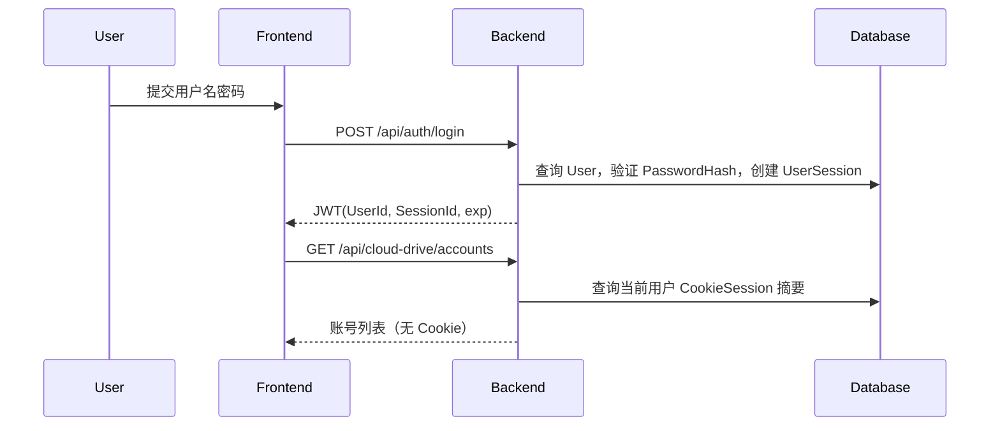

# 设计文档：个人认证与多 115 账号

## 概述

新增 User/UserSession 领域聚合，复用 CookieSession 作为用户-115账号绑定凭据聚合；Application 以 CQRS Handler 编排注册、登录、会话生命周期及账号绑定，Infrastructure 使用 SqlSugar CodeFirst 和 PBKDF2/Data Protection，WebApi 只通过 ISender 进入用例并在边界签发 JWT。

## 系统架构

`WebApi Controller -> MediatR -> Application Handler -> Domain Repository -> Infrastructure(SqlSugar/DataProtection)`。
JWT 仅包含 `sub`、`NameIdentifier`、`sid`、`jti`、`iat/exp`；115 Cookie 永不进入 JWT 或前端响应。

## 组件设计

## §User/UserSession
- **User/UserSession**：User 保存用户名与密码哈希；UserSession 保存会话级当前账号与会话撤销/过期状态。_覆盖需求: 1.1, 1.2, 1.3, 2.3, 4.1_
## §PersonalAuthHandlers
- **PersonalAuthHandlers**：实现注册、登录、注销、刷新、当前用户查询。_覆盖需求: 1.1, 1.2, 1.3, 3.1_
## §CookieSessionManager + AccountContextResolver
- **CookieSessionManager + AccountContextResolver**：绑定 Cookie 密文、账号摘要和当前账号解析。_覆盖需求: 2.1, 2.2, 2.3_
## §AuthController / CloudDriveAccountsController
- **AuthController / CloudDriveAccountsController**：公开认证与账号 API。_覆盖需求: 3.1, 3.2, 3.3_
## §Pbkdf2PasswordHasher / SqlSugar 映射
- **Pbkdf2PasswordHasher / SqlSugar 映射**：跨关系数据库的密码和表映射。_覆盖需求: 1.1, 4.1_

## §数据模型与接口

## 关键时序

## 数据模型与接口

| 表 | 关键字段 | 说明 |
|---|---|---|
| `users` | `id,user_name,password_hash` | 个人用户 |
| `user_sessions` | `id,user_id,active_cloud_account_uid,expires_at,revoked_at` | JWT 会话生命周期与当前账号 |
| `cloud_drive_cookie_sessions` | `user_id,cloud_account_uid,encrypted_cookie_payload` | 用户-账号绑定及加密凭据 |

认证响应返回 `accessToken/tokenType/expiresAt/userId`；账号 API 返回账号 UID、状态和时间字段，不返回 Cookie。

## 错误处理

密码错误/会话失效映射 401，重复用户名映射 409，账号不存在映射 404，多账号未选择当前账号返回稳定业务码 `cloud_drive_account_context_ambiguous`。

## 测试策略

## §测试策略

覆盖密码哈希不可逆与验证、注册/登录/注销/刷新 Handler、JWT 不含 Cookie/Role、账号绑定密文与摘要脱敏、当前账号解析，以及 WebApi 401/409/404 契约；前端覆盖 token 拦截器、登录注册状态和账号切换。
