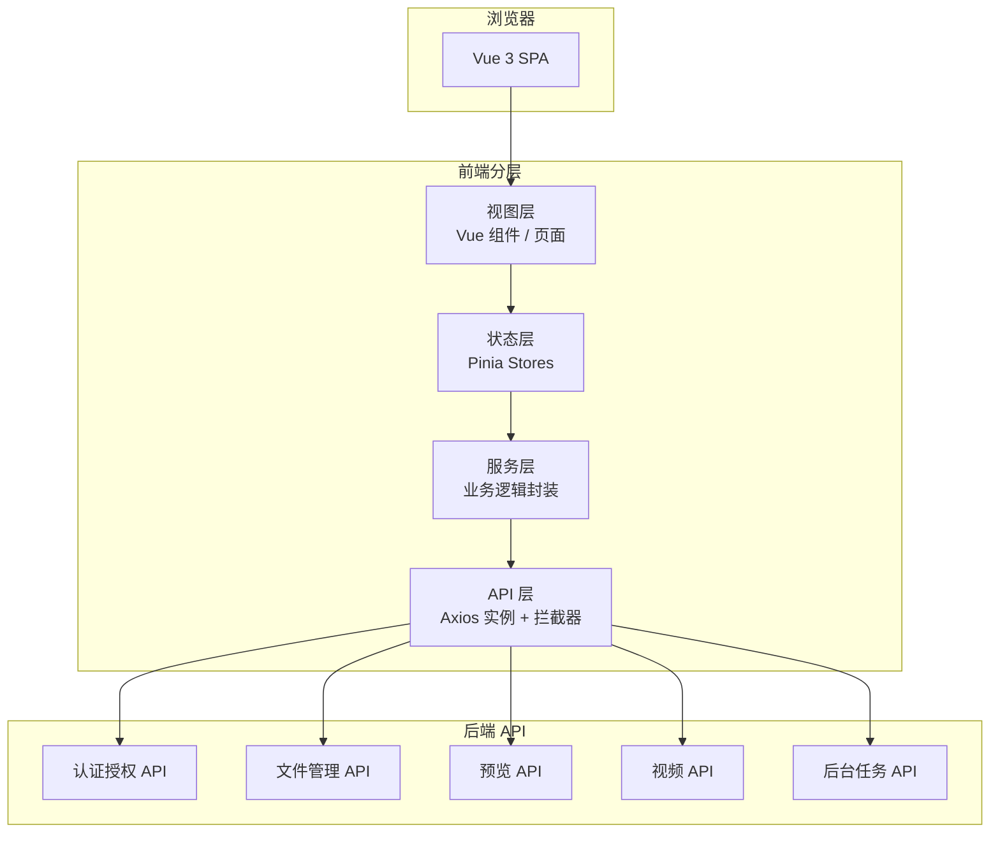
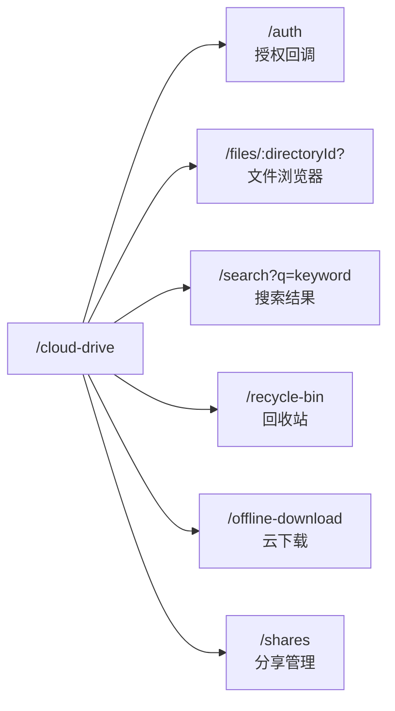
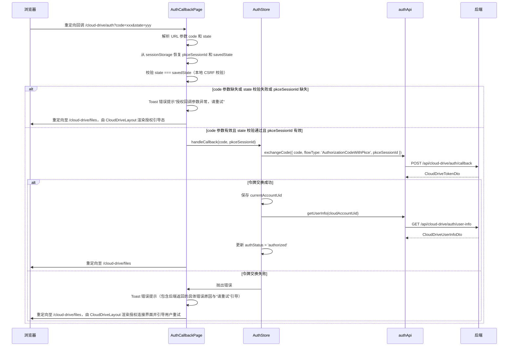
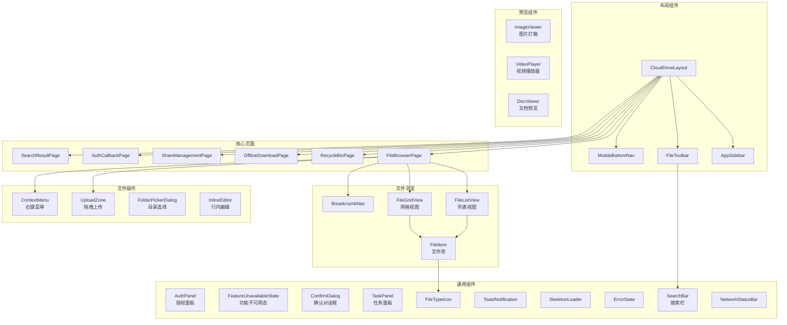
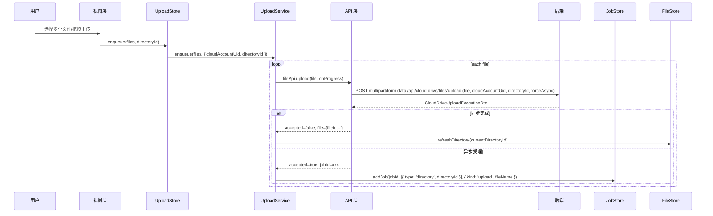
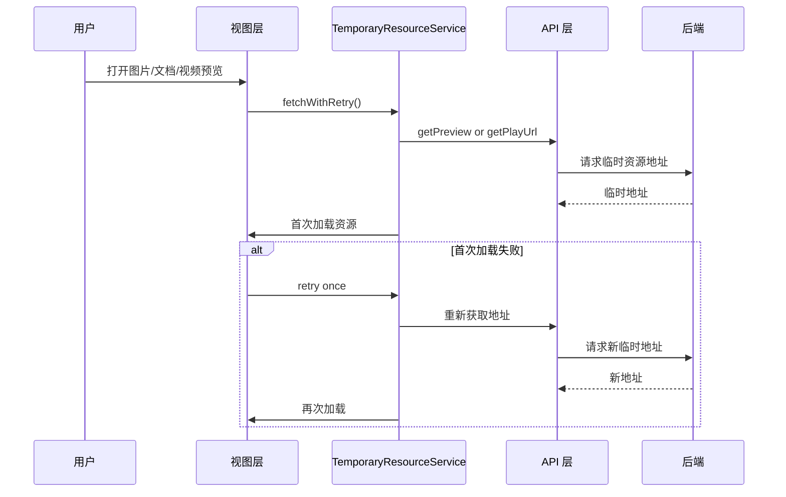

# 设计文档：115 网盘前端展示

## 概述

本设计文档描述 115 网盘前端展示层的技术架构与实现方案。系统基于 Vue 3 + TypeScript 构建 SPA 应用，采用 Naive UI 组件库（暗色主题）+ Tailwind CSS 实现 Glassmorphism 视觉风格，通过 Axios 消费后端 RESTful API，提供文件浏览、上传下载、预览播放、后台任务管理等完整的网盘前端交互能力。

### 设计目标

- 前后端分离 SPA 架构，前端仅通过后端 API 访问 115 网盘能力，不直接调用 115 开放平台
- 暗色主题 + Glassmorphism 毛玻璃效果，提供沉浸式视觉体验
- 响应式布局，适配桌面端、平板端、移动端三种断点
- 统一处理同步/异步操作结果（`Accepted` + `JobId` 双态模型）
- 临时资源地址过期自动重试机制
- 显式 `CloudAccountUid` 上下文，不隐式推断默认账号

### 关键设计决策

| 决策 | 选择 | 理由 |
|------|------|------|
| 框架 | Vue 3 + TypeScript + Vite | 组合式 API 适合复杂状态管理，TypeScript 提供类型安全 |
| 组件库 | Naive UI | 原生暗色主题支持、右键菜单开箱即用、图片画廊内置 |
| 状态管理 | Pinia | Vue 3 官方推荐，TypeScript 友好，支持模块化 Store |
| CSS 方案 | Tailwind CSS + CSS 变量（Vite 项目优先 `@tailwindcss/vite`） | 辅助 Glassmorphism 效果实现，响应式断点便捷 |
| HTTP 客户端 | Axios + AbortController | 拦截器机制便于统一错误处理、请求取消与令牌失效处理；`CloudAccountUid` 由各 API 方法按后端契约显式组装到 query、form-data 或 body |
| 视频播放 | Video.js（默认 VHS/HLS） | 提供完整播放器 UI，优先复用内置 VHS/HLS 能力；仅在播放器封装或兼容性场景确有需要时再补充 `hls.js` |
| PDF 预览 | PDF.js | 成熟的 PDF 渲染方案，支持页码导航与缩放；在 Vite 中需显式配置 worker 资源（如 Vite `new URL(..., import.meta.url)` 或等效方案），避免回退为 fake worker。 |
| 图标 | Lucide Icons | 现代线性图标风格，Tree-shakable |
| 路由 | Vue Router | SPA 路由管理，支持导航守卫实现授权检查 |

### 前置约束

- 前端不直接调用 115 开放平台 API，所有数据交互通过后端 API
- 所有临时资源地址（下载、预览、播放）可能过期，需要重试机制
- 所有授权后请求必须显式携带 `CloudAccountUid`
- 后端操作可能返回同步结果或异步任务受理（`Accepted` + `JobId`），前端需统一处理
- 请求取消与过期处理统一基于 `AbortController` / `AbortSignal`
- 缩略图与视频列表预览仅使用后端返回的缩略图或其他明确用于列表预览的字段；列表预览必须采用懒加载与视口优先策略，不得主动预取完整原图或原视频资源
- 视频清晰度、字幕、转码状态以后端实际返回为准

---

## 架构

### 系统架构图



### 前端分层架构

#### 项目目录结构

```
src/
├── api/                          # API 层 - Axios 实例与接口封装
│   ├── http.ts                   # Axios 实例、拦截器、错误映射
│   ├── authApi.ts                # 认证授权 API
│   ├── fileApi.ts                # 文件管理 API
│   ├── previewApi.ts             # 预览 API
│   ├── videoApi.ts               # 视频 API
│   ├── jobApi.ts                 # 后台任务 API
│   ├── offlineApi.ts             # 云下载 API
│   └── shareApi.ts               # 分享管理 API
├── stores/                       # 状态层 - Pinia Stores
│   ├── authStore.ts
│   ├── fileStore.ts
│   ├── searchStore.ts
│   ├── recycleBinStore.ts
│   ├── uploadStore.ts
│   ├── jobStore.ts
│   ├── offlineStore.ts
│   ├── shareStore.ts
│   └── uiStore.ts
├── services/                     # 服务层 - 业务逻辑封装
│   ├── operationService.ts       # 操作结果双态统一处理
│   ├── temporaryResourceService.ts # 临时资源过期重试
│   ├── fileNameValidator.ts      # 文件名前端校验
│   ├── clipboardService.ts       # 应用内剪贴板
│   ├── keyboardService.ts        # 键盘快捷键管理
│   ├── jobPollingService.ts      # 任务轮询服务
│   ├── offlineService.ts         # 云下载服务
│   └── shareService.ts           # 分享管理服务
├── composables/                  # Vue 组合式函数
│   ├── useImageViewer.ts         # 图片灯箱逻辑
│   ├── useVideoPlayer.ts         # 视频播放器逻辑
│   └── usePdfViewer.ts           # PDF 预览逻辑
├── views/                        # 页面级组件
│   ├── CloudDriveLayout.vue      # 布局容器
│   ├── FileBrowserPage.vue       # 文件浏览器主页面
│   ├── SearchResultPage.vue      # 搜索结果页
│   ├── RecycleBinPage.vue        # 回收站管理页
│   ├── OfflineDownloadPage.vue   # 云下载管理页
│   ├── ShareManagementPage.vue   # 分享管理页
│   └── AuthCallbackPage.vue      # OAuth 回调处理页
├── components/                   # 可复用组件
│   ├── layout/                   # 布局组件
│   │   ├── AppSidebar.vue
│   │   ├── FileToolbar.vue
│   │   └── MobileBottomNav.vue
│   ├── file/                     # 文件浏览组件
│   │   ├── FileListView.vue
│   │   ├── FileGridView.vue
│   │   ├── FileItem.vue
│   │   ├── BreadcrumbNav.vue
│   │   └── InlineEditor.vue
│   ├── operation/                # 文件操作组件
│   │   ├── UploadZone.vue
│   │   ├── ContextMenu.vue
│   │   └── FolderPickerDialog.vue
│   ├── offline/                  # 云下载组件
│   │   ├── OfflineTaskList.vue
│   │   ├── OfflineTaskForm.vue
│   │   └── BtFilePickerDialog.vue
│   ├── share/                    # 分享管理组件
│   │   ├── ShareManagementTabs.vue
│   │   └── ShareRecordList.vue
│   ├── preview/                  # 预览组件
│   │   ├── ImageViewer.vue
│   │   ├── VideoPlayer.vue
│   │   └── DocViewer.vue
│   └── common/                   # 通用组件
│       ├── AuthPanel.vue
│       ├── FeatureUnavailableState.vue
│       ├── ConfirmDialog.vue
│       ├── TaskPanel.vue
│       ├── SearchBar.vue
│       ├── FileTypeIcon.vue
│       ├── SkeletonLoader.vue
│       ├── ErrorState.vue
│       └── NetworkStatusBar.vue
├── types/                        # TypeScript 类型定义
│   └── index.ts                  # 所有 DTO 和接口类型
├── utils/                        # 工具函数
│   ├── fileTypeMapping.ts        # 文件类型分类与图标/颜色映射
│   └── formatters.ts             # 文件大小、日期等格式化
├── theme/                        # 主题配置
│   ├── naiveThemeOverrides.ts    # Naive UI 主题覆盖
│   └── glassmorphism.css         # Glassmorphism CSS 变量
├── router/                       # 路由配置
│   └── index.ts                  # Vue Router 路由定义与导航守卫
├── App.vue
└── main.ts
```

#### 分层职责

| 层级 | 职责 | 技术实现 |
|------|------|----------|
| 视图层 (Views) | 页面渲染、用户交互、事件处理 | Vue 3 组件（SFC）、Naive UI 组件、Tailwind CSS |
| 状态层 (Stores) | 全局状态管理、跨组件数据共享 | Pinia Stores |
| 服务层 (Services) | 业务逻辑封装、操作结果统一处理、临时资源重试 | TypeScript 类/函数 |
| API 层 (API) | HTTP 请求封装、拦截器、错误映射 | Axios 实例 + 请求/响应拦截器 |

数据流方向：视图层 → 状态层 → 服务层 → API 层 → 后端

### 路由设计



| 路由路径 | 组件 | 说明 | 导航守卫 |
|----------|------|------|----------|
| `/cloud-drive` | `CloudDriveLayout` | 布局容器，含侧边栏/导航 | 检查授权状态 |
| `/cloud-drive/auth` | `AuthCallbackPage` | OAuth 回调处理页 | 无 |
| `/cloud-drive/files/:directoryId?` | `FileBrowserPage` | 文件浏览器主页面 | 需授权 |
| `/cloud-drive/search` | `SearchResultPage` | 搜索结果页 | 需授权 |
| `/cloud-drive/recycle-bin` | `RecycleBinPage` | 回收站管理页 | 需授权 |
| `/cloud-drive/offline-download` | `OfflineDownloadPage` | 云下载任务管理页 | 需授权 |
| `/cloud-drive/shares` | `ShareManagementPage` | 分享管理页 | 需授权 |

未授权与功能不可用的 UI 承载方案：
- 未授权引导页不使用独立路由，而是作为 `CloudDriveLayout` 的空态嵌入：当 `authStatus === 'unauthorized'` 时，主内容区渲染 `AuthPanel`（含"连接 115 网盘"按钮），替代 `<router-view>`
- 功能不可用同样归属 `AuthPanel` 的禁用态语义：当 `authStatus === 'disabled'` 时，主内容区渲染 `AuthPanel` 的 disabled 变体；若实现上拆出 `FeatureUnavailableState`，它仅作为 `AuthPanel` 禁用态的内部展示组件承载 `featureUnavailableReason` 和"联系管理员"提示
- 当 Cloud Drive 相关请求返回 `503 Service Unavailable`，且 `ProblemDetails.detail` 表示功能未配置、未启用或暂不可用时，前端必须将 `authStatus` 置为 `disabled`，并将 `featureUnavailableReason` 设置为该 `detail`
- 导航守卫不做额外重定向，而是让 `CloudDriveLayout` 根据 `authStatus` 决定渲染内容，避免 URL 跳转导致用户无法直接分享链接

导航守卫逻辑：
- 受保护子路由仅执行授权状态预检，并确保 `CloudDriveLayout` 可获得最新 `authStatus`
- 未授权用户访问需授权页面，或令牌失效触发 `handleTokenExpired()` 后，前端必须立即进入授权连接界面（保持当前 URL，由 `CloudDriveLayout` 渲染 `AuthPanel` 未授权态，无需修改 URL）。
- 后端返回功能未配置/已禁用时，保持当前 URL，由 `CloudDriveLayout` 渲染 `AuthPanel` 的禁用态/功能不可用展示

#### OAuth 回调页面流程（AuthCallbackPage）

`/cloud-drive/auth` 页面负责处理 115 开放平台 OAuth 授权回调，流程如下：



---

## 组件与接口

### 组件架构图



### 核心组件接口定义

#### 1. API 层

```typescript
// api/http.ts
import axios, { AxiosError, AxiosInstance } from 'axios';

interface ApiProblemDetails {
  type?: string;
  title?: string;
  status?: number;
  detail?: string;
  instance?: string;
  /** 业务错误码，由后端 ProblemDetails.Extensions["code"] 序列化到 JSON 顶层 */
  code?: string;
  /** FluentValidation 校验错误字典，由后端 ProblemDetails.Extensions["errors"] 序列化到 JSON 顶层 */
  errors?: Record<string, string[]>;
  /** 其他扩展字段同样会被提升到顶层 */
  [key: string]: unknown;
}

function createHttpClient(baseURL: string): AxiosInstance;
function setupRequestInterceptor(client: AxiosInstance): void;
function setupResponseInterceptor(client: AxiosInstance): void;
```

```typescript
// api/authApi.ts
// 注：createPkceSession() 为默认授权入口；getAuthorizationUrl() 仅保留为兼容接口封装，不参与 redirectToAuth() 主流程。
interface AuthApi {
  getAuthorizationUrl(): Promise<string>;
  createPkceSession(): Promise<CloudDrivePkceAuthorizationDto>;
  exchangeCode(input: ExchangeCodeInput): Promise<CloudDriveTokenDto>;
  listAccounts(): Promise<CloudDriveAccountSummaryDto[]>;
  getUserInfo(cloudAccountUid: string): Promise<CloudDriveUserInfoDto>;
  disconnect(cloudAccountUid: string): Promise<void>;
}
```

```typescript
// api/fileApi.ts
// 注：后端另有 POST /files/upload/init 端点用于获取官方上传凭证（客户端直传场景），
// 当前前端代理上传流程通过 upload() 一步完成，不使用 init 端点。
// `upload()` 必须以 `multipart/form-data` 提交，字段名固定为 `file`、`cloudAccountUid`、`directoryId`、`forceAsync`。
interface FileApi {
  getList(input: GetFileListInput): Promise<FileListResult>;
  get(cloudAccountUid: string, fileId: string): Promise<CloudDriveFileDetailDto>;
  createFolder(input: CreateFolderInput): Promise<CloudDriveFolderDto>;
  upload(
    input: UploadFileInput,
    onProgress?: (progress: UploadProgressEvent) => void
  ): Promise<CloudDriveUploadExecutionDto>;
  getDownloadUrl(cloudAccountUid: string, fileId: string): Promise<CloudDriveDownloadDto>;
  move(input: MoveFilesInput): Promise<CloudDriveOperationResultDto>;
  copy(input: CopyFilesInput): Promise<CloudDriveOperationResultDto>;
  delete(input: DeleteFilesInput): Promise<CloudDriveOperationResultDto>;
  rename(input: RenameFileInput): Promise<CloudDriveFileDetailDto>;
  search(input: SearchFileInput): Promise<PagedResult<CloudDriveSearchResultDto>>;
  getRecycleBinList(input: GetRecycleBinListInput): Promise<PagedResult<CloudDriveRecycleBinItemDto>>;
  restoreFromRecycleBin(input: RecycleBinOperationInput): Promise<CloudDriveOperationResultDto>;
  deleteFromRecycleBin(input: RecycleBinOperationInput): Promise<CloudDriveOperationResultDto>;
  clearRecycleBin(cloudAccountUid: string): Promise<CloudDriveOperationResultDto>;
  refreshDirectory(cloudAccountUid: string, directoryId: string): Promise<void>;
  getSpaceSummary(cloudAccountUid: string): Promise<CloudDriveSpaceSummaryDto>;
}
```

```typescript
// api/previewApi.ts
interface PreviewApi {
  getImagePreview(cloudAccountUid: string, fileId: string): Promise<CloudDriveImagePreviewDto>;
  getDocPreview(cloudAccountUid: string, fileId: string): Promise<CloudDriveDocPreviewDto>;
}
```

```typescript
// api/videoApi.ts
interface VideoApi {
  /** POST /video/{fileId}/play — 使用 POST 因为可能触发转码副作用 */
  getPlayUrl(input: GetVideoPlayInput): Promise<CloudDriveVideoPlayDto>;
  /** POST /video/{fileId}/transcode — 显式提交转码任务，返回 202 Accepted + 任务信息 */
  submitTranscode(cloudAccountUid: string, fileId: string): Promise<CloudDriveVideoTranscodeDto>;
  getSubtitles(cloudAccountUid: string, fileId: string): Promise<ListResult<CloudDriveSubtitleDto>>;
  getPlaybackProgress(input: GetVideoPlaybackProgressInput): Promise<CloudDriveVideoPlaybackProgressDto | null>;
  savePlaybackProgress(input: SaveVideoPlaybackProgressInput): Promise<void>;
}
```

```typescript
// api/jobApi.ts
interface JobApi {
  getJobStatus(cloudAccountUid: string, jobId: string): Promise<CloudDriveJobDto>;
  getJobList(input: GetJobListInput): Promise<PagedResult<CloudDriveJobDto>>;
}
```

```typescript
// api/offlineApi.ts
interface OfflineApi {
  getQuota(cloudAccountUid: string): Promise<CloudDriveOfflineQuotaDto>;
  getTaskStats(cloudAccountUid: string): Promise<CloudDriveOfflineTaskStatsDto>;
  getTasks(input: GetOfflineTaskListInput): Promise<PagedResult<CloudDriveOfflineTaskDto>>;
  createLinkTasks(input: CreateOfflineLinkTaskInput): Promise<CloudDriveOperationResultDto>;
  parseBt(input: ParseOfflineBtInput): Promise<CloudDriveOfflineBtParseDto>;
  createBtTask(input: CreateOfflineBtTaskInput): Promise<CloudDriveOperationResultDto>;
  deleteTask(input: DeleteOfflineTaskInput): Promise<CloudDriveOperationResultDto>;
  clearTasks(input: ClearOfflineTasksInput): Promise<CloudDriveOperationResultDto>;
}
```

```typescript
// api/shareApi.ts
interface ShareApi {
  getMine(input: GetShareListInput): Promise<PagedResult<CloudDriveShareRecordDto>>;
  getSent(input: GetShareListInput): Promise<PagedResult<CloudDriveShareRecordDto>>;
  getReceived(input: GetShareListInput): Promise<PagedResult<CloudDriveShareRecordDto>>;
}
```

#### 2. 服务层

```typescript
type RefreshTarget =
  | { type: 'directory'; directoryId: string }
  | { type: 'recycleBin' };

type OperationExecutionResult =
  | CloudDriveOperationResultDto
  | CloudDriveUploadExecutionDto
  | CloudDriveFolderDto
  | CloudDriveFileDetailDto;

interface OperationService {
  executeOperation<T extends OperationExecutionResult>(
    operation: () => Promise<T>,
    options: {
      successMessage: string;
      asyncMessage?: string;
      refreshTargets?: RefreshTarget[];
      isAccepted?: (result: T) => boolean;
      getJobId?: (result: T) => string | undefined;
      onSuccess?: (result: T) => Promise<void> | void;
    }
  ): Promise<T>;
}

interface TemporaryResourceService {
  fetchWithRetry<T>(
    fetchUrl: () => Promise<T>,
    useUrl: (resource: T) => Promise<void>
  ): Promise<void>;
}

interface FileNameValidator {
  validate(name: string): string | null;
}

interface ClipboardItem {
  fileIds: string[];
  sourceDirectoryId: string;
  operation: 'copy' | 'cut';
}

interface ClipboardService {
  copy(fileIds: string[], sourceDirectoryId: string): void;
  cut(fileIds: string[], sourceDirectoryId: string): void;
  paste(targetDirectoryId: string): Promise<void>;
  getClipboard(): ClipboardItem | null;
  clear(): void;
}

interface KeyboardService {
  register(shortcut: string, handler: () => void, scope: KeyboardScope): void;
  unregister(shortcut: string, scope: KeyboardScope): void;
  setActiveScope(scope: KeyboardScope): void;
  suspend(): void;
  resume(): void;
}

type KeyboardScope = 'fileBrowser' | 'imageViewer' | 'videoPlayer' | 'docViewer' | 'global';

interface JobPollingService {
  startPolling(): void;
  stopPolling(): void;
  reducePollRate(): void;
  restorePollRate(): void;
  /**
   * 根据三个维度自适应调整轮询频率（需求 10.5）：
   * 1. 无进行中任务 → 降频
   * 2. 面板收起（panelVisible = false）→ 降频
   * 3. 页面不可见（document.visibilityState === 'hidden'）→ 暂停
   * 三个条件任一满足即降频/暂停，全部恢复时才恢复正常频率。
   */
  evaluatePollRate(): void;
  /** 监听 document.visibilitychange 事件 */
  setupVisibilityListener(): void;
  /** 清理 visibilitychange 监听 */
  teardownVisibilityListener(): void;
}

interface UploadService {
  enqueue(files: File[], options: { cloudAccountUid: string; directoryId: string }): Promise<void>;
  cancel(localId: string): void;
  retry(localId: string): Promise<void>;
  clearFinished(): void;
}

/**
 * OperationService 新签名的使用说明：
 * 
 * - `createFolder()`、`rename()` 等立即返回资源 DTO 的操作通过 `executeOperation()` 的同步完成分支处理，并使用 `onSuccess()` 刷新目录或更新局部状态。
 * - `upload()`、`move()`、`copy()`、`delete()` 等可能返回 `accepted` / `jobId` 的操作，通过 `isAccepted` 与 `getJobId` 提取双态执行结果，并使用 `refreshTargets` 描述任务完成后的视图刷新目标。
 * - `clearRecycleBin()` 当前固定走后台任务受理分支，调用后直接提取 `jobId`，注册 `{ type: 'recycleBin' }` 刷新目标，并依赖任务完成事件刷新回收站列表。
 * - 目录刷新目标使用 `{ type: 'directory', directoryId }`；回收站刷新目标使用 `{ type: 'recycleBin' }`。
 */
```

#### 3. 关键组件 Props 接口

```typescript
interface FileViewProps {
  files: CloudDriveFileDto[];
  viewMode: 'list' | 'grid';
  selectedFileIds: string[];
  loading: boolean;
  sortField: 'name' | 'size' | 'modifiedTime';
  sortOrder: 'asc' | 'desc';
  sortMode: 'server' | 'local';
  filterMode: 'server' | 'local';
  selectionScopeNotice?: string | null;
}

interface ImageViewerProps {
  visible: boolean;
  images: CloudDriveFileDto[];
  currentIndex: number;
  cloudAccountUid: string;
  showThumbnailStrip: boolean;
}

interface VideoPlayerProps {
  visible: boolean;
  file: CloudDriveFileDto;
  cloudAccountUid: string;
}

interface DocViewerProps {
  visible: boolean;
  file: CloudDriveFileDto;
  cloudAccountUid: string;
}

interface ContextMenuProps {
  visible: boolean;
  x: number;
  y: number;
  targetFiles: CloudDriveFileDto[];
  isBlankArea: boolean;
}

interface TaskPanelProps {
  visible: boolean;
  accountScope: 'currentAccount' | 'allAccounts';
  showAccountScopeSwitch: boolean;
}

interface UploadZoneProps {
  visible: boolean;
  directoryId: string;
  multiple: boolean;
}

interface FolderPickerProps {
  visible: boolean;
  title: string;
  confirmText: string;
}

interface ConfirmDialogProps {
  visible: boolean;
  title: string;
  content: string;
  confirmText?: string;
  cancelText?: string;
  type?: 'warning' | 'danger';
}
```

#### ConfirmDialog 组件
- **职责**：通用确认对话框，用于删除、彻底删除、清空回收站、断开连接等危险操作的二次确认
- **使用场景**：删除文件（文案"文件将移至回收站"）、彻底删除（文案"文件将被永久删除且无法恢复"）、清空回收站、断开 115 网盘连接
- **行为**：确认后触发回调并关闭；取消或 Esc 关闭；使用 Glassmorphism 风格
- **覆盖需求**：_覆盖需求: 1.5, 2.25, 3.12, 6.5, 6.6_

### 数据模型

#### 前端 TypeScript 类型定义

#### 通用类型

```typescript
interface PagedResult<T> {
  items: T[];
  totalCount: number;
  offset: number;
  limit: number;
}

interface ListResult<T> {
  items: T[];
}

interface CloudDriveOperationResultDto {
  accepted: boolean;
  jobId?: string;
  message?: string;
}
```

#### 认证相关

以下 `CloudDriveAuthorizationFlowType`、`CloudDriveDocPreviewDto.renderMode`、`CloudDriveVideoPlayDto.status`、`CloudDriveJobType`、`CloudDriveJobStatus` 等字符串联合类型表示前端经 API 适配层归一化后的业务状态，不直接等同于线上原始 JSON。
基于当前后端可见配置，相关 C# `enum` 未显式启用字符串序列化，因此 `authApi`、`previewApi`、`videoApi`、`jobApi` 需要在边界完成数值枚举与前端字符串联合类型的双向映射：请求写回后端时映射为数值枚举，响应进入 Store/组件前再归一化为字符串状态。

```typescript
type CloudDriveAuthorizationFlowType = 'AuthorizationCode' | 'AuthorizationCodeWithPkce';

interface ExchangeCodeInput {
  code: string;
  flowType?: CloudDriveAuthorizationFlowType;
  /** 后端 PKCE 服务端会话 ID（由 createPkceSession 返回），用于后端检索 code_verifier */
  pkceSessionId?: string;
  /** 客户端自行生成的 code_verifier（仅在未使用服务端会话模式时需要） */
  codeVerifier?: string;
}

interface CloudDrivePkceAuthorizationDto {
  sessionId: string;
  qrCodeContent: string;
  expiresAt: string;
}

interface CloudDriveTokenDto {
  cloudAccountUid: string;
  accessTokenExpiresAt: string;
  requiresReauthorization: boolean;
}

interface CloudDriveAccountSummaryDto {
  cloudAccountUid: string;
  isActive: boolean;
  creationTime: string;
}

interface CloudDriveUserInfoDto {
  cloudAccountUid: string;
  nickname: string;
  avatarUrl?: string;
}
```

#### 文件相关

```typescript
interface CloudDriveFileDto {
  fileId: string;
  name: string;
  size: number;
  fileType: string;
  isDirectory: boolean;
  modifiedTime: string;
  thumbnailUrl?: string;
}

interface CloudDriveFileDetailDto extends CloudDriveFileDto {
  createdTime: string;
  sha1?: string;
  parentId?: string;
  path?: string;
}

interface CloudDriveSearchResultDto extends CloudDriveFileDto {
  path?: string;
}

interface CloudDriveFolderDto {
  folderId: string;
  name: string;
  parentId?: string;
  path?: string;
}

interface CloudDriveRecycleBinItemDto extends CloudDriveFileDto {
  deletedTime: string;
  originalPath?: string;
}

interface CloudDriveDownloadDto {
  downloadUrl: string;
  fileName: string;
  fileSize: number;
  isTemporary: boolean;
}

interface FileQueryCapabilities {
  serverSort: boolean;
  serverFilter: boolean;
}

interface FileListResult extends PagedResult<CloudDriveFileDto> {}

interface UploadProgressEvent {
  loaded: number;
  total?: number;
  percentage?: number;
}

interface UploadQueueItem {
  localId: string;
  cloudAccountUid: string;
  fileName: string;
  size: number;
  directoryId: string;
  status: 'queued' | 'uploading' | 'accepted' | 'completed' | 'failed' | 'cancelled';
  progress: number;
  jobId?: string;
  errorMessage?: string;
}
```

#### 文件操作输入

```typescript
interface GetFileListInput {
  cloudAccountUid: string;
  directoryId?: string;
  offset: number;
  limit: number;
  /** 排序字段（当 queryCapabilities.serverSort 为 true 时透传给后端） */
  sortField?: 'name' | 'size' | 'modifiedTime';
  /** 排序方向（当 queryCapabilities.serverSort 为 true 时透传给后端） */
  sortOrder?: 'asc' | 'desc';
  /** 文件类型筛选（当 queryCapabilities.serverFilter 为 true 时透传给后端） */
  fileTypeFilter?: string;
}

interface CreateFolderInput {
  cloudAccountUid: string;
  parentDirectoryId: string;
  name: string;
}

interface UploadFileInput {
  cloudAccountUid: string;
  directoryId: string;
  file: File;
  forceAsync?: boolean;
}

interface CloudDriveUploadExecutionDto extends CloudDriveOperationResultDto {
  file?: {
    fileId: string;
    name: string;
    path?: string;
  };
}

interface MoveFilesInput {
  cloudAccountUid: string;
  fileIds: string[];
  targetDirectoryId: string;
  /** 源目录 ID（可选），后端用于失效源目录缓存 */
  sourceDirectoryId?: string;
}

interface CopyFilesInput {
  cloudAccountUid: string;
  fileIds: string[];
  targetDirectoryId: string;
}

interface DeleteFilesInput {
  cloudAccountUid: string;
  fileIds: string[];
  /** 源目录 ID（可选），后端用于失效源目录缓存 */
  sourceDirectoryId?: string;
}

interface RenameFileInput {
  cloudAccountUid: string;
  fileId: string;
  newName: string;
  /** 父目录 ID（可选），后端用于失效父目录缓存 */
  parentDirectoryId?: string;
}

interface SearchFileInput {
  cloudAccountUid: string;
  keyword: string;
  offset: number;
  limit: number;
}

interface GetRecycleBinListInput {
  cloudAccountUid: string;
  offset: number;
  limit: number;
}

interface RecycleBinOperationInput {
  cloudAccountUid: string;
  fileIds: string[];
}

interface GetVideoPlayInput {
  cloudAccountUid: string;
  fileId: string;
  /** 画质标识（可选），切换清晰度时传入 */
  quality?: string;
}
```

 - `UploadFileInput` 仅表示前端调用层签名；实际发送到后端 `POST /api/cloud-drive/files/upload` 时必须组装为 `multipart/form-data`。
 - 表单字段名固定为 `file`、`cloudAccountUid`、`directoryId`、`forceAsync`，以匹配当前后端控制器绑定方式。

#### 预览相关

```typescript
interface CloudDriveImagePreviewDto {
  previewUrl: string;
  fileName: string;
  fileType: string;
  isTemporary: boolean;
}

interface CloudDriveDocPreviewDto {
  previewUrl: string;
  fileName: string;
  fileType: string;
  renderMode: 'Direct' | 'ThirdParty' | 'NotAvailable';
  thirdPartyPreviewUrl?: string;
  isTemporary: boolean;
}
```

#### 视频相关

```typescript
interface CloudDriveVideoPlayDto {
  status: 'Ready' | 'Transcoding';
  jobId?: string;
  qualityOptions: VideoQualityOption[];
  duration: number;
  playbackMetadata?: Record<string, string>;
  isTemporary: boolean;
}

interface VideoQualityOption {
  quality: string;
  playUrl: string;
}

interface CloudDriveSubtitleDto {
  subtitleId: string;
  language: string;
  subtitleUrl: string;
}

interface CloudDriveVideoTranscodeDto {
  fileId: string;
  status: string;
  jobId?: string;
}

interface SubmitTranscodeInput {
  cloudAccountUid: string;
  fileId: string;
}
```

#### 任务相关

```typescript
type CloudDriveJobType = 'Upload' | 'BatchCopy' | 'BatchMove' | 'BatchDelete' | 'ClearRecycleBin' | 'Transcode';
type CloudDriveJobStatus = 'Pending' | 'Running' | 'Completed' | 'Failed' | 'Cancelled';

type JobLocalOperationKind =
  | 'upload'
  | 'copy'
  | 'move'
  | 'delete'
  | 'recycleRestore'
  | 'recyclePermanentDelete'
  | 'clearRecycleBin'
  | 'transcode';

interface JobLocalContext {
  kind: JobLocalOperationKind;
  fileName?: string;
  fileCount?: number;
  sourceDirectoryId?: string;
  targetDirectoryId?: string;
}

interface CloudDriveJobDto {
  id: string;
  jobType: CloudDriveJobType;
  status: CloudDriveJobStatus;
  /** 关联的 115 账号唯一标识（后端始终返回，用于多账号场景下的任务归属展示） */
  cloudAccountUid: string;
  resourceId?: string;
  progress: number;
  errorMessage?: string;
  startTime?: string;
  endTime?: string;
}

interface JobListItem {
  job: CloudDriveJobDto;
  description: string;
  localContext?: JobLocalContext;
  accountBadge?: string;
}

interface GetJobListInput {
  cloudAccountUid?: string;
  status?: CloudDriveJobStatus;
  offset: number;
  limit: number;
}
```

### Pinia Store 设计

#### AuthStore - 授权状态管理

```typescript
interface AuthState {
  currentAccountUid: string | null;
  accounts: CloudDriveAccountSummaryDto[];
  authStatus: 'unknown' | 'unauthorized' | 'authorized' | 'disabled';
  requiresReauthorization: boolean;
  featureUnavailableReason: string | null;
  loading: boolean;
}

interface AuthStore {
  state: AuthState;
  isAuthorized: boolean;
  currentAccount: CloudDriveUserInfoDto | null;
  hasMultipleAccounts: boolean;

  redirectToAuth(): Promise<void>;
  handleCallback(code: string, pkceSessionId?: string): Promise<void>;
  bootstrapAuthState(): Promise<void>;
  fetchUserInfo(): Promise<void>;
  switchAccount(cloudAccountUid: string): Promise<void>;
  disconnect(): Promise<void>;
  handleTokenExpired(problem?: ApiProblemDetails): void;
}
```

#### FileStore - 文件浏览状态管理

```typescript
interface BreadcrumbItem {
  id: string;
  name: string;
}

interface FileState {
  currentDirectoryId: string;
  breadcrumbs: BreadcrumbItem[];
  files: CloudDriveFileDto[];
  totalCount: number;
  queryCapabilities: FileQueryCapabilities;
  offset: number;
  hasMore: boolean;
  viewMode: 'list' | 'grid';
  sortField: 'name' | 'size' | 'modifiedTime';
  sortOrder: 'asc' | 'desc';
  sortMode: 'server' | 'local';
  fileTypeFilter: string;
  filterMode: 'server' | 'local';
  selectedFileIds: string[];
  selectionScopeNotice: string | null;
  focusedFileId: string | null;
  loading: boolean;
  loadingMore: boolean;
  error: string | null;
}

interface FileStore {
  state: FileState;
  selectedFiles: CloudDriveFileDto[];
  imageFiles: CloudDriveFileDto[];
  isAllSelected: boolean;

  fetchFiles(directoryId?: string): Promise<void>;
  fetchMore(): Promise<void>;
  refreshDirectory(): Promise<void>;
  navigateTo(directoryId: string, breadcrumbName?: string): Promise<void>;
  navigateUp(): Promise<void>;
  setViewMode(mode: 'list' | 'grid'): void;
  setSort(field: string, order: string): Promise<void>;
  setFilter(fileType: string): Promise<void>;
  toggleSelect(fileId: string, ctrlKey: boolean, shiftKey: boolean): void;
  selectAll(): void;
  acknowledgeSelectionScopeNotice(): void;
  focusFile(fileId: string): void;
  clearSelection(): void;
}

- `FileState.currentDirectoryId` 始终保存归一化后的目录 ID；根目录固定使用 `"0"`，路由缺省参数和首屏进入文件浏览页时都必须先归一化为 `"0"`

#### SearchStore - 搜索状态管理

```typescript
interface SearchState {
  keyword: string;
  results: CloudDriveSearchResultDto[];
  totalCount: number;
  offset: number;
  hasMore: boolean;
  loading: boolean;
  breadcrumbLabel: string;
  emptyStateVisible: boolean;
  previousDirectoryId: string | null;
}

interface SearchStore {
  state: SearchState;
  search(keyword: string): Promise<void>;
  fetchMore(): Promise<void>;
  restorePreviousDirectory(): Promise<void>;
  clearSearch(): void;
}
```

#### RecycleBinStore - 回收站状态管理

```typescript
interface RecycleBinState {
  items: CloudDriveRecycleBinItemDto[];
  totalCount: number;
  offset: number;
  hasMore: boolean;
  selectedFileIds: string[];
  loading: boolean;
  error: string | null;
  needsRefresh: boolean;
}

interface RecycleBinStore {
  state: RecycleBinState;
  fetchItems(): Promise<void>;
  refresh(): Promise<void>;
  fetchMore(): Promise<void>;
  restore(fileIds: string[]): Promise<void>;
  permanentDelete(fileIds: string[]): Promise<void>;
  clearAll(): Promise<void>;
  toggleSelect(fileId: string): void;
  selectAll(): void;
  clearSelection(): void;
}
```

#### UploadStore - 上传队列状态管理

```typescript
interface UploadState {
  items: UploadQueueItem[];
  dragActive: boolean;
  overlayVisible: boolean;
}

interface UploadStore {
  state: UploadState;
  /** 内部从 AuthStore.currentAccountUid 获取 cloudAccountUid 后委托 UploadService.enqueue() */
  enqueue(files: File[], directoryId: string): Promise<void>;
  updateProgress(localId: string, progress: number): void;
  markAccepted(localId: string, jobId: string): void;
  markCompleted(localId: string): void;
  markFailed(localId: string, errorMessage: string): void;
  clearFinished(): void;
}
```

#### JobStore - 后台任务状态管理

```typescript
interface JobState {
  jobs: JobListItem[];
  totalCount: number;
  statusFilter: CloudDriveJobStatus | null;
  accountScope: 'currentAccount' | 'allAccounts';
  showAccountScopeSwitch: boolean;
  panelVisible: boolean;
  hasRunningJobs: boolean;
  pollTimerId: number | null;
  pendingRefreshMap: Map<string, RefreshTarget[]>;
  jobLocalContextMap: Map<string, JobLocalContext>;
}

interface JobStore {
  state: JobState;
  runningJobCount: number;
  fetchJobs(): Promise<void>;
  addJob(jobId: string, refreshTargets?: RefreshTarget[], localContext?: JobLocalContext): void;
  consumePendingRefresh(jobId: string): Promise<void>;
  startPolling(): void;
  stopPolling(): void;
  togglePanel(): void;
  setStatusFilter(status: CloudDriveJobStatus | null): void;
  setAccountScope(scope: 'currentAccount' | 'allAccounts'): void;
}
```

#### UIStore - 界面状态管理

```typescript
interface UIState {
  sidebarExpanded: boolean;
  breakpoint: 'desktop' | 'tablet' | 'mobile';
  isOnline: boolean;
  clipboard: ClipboardItem | null;
  fileBrowserFocused: boolean;
  activeModal: 'imageViewer' | 'videoPlayer' | 'docViewer' | null;
  mobileActionMenuVisible: boolean;
  keyboardSuspended: boolean;
}

interface UIStore {
  state: UIState;
  toggleSidebar(): void;
  updateBreakpoint(): void;
  setOnlineStatus(online: boolean): void;
  setClipboard(item: ClipboardItem | null): void;
  setFileBrowserFocused(focused: boolean): void;
  setActiveModal(modal: UIState['activeModal']): void;
  toggleMobileActionMenu(): void;
  suspendKeyboard(): void;
  resumeKeyboard(): void;
}
```

### 数据流设计





### 主题定制方案

#### Naive UI Theme Overrides

```typescript
import type { GlobalThemeOverrides } from 'naive-ui';

const themeOverrides: GlobalThemeOverrides = {
  common: {
    primaryColor: '#6366f1',
    primaryColorHover: '#818cf8',
    primaryColorPressed: '#4f46e5',
    bodyColor: '#0a0a0f',
    cardColor: 'rgba(255, 255, 255, 0.05)',
    modalColor: 'rgba(255, 255, 255, 0.08)',
    popoverColor: 'rgba(255, 255, 255, 0.10)',
    borderColor: 'rgba(255, 255, 255, 0.10)',
    textColorBase: '#e2e8f0',
    successColor: '#22c55e',
    warningColor: '#f59e0b',
    errorColor: '#ef4444',
    infoColor: '#3b82f6',
  },
};
```

#### Glassmorphism Variables

```css
:root {
  --glass-bg: rgba(255, 255, 255, 0.08);
  --glass-bg-hover: rgba(255, 255, 255, 0.12);
  --glass-border: rgba(255, 255, 255, 0.10);
  --glass-blur: blur(16px);
  --glass-shadow: 0 8px 32px rgba(0, 0, 0, 0.30);

  --transition-fast: 150ms ease;
  --transition-normal: 200ms ease;
  --transition-slow: 300ms ease;

  --color-folder: #f59e0b;
  --color-image: #22c55e;
  --color-video: #ef4444;
  --color-document: #3b82f6;
  --color-audio: #a855f7;
  --color-archive: #f97316;
  --color-other: #64748b;
}
```

动画应用规范：
- 按钮、文件卡片、菜单项的 hover / pressed 反馈统一使用 `--transition-fast` 或 `--transition-normal`
- 抽屉、任务面板、模态、Toast 的展开/收起与淡入/淡出统一使用 150-300ms 过渡
- 用户启用 `prefers-reduced-motion: reduce` 时，非必要动画应降级为最小化淡入效果或直接禁用
- 禁止出现无过渡的突兀状态切换，除非是错误态或系统级性能降级场景

#### 文件类型图标与颜色映射

```typescript
type FileCategory = 'folder' | 'image' | 'video' | 'document' | 'audio' | 'archive' | 'other';

function getFileCategory(file: CloudDriveFileDto): FileCategory;
function getFileIcon(category: FileCategory): string;
function getFileColor(category: FileCategory): string;

const extensionCategoryMap: Record<string, FileCategory> = {
  jpg: 'image', jpeg: 'image', png: 'image', gif: 'image', bmp: 'image', webp: 'image', svg: 'image',
  mp4: 'video', mkv: 'video', avi: 'video', mov: 'video', wmv: 'video', flv: 'video', webm: 'video',
  pdf: 'document', doc: 'document', docx: 'document', xls: 'document', xlsx: 'document',
  ppt: 'document', pptx: 'document', txt: 'document', md: 'document',
  mp3: 'audio', wav: 'audio', flac: 'audio', aac: 'audio', ogg: 'audio', wma: 'audio',
  zip: 'archive', rar: 'archive', '7z': 'archive', tar: 'archive', gz: 'archive',
};

const previewableImageExtensions = new Set([
  'jpg', 'jpeg', 'png', 'gif', 'bmp', 'webp',
]);

function isPreviewableImage(file: CloudDriveFileDto): boolean {
  const ext = file.name.split('.').pop()?.toLowerCase() ?? '';
  return previewableImageExtensions.has(ext);
}
```

### 交互与行为规则

#### 授权状态与账号切换联动

- `redirectToAuth()` 发起授权流程的具体步骤：调用 `authApi.createPkceSession()` 获取 `{ sessionId, qrCodeContent, expiresAt }`，将 `sessionId` 写入 `sessionStorage`，生成随机 `state` 写入 `sessionStorage`，再拼接最终授权 URL 重定向。
- `redirectToAuth()` 的默认实现不得先调用 `getAuthorizationUrl()`；如保留该接口，仅用于兼容封装、调试或降级场景，不参与主授权流程。
- 应用启动、进入受保护路由、OAuth 回调完成后统一调用 `bootstrapAuthState()`；该流程先调用 `listAccounts()` 获取已绑定账号摘要，再基于 `exchangeCode()` 返回的 `cloudAccountUid`、已保存的 `currentAccountUid` 或账号列表首项选择当前账号，并通过 `getUserInfo()` 构建授权状态。
- 当前后端已提供已绑定账号列表接口；前端应基于 `listAccounts()` 返回的账号摘要决定是否显示账号切换器。即使仅返回单账号，也保留显式 `currentAccountUid`。
- `switchAccount()` 的顺序固定为：更新 currentAccountUid → 拉取账号信息 → 清空搜索 → 刷新目录 → 刷新任务 → 关闭预览。
- `handleTokenExpired()` 仅处理 Cloud Drive 模块内可判定为 115 网盘令牌失效或需重授权的错误；它负责清理当前账号上下文、展示 Toast `"授权已过期，请重新连接"`，并自动切换到授权连接界面（保持当前 URL，由 `CloudDriveLayout` 渲染 `AuthPanel` 未授权态）。
- 宿主应用 JWT 或站点登录态失效不在 `handleTokenExpired()` 的处理范围内，而是交由更外层的全局认证逻辑接管。

#### 文件浏览查询能力与降级策略

- 当前集成规格未定义文件列表的服务端排序或筛选契约，前端默认 `queryCapabilities = { serverSort: false, serverFilter: false }`。
- 排序和筛选仅对当前已加载结果本地生效；若后续 API 版本显式补充相关参数与语义，再开启服务端透传，并同步更新 `queryCapabilities`。
- 本地降级排序与筛选必须提示用户，避免误解为服务端能力；推荐统一提示为 `"仅对当前已加载项目生效"`。
- 无限滚动使用 `IntersectionObserver`、200ms 防抖和同参请求去重。
- `Ctrl+A` 只选中当前已加载项目，不推断未加载页；若目录尚未完整加载，必须显示精确提示 `"已选择当前已加载项目"`。

#### 文件操作与回收站确认规则

- 创建文件夹与重命名使用 `OperationService.executeOperation()` 的同步完成分支处理，并在成功后刷新当前目录；同步完成的移动、复制、删除也必须刷新当前目录。
- 删除文件前弹出确认对话框，明确提示“文件将移至回收站”。
- 回收站还原同步完成后显示 Toast `"文件已还原"`，并立即从当前回收站列表移除对应项；大批量还原可能返回 `accepted` / `jobId`，此时必须走异步受理分支写入 `Task_Panel` 并注册 `{ type: 'recycleBin' }` 刷新目标。
- 彻底删除时确认对话框必须展示精确文案 `"文件将被永久删除且无法恢复"`；大批量彻底删除同样可能返回 `accepted` / `jobId`，此时走异步受理分支写入 `Task_Panel` 并注册 `{ type: 'recycleBin' }` 刷新目标。
- 清空回收站当前固定返回后台任务 `jobId`；前端必须写入 `Task_Panel`，注册刷新目标 `{ type: 'recycleBin' }`，展示“回收站清理已开始”提示，并在任务完成后刷新回收站列表。

#### 异步任务刷新目标闭环

- `refreshTargets` 统一描述任务完成后的视图刷新目标：目录使用 `{ type: 'directory', directoryId }`，回收站使用 `{ type: 'recycleBin' }`。
- 上传异步任务必须注册当前目录 `{ type: 'directory', directoryId }`。
- 批量移动异步任务必须至少注册源目录与目标目录两个刷新目标。
- 批量复制异步任务必须至少注册目标目录刷新目标。
- 批量删除异步任务必须注册当前/源目录刷新目标。
- 大批量回收站还原/彻底删除异步任务必须注册 `{ type: 'recycleBin' }`。
- 清空回收站异步任务必须注册 `{ type: 'recycleBin' }`。

#### 后台任务面板与多账号闭环

- 任务面板默认显示为可折叠底部面板，在平板与移动端可退化为底部抽屉。
- 任务项必须展示任务描述与账号上下文；`currentAccount` 范围下必须显示任务描述与当前账号上下文；`allAccounts` 视图中的每个任务项必须通过 `cloudAccountUid`（后端始终返回）展示账号标识。
- 后端始终返回 `cloudAccountUid`，`currentAccount` 范围下可直接展示当前账号标识，`allAccounts` 视图下为每个任务项展示账号徽标。
- 面板支持按状态筛选，并通过是否传递 `cloudAccountUid` 实现 `currentAccount` 与 `allAccounts` 两种账号范围切换。
- `JobPollingService` 检测任务状态从非终态跃迁到 `Completed` 或 `Failed` 时，分别触发 `"[任务名称] 已完成"` / `"[任务名称] 失败"` Toast；任务名称与列表 `description` 一样遵循 `localContext` 优先、后端字段回退的规则。

#### 图片查看器集成方案

```typescript
interface UseImageViewerReturn {
  loading: Ref<boolean>;
  currentIndex: Ref<number>;
  scale: Ref<number>;
  translateX: Ref<number>;
  translateY: Ref<number>;
  metadata: Ref<CloudDriveImagePreviewDto | null>;
  dimensions: Ref<{ width: number; height: number } | null>;
  errorMessage: Ref<string | null>;

  open(index: number): Promise<void>;
  next(): Promise<void>;
  prev(): Promise<void>;
  loadAdjacentPage(direction: 'prev' | 'next'): Promise<void>;
  zoomBy(delta: number): void;
  resetZoom(): void;
  panBy(dx: number, dy: number): void;
  retry(): Promise<void>;
  close(): void;
}
```

- 打开灯箱时获取图片预览地址；图片成功加载后，如可获取实际尺寸则写入 `dimensions`
- 图片灯箱仅遍历通过 `isPreviewableImage()` 的文件；SVG 文件虽归类为 image（使用图片图标与颜色），但因安全风险（可内嵌 JavaScript 导致 XSS）不得调用图片预览 API，也不得进入灯箱导航集合
- 顶部工具栏展示文件名、下载和关闭按钮；若 `dimensions` 可用则附加展示尺寸信息；底部展示缩略图导航，并高亮当前查看项
- 支持滚轮缩放、双击缩放、双指捏合、拖拽平移
- 左右切换默认只遍历当前已加载图片集合；需要跨分页时通过 `loadAdjacentPage()` 增量加载
- 临时地址失效时自动重试一次，再失败则展示错误态和手动重试入口

#### 视频播放器集成方案

```typescript
interface UseVideoPlayerOptions {
  file: CloudDriveFileDto;
  cloudAccountUid: string;
}

interface UseVideoPlayerReturn {
  playerStatus: Ref<'loading' | 'ready' | 'transcoding' | 'error'>;
  currentQuality: Ref<string>;
  qualityOptions: Ref<VideoQualityOption[]>;
  subtitles: Ref<CloudDriveSubtitleDto[]>;
  relatedJobId: Ref<string | null>;
  errorMessage: Ref<string | null>;

  initPlayer(videoElement: HTMLVideoElement): Promise<void>;
  switchQuality(quality: string): Promise<void>;
  refreshStatus(): Promise<void>;
  retry(): Promise<void>;
  destroy(): void;
}
```

- 顶部工具栏展示文件名、下载按钮和关闭按钮
- 播放状态完全以后端 `status` 为准
- `Ready` 时优先初始化 Video.js（默认复用其内置 VHS/HLS 能力）；仅在播放器封装或兼容性场景确有需要时再补充 `hls.js`；`Transcoding` 时展示说明、刷新按钮和任务面板入口
- 切换清晰度时保持当前播放进度
- 字幕接口当前返回 `ListResult<CloudDriveSubtitleDto>`；组合式函数需读取 `items` 并投影到 `subtitles` 状态
- 字幕列表为空时隐藏字幕控件或展示“无字幕”状态；存在字幕时通过 text track API 加载，并在字幕菜单中提供各语言项与显式的“关闭字幕”选项
- 获取播放地址阶段若收到非 `Transcoding` 的失败响应，则进入错误态并展示由 `ProblemDetails` 映射的提示信息
- 临时播放地址失效时自动重试一次
- 按 `Esc` 或点击关闭按钮时停止播放并关闭播放器

#### PDF 与 Office 预览集成方案

```typescript
interface UsePdfViewerOptions {
  file: CloudDriveFileDto;
  cloudAccountUid: string;
}

interface UsePdfViewerReturn {
  loading: Ref<boolean>;
  currentPage: Ref<number>;
  totalPages: Ref<number>;
  scale: Ref<number>;
  errorMessage: Ref<string | null>;

  initViewer(container: HTMLElement): Promise<void>;
  goToPage(page: number): void;
  setScale(scale: number): void;
  retry(): Promise<void>;
  destroy(): void;
}
```

- 顶部工具栏展示文件名、下载按钮和关闭按钮
- `renderMode === 'Direct'` 时使用 PDF.js 或文本渲染；PDF.js 需显式配置 worker 资源（如 Vite `new URL(..., import.meta.url)` 或等效方案），避免回退为 fake worker
- `renderMode === 'ThirdParty'` 时使用 iframe 内嵌预览
- 第三方 Office 预览失败时提供新窗口打开与下载回退入口
- 文档预览地址同样遵循一次自动重试策略

#### 响应式布局细化

| 断点 | 布局行为 |
|------|----------|
| `desktop` | 侧边栏常驻，工具栏完整展开，任务面板默认以底部可折叠面板呈现 |
| `tablet` | 侧边栏切换为汉堡菜单与抽屉，工具栏收纳次级操作，任务面板可用底部抽屉 |
| `mobile` | 使用底部导航替代侧边栏，默认列表视图，更多操作收纳到动作面板，右键菜单退化为长按菜单 |

- 网格列数按断点变化：移动端 2 列，平板端 3 到 4 列，桌面端 5 到 8 列
- 图片、视频、文档预览在平板和移动端统一以全屏模态呈现
- 移动端首次进入文件浏览器默认列表视图，仍允许手动切换网格视图

#### 键盘快捷键映射

| 作用域 | 快捷键 | 行为 |
|--------|--------|------|
| `fileBrowser` | `Ctrl+A` | 全选当前已加载项目 |
| `fileBrowser` | `Delete` | 删除当前选中项 |
| `fileBrowser` | `F2` | 重命名当前聚焦项 |
| `fileBrowser` | `Ctrl+C` / `Ctrl+X` / `Ctrl+V` | 应用内复制、剪切、粘贴 |
| `fileBrowser` | `Enter` | 打开当前聚焦文件或目录 |
| `fileBrowser` | `Backspace` | 返回上级目录并阻止浏览器历史回退 |
| `fileBrowser` | `Ctrl+F` | 聚焦搜索框 |
| `fileBrowser` | `Arrow` | 列表或网格导航 |
| `imageViewer` | `ArrowLeft` / `ArrowRight` / `Esc` | 切换图片与关闭灯箱 |
| `videoPlayer` | `Space` / `ArrowLeft` / `ArrowRight` / `ArrowUp` / `ArrowDown` / `Esc` | 播放控制、音量调节与关闭 |
| `docViewer` | `Esc` | 关闭文档预览 |

- 输入框、下拉框、行内编辑状态下暂停文件浏览器快捷键。
- 任一模态窗口打开后，仅启用对应模态作用域快捷键。

#### 焦点管理与快捷键联动机制（需求 13.7 完整闭环）

```
焦点状态判定流程：
┌─────────────────────────────────────────────────────┐
│ KeyboardService.shouldHandleEvent(event) 判定逻辑：  │
│                                                     │
│ 1. 检查 UIStore.activeModal                         │
│    → 非 null → 仅处理对应模态作用域快捷键            │
│                                                     │
│ 2. 检查 UIStore.keyboardSuspended                   │
│    → true → 跳过所有快捷键                           │
│                                                     │
│ 3. 检查 event.target 是否为可交互控件                │
│    → input/textarea/select/button/[contenteditable]  │
│    → 是 → 跳过文件浏览器快捷键                       │
│                                                     │
│ 4. 检查 UIStore.fileBrowserFocused                  │
│    → false → 跳过文件浏览器快捷键                    │
│                                                     │
│ 5. 特殊处理 Backspace：                              │
│    → 在 fileBrowser 作用域内 → event.preventDefault()│
│      + 触发 navigateUp()                             │
│    → 在其他作用域或焦点不在 FileBrowser → 不处理     │
└─────────────────────────────────────────────────────┘
```

- `UIStore.fileBrowserFocused` 通过 `focusin`/`focusout` 事件在 `FileBrowserPage` 根元素上维护
- 对话框（FolderPickerDialog、确认对话框）打开时，焦点自然离开 FileBrowser，`fileBrowserFocused` 变为 `false`
- 右键菜单打开时，通过 `keyboardSuspended` 暂停快捷键（菜单关闭后恢复）
- 对于 Naive UI 等封装控件，若宿主元素带有 `role="button"`、`role="combobox"`、`role="menuitem"` 等交互语义，也视为可交互控件并禁用文件浏览器快捷键
- `Backspace` 必须在 `fileBrowser` 作用域且 `fileBrowserFocused === true` 时才触发目录回退，其他情况一律不处理（不 preventDefault）

### 正确性属性 (Correctness Properties)

#### Property 1: 授权后请求必须携带 CloudAccountUid
对于任意授权后的 API 请求，请求上下文都必须携带非空 `CloudAccountUid`。

#### Property 2: 路由守卫必须区分未授权与功能不可用
未授权进入授权引导态，功能不可用进入 `AuthPanel` 的 disabled 变体（必要时由 `FeatureUnavailableState` 承载展示）。

#### Property 3: 文件夹优先排序
对于任意排序结果，文件夹必须始终排在普通文件之前。

#### Property 4: 文件名校验
空白、空字符串或包含非法字符的文件名必须被拒绝。

#### Property 5: 临时资源地址自动重试一次
下载、图片预览、文档预览和视频播放地址首次失败时必须自动重新获取并仅重试一次。

#### Property 6: 文件操作双态统一处理
同步完成刷新目录，异步受理写入任务面板并展示 `"任务已开始"`。

#### Property 7: 多文件下载逐个执行
任意批量下载都必须拆为多个单文件下载请求。若浏览器阻止连续下载（如弹窗拦截），前端必须通过 Toast 给出明确提示，告知用户允许弹窗或逐个手动下载。

#### Property 8: 右键菜单与文件类型匹配
菜单项只暴露与文件类型、选择数量和落点上下文匹配的操作；点击菜单项时必须先关闭菜单再执行。

#### Property 9: 文件详情不伪造元数据
详情面板只展示后端返回的元数据，不自行补造字段。

#### Property 10: 搜索关键词必须通过前端校验
空关键词或纯空白关键词不得发起搜索请求，并应在输入框下方显示精确提示 `"请输入搜索关键词"`。

#### Property 11: 任务面板显示任务描述与账号上下文
`currentAccount` 范围下必须显示任务描述与当前账号上下文；`allAccounts` 视图中的每个任务项必须通过 `cloudAccountUid`（后端始终返回）展示账号标识。

#### Property 12: 任务轮询存在降频策略
没有运行中任务时轮询频率必须下降，有新任务时恢复正常频率。

#### Property 13: 缩略图懒加载且失败可回退
缩略图失败不能阻塞文件列表渲染，必须回退为图标或占位图。

#### Property 14: 全选只作用于当前已加载结果
分页或无限滚动下的全选不能隐式包含未加载项；当目录尚未完整加载时，必须显示精确提示 `"已选择当前已加载项目"`。

#### Property 15: 视频状态以后端返回为准
前端不得自行推断视频准备中或转码中状态。

#### Property 16: 切换视频清晰度保持播放进度
清晰度切换后的播放时间点应尽量接近切换前位置。

#### Property 17: Office 第三方预览存在回退路径
第三方预览失败时必须提供新窗口打开或下载入口。

#### Property 18: 搜索返回浏览后恢复原目录上下文
用户退出搜索后应回到搜索前所在目录。

#### Property 19: 多文件上传逐文件建模
每个上传文件都必须拥有独立状态、进度和错误信息。

#### Property 20: 异步上传必须进入任务面板
上传接口返回 `accepted = true` 时必须追加任务项。

#### Property 21: 回收站危险操作必须二次确认
彻底删除和清空回收站必须显式确认；彻底删除确认文案必须为 `"文件将被永久删除且无法恢复"`。

#### Property 22: 断点切换保持布局一致性
同一导航意图在桌面、平板、移动端应保持一致的可达性。

#### Property 23: 模态窗口与快捷键作用域隔离
任一模态窗口打开后，文件浏览器快捷键必须完全暂停。

#### Property 24: Backspace 不触发浏览器历史回退
文件浏览器作用域下 `Backspace` 只能触发目录回退。

#### Property 25: 无限滚动请求去重
同一分页请求在进行中时不得重复发起。

#### Property 26: 离线状态反馈明确
网络离线时必须显示全局提示 `"网络连接已断开，请检查网络"`，并阻止依赖网络的新请求静默失败。

#### Property 27: 图片查看器工具栏显示真实尺寸信息
尺寸信息仅可使用已加载预览资源获得的实际值；无法可靠获取时显示占位或隐藏，不得估算。

#### Property 28: 图片切换边界与已加载集合一致
默认切换范围仅限当前已加载图片集合，跨页切换必须显式加载相邻页，且底部缩略图导航应与当前查看项保持高亮一致。

#### Property 29: 本地降级排序与筛选必须提示用户
当服务端能力缺失时，必须展示 `仅对当前已加载项目生效` 一类提示。

#### Property 30: 切换账号必须刷新核心视图状态
账号切换后，文件列表、搜索状态和任务列表必须与新账号上下文一致。

#### Property 31: 任务面板账号范围切换语义稳定
`currentAccount` 只显示当前账号任务，`allAccounts` 显示全部账号任务。

#### Property 32: 预览组件在平板与移动端全屏适配
图片、视频、文档预览在小屏设备上必须使用全屏模态。

#### Property 33: 空白区域粘贴依赖应用内剪贴板
没有内部剪贴板数据时不得显示或执行粘贴操作。

#### Property 34: 临时资源二次失败进入可恢复错误态
自动重试失败后必须保留手动重试、关闭或下载等恢复入口。

#### Property 35: 手动刷新必须先调用后端目录刷新接口
工具栏触发的 `FileStore.refreshDirectory()` 必须先调用后端 `refreshDirectory(cloudAccountUid, directoryId)` 接口，再重置分页并重新拉取绕过缓存的最新列表数据。

#### Property 36: 工具栏批量操作与选中项类型匹配
当存在选中项时，工具栏必须显式展示 `移动`、`复制`、`删除` 批量操作；仅当所选全部为文件时才额外展示 `逐个下载`。

#### Property 37: 列表预览遵循视口优先且不得请求原始资源
列表或网格中的缩略图加载只允许针对进入视口或接近视口的项目触发，并且不得为列表展示主动调用原图预览、视频播放或其他完整原始资源接口。

#### Property 38: 授权失败提示包含错误原因并引导重试
OAuth 回调参数异常或令牌交换失败时，Toast 必须包含具体错误原因或可回退默认原因，并明确提示用户重新连接或重试。

#### Property 39: SVG 不进入图片预览链路
SVG 文件虽归类为 image，但不得调用图片预览 API，也不得进入灯箱导航集合。

### 错误处理与状态反馈

- Axios 响应拦截器负责将后端错误映射为统一 `ApiProblemDetails`。
- 仅当 Cloud Drive 相关请求返回 `401`，且 `ProblemDetails.code`（顶层字段）或错误来源可判定为 115 网盘令牌失效/需重授权时，才触发 `handleTokenExpired()`，展示警告 Toast `"授权已过期，请重新连接"`，并自动切换到授权连接界面（保持当前 URL，由 `CloudDriveLayout` 渲染 `AuthPanel` 未授权态）。
- 宿主应用 JWT 或站点登录态失效继续交由更外层的全局认证逻辑处理，不在 Cloud Drive 模块内误判为“重新连接 115 网盘”。
- 当 Cloud Drive 相关请求返回 `503 Service Unavailable`，且 `ProblemDetails.detail` 表示功能未配置、未启用或暂不可用时，前端必须将 `authStatus` 置为 `disabled`，并将 `featureUnavailableReason` 设为该 `detail`。
- 列表页、预览页、搜索页、回收站页均有独立错误态与重试按钮。
- 全局 Toast 支持成功、错误、警告、信息四种类型，默认 4 秒自动消失，并允许用户手动关闭。
- 网络离线状态由 `UIStore.isOnline` 驱动顶部提示条，提示文案固定为 `"网络连接已断开，请检查网络"`；网络恢复后自动消失。
- 被主动取消的过期请求不展示全局错误 Toast。
- 请求取消统一使用 `AbortController.signal`；已废弃的 `CancelToken` 不作为新实现选项。
- 同步上传等前台进行中操作在离开页面时给出提示；提示依赖浏览器通用确认弹窗；已受理的后台任务不阻止用户离开。
- 加载状态统一使用 Skeleton、按钮 loading 态和局部占位，避免空白闪烁。

### 测试策略

### 1. 单元测试

- 文件名校验器、排序与筛选函数。
- `TemporaryResourceService` 一次自动重试逻辑。
- `AuthStore`、`FileStore`、`UploadStore`、`JobStore` 的状态流转。
- `KeyboardService` 作用域切换与暂停恢复逻辑。

### 2. 组件测试

- 文件浏览器的列表/网格切换、懒加载和选择行为。
- 搜索页的空状态、路径展示与返回浏览。
- 上传队列、拖拽覆盖层和任务面板联动。
- 图片、视频、文档预览组件的加载态、错误态和恢复入口。

### 3. 属性测试

- 至少对 Property 1、2、3、4、5、14、19、24、25、29、31 建立属性测试。
- 属性测试使用 `fast-check`，Vitest 项目优先 `@fast-check/vitest`，覆盖随机文件列表、随机非法文件名、随机网络失败场景和随机任务集合。

```typescript
describe('Property 3: 文件列表排序——文件夹优先', () => {
  it('对于任意文件列表，排序后文件夹应排在文件之前', () => {
    const fileArb = fc.record({
      fileId: fc.uuid(),
      name: fc.string({ minLength: 1 }),
      size: fc.nat(),
      fileType: fc.string(),
      isDirectory: fc.boolean(),
      modifiedTime: fc.date().map((d) => d.toISOString()),
    });

    fc.assert(
      fc.property(fc.array(fileArb, { minLength: 1 }), (files) => {
        const sorted = sortFiles(files);
        const lastDirIndex = sorted.reduce((max, f, i) => f.isDirectory ? i : max, -1);
        const firstFileIndex = sorted.findIndex((f) => !f.isDirectory);
        if (lastDirIndex >= 0 && firstFileIndex >= 0) {
          expect(lastDirIndex).toBeLessThan(firstFileIndex);
        }
      })
    );
  });
});
```

```typescript
describe('Property 4: 文件名校验', () => {
  it('对于任意包含非法字符的字符串应返回错误', () => {
    const illegalChars = ['/', '\\', ':', '*', '?', '"', '<', '>', '|'];

    fc.assert(
      fc.property(
        fc.string({ minLength: 1 }),
        fc.constantFrom(...illegalChars),
        fc.nat(),
        (base, illegalChar, insertPos) => {
          const pos = insertPos % (base.length + 1);
          const name = base.slice(0, pos) + illegalChar + base.slice(pos);
          expect(validateFileName(name)).not.toBeNull();
        }
      )
    );
  });
});
```

### 4. 端到端测试

- OAuth 授权成功、失败、断开连接与多账号切换。
- 文件浏览、搜索、回收站、上传、下载和预览的主路径。
- 视频准备中/转码中、Office 第三方预览失败、临时地址过期重试等异常路径。

### 5. 验收重点

- 设计文档中的关键交互与需求文档保持一致。
- 所有多账号相关操作均具有显式账号上下文。
- 所有预览、播放、下载类临时资源都定义了统一恢复策略。
